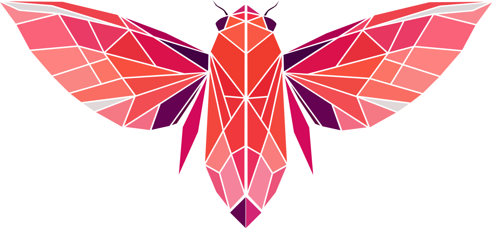

# SiMuseor · VIS 视觉识别系统 v2.5

> 日期：2026-11-17　·　编制：UI 设计全栈专家团（视觉设计架构师 / 体验设计师 / 前端工程专家），主理人汇编
> **状态：目标态规范，非已落地状态。** 本轮零落地：未修改 `web/src/`、`tests/`、`angular.json`、`web/public/` 下任何文件。
> **标识状态（v2.0）：字标基线锁定 + 蝉形辅助图形已定案。** 已锁定「Barlow Condensed Regular 400 / 混合大小写 `SiMuseor` / 字距 `.028em`」；**蝉形已定案**（辅助图形，MAX 56×26px 组合标 + L3 favicon 简化版，三帧全保留在资产库）；**字形手术仍未冻结**，月桂已改判为「作品层荣誉母题」并移出品牌标志层。
> **v2.1 增补**：§3.7 组件规格登记表（favicon / `.pill` 分工 / 卡片几何 / 蝉形矢量结构 / token 分层 / PrimeNG 边界）；favicon 底板改判为透明底 + 深紫描边。
> **v2.3 同步**：favicon 描边宽度收敛为 0.5 / 0.16 / 0.08；ICO 三档改为 **16×16 / 32×16 / 48×24**（非方形）；补记「favicon 画布不必是方形」；实测几何表补「透明占比」列。
> **v2.5 同步**：§3.7.1 表格标注 v2.4 口径 + 档位生成纪律；§3.7.3 新增卡片 hover 描边条款；§3.7.4 更正「部署版 vs 资产库版」；补部署同步纪律。
> 三态标记：〔现〕代码现状 ／〔目〕本 VIS 目标态 ／〔冻〕LOGO 冻结后。
> 阅读顺序：`SiMuseor-VIS.html`（可预览手册）→ 本文件（规范正文）→ 三份阶段规范全文 → `vis-tokens.css` / `vis-check.mjs`。

---

## 0. 现状审计与冲突裁决

### 0.1 关键事实

| 项 | 现状 |
|---|---|
| 全站 token | `web/src/styles.css`（1641 行）：`:root:17-74` 与 `:root[data-theme="dark"]:77-122` 两套；`--sidebar-w:236px`；容器 1240px；断点 1040 / 900 / 860 |
| 侧栏品牌位 | `app.component.ts:25-31` 仍是 `<span class="brand-mark">MD</span>` + `Model Downloader` + `Local Studio` |
| 文档标题 | `index.html:5` 仍是 `<title>Model Downloader</title>`；**全文件无 favicon link** |
| 字体 | 全仓**无 `@font-face`**、`web/public/` 无字体文件 → Barlow Condensed 基线字体在产品里**从未生效** |
| 品牌稿 | `logo-vector/design-options.html` 六方向（推荐 D 负形月桂 / D+A）、第二轮 `_r2_strip.png` 八方向（L1 正形月桂）、Cormorant `preview.html`（自标 NOT APPROVED）、`smallcaps`、`designkit-artifacts/` 10 张提案 |
| E2E 契约 | `tests/e2e/app.spec.ts`（828 行）：`.nav > a[href="/models"]`、首个 `ui-badge` 是环境卡徽章、「安装实例」全页唯一、5 条负向断言等 |

### 0.2 15 项冲突裁决（**全部「本轮不执行」**）

| # | 冲突 | 裁决 |
|---|---|---|
| A | 暖纸墨黑 vs zinc+靛紫 | **分层双轨**：靛紫保留为交互色，纸墨收敛为品牌层 `--brand-*` 六枚；UI 两套 `:root` 原样保留、零覆盖 |
| A′ | 两份品牌稿纸色不一致 | 统一取 `preview.html` 的 `#f8f6f1 / #dedbd3 / #6d6a64` |
| B | 字体两层 + 非标字重 | 白名单 `400/500/600/700`；`550→500`、`620/640/650/660/680→600`；**全量口径 26 处**（`styles.css` 17 + 组件 scoped 9，见 §8.2 补遗）；中文 `letter-spacing:0` |
| C | 侧栏旧品牌 | 占位期 `.brand-wordmark` 纯文字 + 中文副行；冻结后按 §2.6 换 SVG 双资产 |
| D | 圆角三档 vs 中间档 | `12/8/5` + 弹层 16 + 胶囊 999；收敛 6/9/4；`lab-theme 3/6/10 → 5/8/12` |
| E | 边框优先 vs hover 阴影 | **3 处**待收敛：`.task:hover`、`.segmented.active`、`md-model-card .card:hover`（scoped） |
| F | 品牌字体根本没加载 | 转 woff2 + 2 条 `@font-face`（`font-display:swap`）；仅品牌类声明 Barlow |
| G | 深色主色 300 vs 400 | `lab-theme.ts` 归一 `{primary.300}`；**只改色值、不动 `contrastColor` 深字** |
| H | 参照站全大写 / 中等字重 | 只采纳「压缩窄体 + 紧字距 + 大留白」 |
| I | 无 favicon / title 旧称 | `data:,` 空图标起步（不含字形）；冻结后换正式图标 |
| J | r2 八方向 / designkit「终稿」 | 全部标注迭代中 / 已否，文件名不作数 |
| K | 900px 隐藏品牌文字 | 隐藏 `.brand-sub`、保留横版字标；**不设 30×30 图标互斥分支**（主理人裁决，见 §10） |
| L | 对外「下载器」措辞 | 自称统一 `SiMuseor`；「下载任务」/`/downloads`/`md-*` 保留 |
| M | 交互亮色作白字填充 | 适用范围 `--accent` / `--accent-hover` / `--primary-hover`；**共 4 处**（原 3 处 + `button.primary:hover`）改 `--primary` 底 / 保持底色仅改描边；**不改任何 token 值**（§10 裁决 5）；Phase 3 立即项 |
| N | `--faint` 承载文本 | **全量口径 39 处**（`styles.css` 22 + 组件 scoped 17）使用位置迁移到 `--muted` / `--text-2`；非文本装饰引用按 §3.3 保留；**不改色值**；Phase 3 立即项 |

> 计数更正：早期回传的「12 项」是笔误；v1.0 实为 13 项（A–L 含 A′），v1.1 新增 M / N 后为 **15 项**。M / N 与 LOGO 冻结解耦。

---

## 1. 品牌内核

### 1.1 命名与定位

- 品牌名 **`SiMuseor`**（内嵌 `muse` / 缪斯），唯一书写形式，大小写固定 `S-i-M-u-s-e-o-r`。禁 `SIMUSEOR` / `Simuseor` / `Si Museor`。
- 定位：**剧集（电影）AI 导演台**。核心工作流是 **剧本 → 分镜 → 镜头 → 成片** —— 把想象变成成片。工作流是最大资产，「查 + 下载」是基础建设。
- 中文名 **司梦**（司 = 掌管、主导；梦 = 梦境、想象）。
- **标识构成两层**：**字标是主视觉**，**蝉形是辅助图形**（低多边形几何分面，品红→橙）；两者共存构成组合标，蝉形单独出现当前**仅限 favicon**（见 §2.0）。
- 对外禁用作品牌自称：`Model Downloader`、`下载器`、`Local Studio`、旧 `MD` 方块。仓库名 `model-downloader` 仅作工程标识。
- **保留不动**：导航「下载任务」、路由 `/downloads`、存储键 `md-*`、测试标题 `test.describe('Model Downloader Web UI')`。

### 1.2 调性判据

| 维度 | 取值 | 可验收判据 |
|---|---|---|
| 气质 | 克制收敛、艺术书卷气 | 单屏交互强调色面积 ≤5%；无渐变铺底、无发光 |
| 字形密度 | 压缩窄体 + 紧字距 + 大留白 | 字标 `.028em`；容器 1240px、内边距 26/28px |
| 层次手段 | 明度与边框，不靠字重与阴影 | 字重只用 4 档；卡片默认无阴影 |
| 意象 | **蝉形（辅助图形）**—— 蜕变 / 再生 / 缪斯之声 | **不进入字标内部**；只作并列辅助图形与 favicon；不溢出、不对称排布 |

### 1.3 五条设计原则

1. **强调色只给可点的、当前选中的**：`--accent` / `--primary` 只允许用于激活导航、主按钮、聚焦环、选中态、进度与链接 hover。禁用于正文、静态图标、普通边框、标题、装饰色块。
2. **边框优先于阴影**：分层一律 `1px solid var(--border)`；阴影只给弹层、主题菜单、吸底条与主按钮 1px 内高光。
3. **圆角只有三档** `12 / 8 / 5`（`--radius / --radius-sm / --radius-xs`）；弹层 16 与胶囊 999 是登记例外。
4. **层次靠明度与留白，不靠加粗**：字标严格 400；正文只用 `400/500/600/700`。禁 Bodoni/Didot 式极端对比与六级近似字重。
5. **装饰只做「减」不做「加」**：刀口、负形、发丝线、单点优于贴图形、加徽章、加光效。

### 1.4 Do / Don't

- **Do**：1px 线分区；`--muted` / `--text-2` 降层级；`tabular-nums` 排数字；双份资产做反白；标识只放品牌槽位；大留白。
- **Don't**：把任一实验稿称「终稿」；暖纸色铺进 `--panel`；`filter:invert()`；标识放大做水印；拉伸 / 改字重 / 改字距 / 加阴影 / 加渐变；旧「MD」方块与新字标并置；重开字体选型。

---

## 2. 标识系统

### 2.0 辅助图形层 —— 蝉形〔新 · LOCKED〕

> 用户已交付三帧成品 JPG（1536×1536 白底）。本节定义它如何进入标识体系。**全部实测数字以 `_cicada-measurements.md`（9 章）为唯一基准。**

**两层关系**：字标 = 主视觉；蝉形 = 辅助图形，**不互相取代**。

#### 2.0.1 三帧与分工

| 帧 | 形态 | 用途 | 本版接入 |
|---|---|---|---|
| **MIN** | 竖直收拢 | 展翅动画起始帧（未来） | ❌ 资产库储备 |
| **MID** | 半展 | 展翅动画中间帧（未来） | ❌ 资产库储备 |
| **MAX** | 全展 · 横向双翅 | **favicon + 侧栏组合标** | ✅ 唯一接入帧 |

MIN **永久否决**作为静态组合标：实测 19.7px 高时**仅 9px 宽**，读作竖直色条。本版**不上展翅动效** —— 三帧未归一化（头顶线 y = 271 / 349 / 461，Δ 78–190px），直接接会跳变。

#### 2.0.2 组合标（侧栏品牌位）

| 项 | 值 |
|---|---|
| 蝉形 | **MAX 56×26px**（等比，宽高比 2.1693） |
| 图–字间距 | **10px**（复用 `.brand` 既有 `gap`，不新增间距口径） |
| 字标 | Barlow Condensed Regular 400 / 20px / cap-height **14.00px** / 墨迹宽 **62.92px** |
| 视觉总宽 | **128.9px**　·　占位宽 **156px**（字标槽 90px） |
| 侧栏品牌位可用宽 | **200px**（`236 − 12×2 − 6×2`）　·　视觉余量 71.1px / 占位余量 44px |
| 对齐 | 蝉形**腹部尖端 ≡ 字标 baseline**（地脚线对齐，非垂直居中） |
| 排布 | 蝉形在左、字标在右（横版） |

**辅助地位的量化保证**：蝉形宽 **56px < 字标墨迹宽 62.92px**（余量 11.0%）。**蝉形上调至 ≥63px 即击穿**，必须同步下调。这是**有阈值的约束**，不是审美偏好。

> 尺寸改判记录：原定案 62×29px（视觉宽 137.06px）→ 改判 56×26px。理由：62×29px 时蝉形宽 63px **≥ 字标墨迹 62.92px**，图形在水平维度上已与主视觉等宽，击穿「辅助地位」；而 56×26px 仍满足全部五条辅助判据（位置 / 高度 ≤2.5×cap / 宽度 ≤50% 视觉宽 / 非独立承载 / 只用 MAX），且 1:1 真实像素下双翅与躯体仍清晰可辨。

#### 2.0.3 三层尺寸策略

接缝线（白色发丝）在源图里原生宽 1px（相对 1397px 主体），渲染后：**64px → 0.046px / 256px → 0.183px / 1024px → 0.733px**。**可见阈值是 ~1024px，不是 64px。**

| 层 | 尺寸区间 | 处置 |
|---|---|---|
| **L1** | ≥ 1024px | 保留原生发丝接缝 |
| **L2** | 64 – 1024px | 接缝必然消失 → 改由**面片色差**承载识别；若要保留线感必须**另出「加粗接缝」独立资产**，不得用参数硬凑同一份 SVG |
| **L3** | 16 – 64px | **独立重画简化版**（5 档量化色带 + 深紫描边 `#2a0a2e` + 面片间隙 ≥1px），**不缩放 MAX 帧** |

#### 2.0.4 favicon

MAX 帧 + **fill**（长边铺满方画布）—— 16px 下唯一保住「横向双翅 + 中央身体」可辨性的方案。L3 简化版从**矢量 MAX 帧**派生（不是位图降采样）：64 个面片按 plum→orange 投影**量化为 5 档色带**（`#3a0a3f` / `#6d0a5e` / `#a3389c` / `#d2477e` / `#f4776a`），叠深紫描边 `#2a0a2e` 与白色接缝网。

**〔v2.1 修订〕底板与档位**：底板由「必须自带不透明底色」改为**透明底**（用户 2026-11-17 裁决 —— 深色 OS 标签栏下不透明浅底会变成一块突兀白方块），改由深紫描边保证深底可辨；产出档位扩为 **16 / 32 / 48 / 64 / 180** + ICO（16/32/48）。

**〔v2.2 修订〕构图**：改为**画布比例随档位变** —— 16px **方形**（16×16，x 压缩 0.46 保主体高 ≥10px），32px+ **长方形**（16×8，**等比展翅**）；主体宽一律 ≤ 画布宽 88%。**非等比仅限 16px 档**，属 §2.4「禁非等比拉伸」的**登记例外**。完整规格与实测几何见 **§3.7.1**。

产物：`assets/cicada/svg/favicon.svg` + `png/favicon-{16,32,48,64,180}.png` + `ico/favicon.ico`（16/32/48）。

#### 2.0.5 深色主题

**禁止**「白线换深线」：深紫接缝 `#2a0a2e` 对深底 `#15151a` 对比度仅 **1.02:1**，完全不可见。

| 方案 | 最暗面片 vs `#15151a` | 判定 |
|---|---|---|
| **A 提亮**（定案） | **3.00:1** ✅ | 保色相保饱和、只抬明度 → **完整保留低多边形面片特征** |
| B 暗剪影 + 白骨架 | 1.24:1（剪影本体不可见） | 低多边形感变成线框；56×26px 下白线仅 0.05px，**组合标尺寸不可用**，仅作 ≥512px 展示层备选 |
| C 单色反白 | 15.57:1 | ❌ 丢失全部面片特征 |

实现要点：**不可**用「`max(channel, floor)` 抬亮」—— 那会把深紫推成不自然的灰紫。必须在 **HSL 空间保色相保饱和、只抬明度**，逐档验证对比度直到 ≥3:1。本项目实测仅最暗的 8 个面片需抬升（占主体 5.8%），主色阶原样保留。

#### 2.0.6 禁用

- 提取蝉形做纹样 / 平铺 / 水印 / loading / 家族色编码
- 对称蝉形环 / 盾形徽章 / 放射星芒（通用反徽章条款）
- 非等比拉伸 · 改色阶 · 在深底用原色资产
- 单独出现在 favicon 以外的产品位
- 把「梦」与「蝉」强行等同（语言不重叠，会造成「名字被图形吃掉」的反向风险）

#### 2.0.7 语义自洽性

| 层 | 依据 |
|---|---|
| 古典神话 | 柏拉图《斐德若》258e–259a「缪斯将人化为蝉，命其向缪斯报告谁敬奉哪位缪斯」—— 蝉是**缪斯的信使** |
| **生产周期**（最强） | 蝉的周期 —— 地下数年（剧本打磨 / 设定 / 分场）→ 破土（定稿进制作）→ 蜕壳（分镜 / 预演 / 粗剪→精剪）→ 羽化（成片）→ 居高而鸣（上线 / 发行 / 展映）。**旧语境只能映射到「迭代 / 再生成」这个通例；新语境映射到一部剧集从开发到上线的完整周期 —— 影视专属。** |
| 中国语境 | 虞世南「居高声自远，非是藉秋风」—— 在影视语境下由「孤高不群 × 热闹批量生产」的摩擦，改判为**「作者把自己的作品抬到高处让它被听见」的正解** |

品牌叙事应站在「**工具替你扛下系统性的部分，你的想象不被流程压扁**」这一侧。


> **本章是唯一处理字形的章节**；其余章节不依赖未冻结字形。

### 2.1 已锁定基线〔LOCKED〕

| 项 | 值 |
|---|---|
| 字体 | Barlow Condensed **Regular 400** |
| 字样 | 混合大小写 `SiMuseor` |
| 字距 | `.028em` |
| 字重 | 仅 400（禁 300/500/600/700） |
| 交付形态 | 纯路径 SVG，不依赖字体文件 |

基线可视化：`assets/baseline-light.svg`、`assets/baseline-reverse.svg`（**是基线字形，不是最终 LOGO**）。

### 2.2 待冻结项〔WIP〕

1. 字形手术：`00/A/B/C/D/E/F` 或 `D+A`（推荐非定案）
2. 第二轮八方向 `O1/W1/W2/S1/M1/L1/E1` —— **L1 正形月桂 vs D 负形月桂须先裁路线**；W1/W2 加重字重与用户偏好相悖，建议降权
3. 月桂几何：叶数 6 或 8、咬口深度、枝干弧度、顶端距 M 肩线 ≥ 字高 10%
4. 独立图标：是否「M 单体 + 月桂」；32/64/128 尺寸删减规则
5. 横 / 竖版、字标 + 中英副行组合
6. 最终色彩稿：纸墨是否微调、是否另出「单色靛紫标」
7. 安全区与最小尺寸**实测值**
8. `smallcaps` 是否采纳（当前倾向不采纳）

### 2.3 安全区与最小尺寸（占位期）

- 安全区单位 `X` = 字标大写 `S` 的 cap-height；四周净空 ≥ 1X，实用近似 ≥ 字标总高 0.5 倍。
- 组合标最小视觉总宽 **120px**（侧栏可用宽 **200px** = `236 − 12×2 − 6×2`，**v2.0 更正 v1.0 的 190px** —— v1.0 漏算 `.brand` 的 6px 双内边距）；独立蝉形最小 **16px**（仅 favicon）；独立图标最小 **32px**。
- **v2.0 四档耦合**：L-a 组合标 ≥120px / L-b 蝉形单用 ≥16px / L-c 字标单用 ≥20px / L-d 独立图标 ≥32px。蝉形只在 L-a 出现，L-b 以下必须退场。
- 封面铭牌 20px 槽位放的是**第三方模型家族标**，不是 SiMuseor 标识。

### 2.4 单色 / 反白 / 九条禁用

- 浅底字标 `--brand-ink #1b1b1e`；深底 `--brand-ink-reverse #f1ede4`（**暖白，非纯白**）；反白底 `#15151a`。允许纯黑 / 纯白用于盖章、单色印刷、烫印。
- 反白必须走**独立 SVG 资产 + 明暗切换**（范本 `cover-plate.component.ts:256-261`），**禁止 `filter:invert()`**。
- 品牌层不借交互靛紫，除非冻结时正式另出「单色靛紫标」并登记。
- **禁用**：① 拉伸 / 压缩 / 改 `.028em` / 改 400 字重 ② 旋转 / 镜像 / 斜切 ③ 投影 / 发光 / 渐变 / 描边 / 内阴影 ④ 压在照片上不垫白底槽 ⑤ 放大做水印 / 平铺 / 单独提取月桂 ⑥ <120px 用含月桂完整字标 ⑦ 用 `filter:invert()` ⑧ 与「MD」方块 / 旧称并置 ⑨ 采用任一实验稿作主标。

### 2.5 占位规范〔目〕

```html
<!-- app.component.ts:25-31 -->
<div class="brand">
  
  <span class="brand-text">
    <span class="brand-wordmark" lang="en" aria-label="SiMuseor">SiMuseor</span>
    <small class="brand-sub">剧集导演台</small>
  </span>
</div>
```

```css
.brand-wordmark { font-family:"Barlow Condensed","Segoe UI",sans-serif;
  font-weight:400; letter-spacing:.028em; font-size:20px; line-height:1.1;
  color:var(--text); min-width:90px; white-space:nowrap; flex:none; }
.brand-sub { font-size:10px; font-weight:500; letter-spacing:0;
  color:var(--muted); text-transform:none; }
```

- 删 `.brand-mark`（30×30 靛紫渐变 / 9px / 700）、`Model Downloader`、`Local Studio`。
- **v2.0 三处改写**：① `.brand-wordmark` 的 `min-width` **120px → 90px**（组合标占位宽 56 + 10 + 90 = 156px ≤ 200px）；② `.brand-mark` 从 30×30 渐变方块改为 **56×26 的蝉形 ``**；③ `.brand` 的 `align-items` 由 `center` 改为 **`baseline`**（蝉形腹部尖端 ≡ 字标 baseline）。**副行文案由「创作工作台」改为「剧集导演台」** —— 旧文案沿用的是已作废的定位。
- **可访问名安全**：蝉形是**纯装饰**，必须 `alt=""` + `aria-hidden="true"`；可访问名**只由**字标的 `aria-label="SiMuseor"` 承载。严禁给 `.brand` 容器加 `role="group"` / `aria-label`（会导致品牌名播报两次）。
- **窄屏断点风险（必须同步处理）**：`styles.css:1616` 现有 `.brand-text{display:none}` 会把**整个文字列连字标一起隐藏**。v2.0 须改为 `.brand-sub{display:none}`，保留横版字标（符合 v1.0 §10 裁决「全断点横版字标」）。
- v1.1 修正：副行是中文，`letter-spacing:.06em → 0`；`color` 由 `--faint`（2.56:1 不达 AA）改 `--muted`（4.83:1）。`::placeholder` 元素与提示文本保留，只换颜色。
- 全站 `.brand-wordmark` **有且仅有 1 个实例**；`app-cover-plate .brand` 内不得出现。
- `<title>` → `SiMuseor`；占位期 favicon `href="data:,"`（空图标，不含任何字形）。

### 2.6 安全替换协议 —— 冻结只改 3 处

1. **资产**：`simuseor-{light,dark,mono-light,mono-dark}.svg` + `icon-{32,64,128}.svg/png` + 实测 `X` / 最小宽 / 尺寸 / 色彩稿 HEX。
2. **URL 变量**：`--brand-logo-light/dark`、`--brand-icon-light/dark` 由 `none` 填成资产路径；明暗切换复用 `:host-context([data-theme='dark'])`；禁止第二处手写 ``。
3. **三个常量**：`--brand-clear-space`、`--brand-min-width:120px`、`--brand-icon-min:32px` 按实测覆盖。

**不动**布局、颜色 token、字号、类名、DOM 节点数量。

> **主理人裁决（窄屏统一）**：字标在**所有断点**都是横版（占位期文字 / 冻结后同一元素换 SVG 字标），≤900 只隐藏中文副行，**不设 30×30 图标互斥布局分支**；独立图标仅用于 favicon 与未来紧凑场景。理由：① 严格守住「冻结只改 3 处」；② §2.7 已明确侧栏用横版字标；③ 两条互斥 CSS 规则无法靠「只填 URL」切换；④ LOGO 未冻结，不值得为未定分支增加布局复杂度。阶段文档 §2.5 / §4.4 / §8-K 的旧表述以此为准。

### 2.7 冻结流程

| 步 | 谁确认 | 产出 |
|---|---|---|
| ① | 品牌主理人 | 汇总六方向 + 第二轮八方向，**先裁「负形 D / 正形 L1」路线** → 1 个候选方向 |
| ② | **用户** | 确认最终字形（含是否 D+A、叶数、横竖版）→ 冻结签字 |
| ③ | 主理人 / 设计 | 出冻结包 |
| ④ | 前端 | 按 §2.6 只改 3 处 + favicon + `<title>` |
| ⑤ | 主理人 | 回写 VIS：§2 全节、§3、§5.1、§7.2、§8（C/I/K 标完成）、§9 关闭待定项并升版号 |

**不受冻结影响**：§0 现状审计、§1 品牌内核、§4 字体系统、§6 版式与空间、§7 的白字填充硬约束、§8 的 lab 深字边界。

---

## 3. 色彩系统

### 3.1 裁决 A：分层双轨

| 层 | 用途 | 色值 | 是否进高频 UI |
|---|---|---|---|
| 品牌层 | LOGO 资产、关于页 / 启动页 / 分享卡、VIS 手册、品牌落款 | 新增 `--brand-*`，纸墨 | **否** |
| 产品层 | 全站界面 | 现有 `:root` / `:root[data-theme="dark"]`，zinc + indigo | 是 |

四条理由：靛紫承担「可点 / 选中」的功能语义；暖纸带黄调并置会拉低靛紫纯度（`styles.css:20` 自述）；书卷气由标识 / 窄体 / 留白承载，全站染暖纸属设计过度；全站换色要重算近 60 token + 9 家族色 × 明暗 + 大量 `color-mix()`，且破坏已校准的暗色层级。`--brand-ink #1b1b1e` 与 UI `--text #18181b` 明度差 <2%，但**不合并、不互相引用**。

### 3.2 品牌层 · 纸墨六枚

| 角色 | 变量 | HEX |
|---|---|---|
| 纸（浅） | `--brand-paper` | `#f8f6f1` |
| 墨 | `--brand-ink` | `#1b1b1e` |
| 线 | `--brand-line` | `#dedbd3` |
| 弱字 | `--brand-muted` | `#6d6a64` |
| 纸（深 / 反白） | `--brand-paper-reverse` | `#15151a` |
| 墨（反白） | `--brand-ink-reverse` | `#f1ede4` |

品牌层**不设交互色**、不引 `--accent`；`--brand-paper` 禁作 `--bg / --panel / --input-bg`。

### 3.3 产品层

| 通道 | 浅色 | 深色 |
|---|---|---|
| 表面四层 | `#f5f5f6 → #fff → #fafafa → #f4f4f5` | `#0b0b0d → #141417 → #1a1a1e → #202025` |
| 文字四档 | `#18181b / #3f3f46 / #71717a / #a1a1aa` | `#ededf0 / #d4d4d8 / #8b8b94 / #5f5f68` |
| 线三档 | `#e4e4e7 / #f0f0f1 / #d4d4d8` | `#26262b / #1e1e22 / #34343a` |
| 文字型 `--accent` | `#4f46e5`（indigo 600） | `#a5b4fc`（indigo 300） |
| 填充型 `--primary` | `#4f46e5` + `--on-primary #fff` | **同为 600，不翻** |
| 语义 fg | `#15803d / #b45309 / #b91c1c` | `#4ade80 / #fbbf24 / #f87171` |
| 语义 soft | 实色 `#f0fdf4 / #fffbeb / #fef2f2` | `rgb(… / .12)` 半透明 |
| 控件边界（新增） | `--border-control #8b8b94`（3.38:1） | 同值（5.44:1） |

indigo 全阶：`50 #eef2ff / 100 #e0e7ff / 200 #c7d2fe / 300 #a5b4fc / 400 #818cf8 / 500 #6366f1 / 600 #4f46e5 / 700 #4338ca / 800 #3730a3 / 900 #312e81 / 950 #1e1b4b`。

### 3.4 配额与禁止组合

- 产品 UI 单屏：中性表面 + 文字 **≥85%**、边框 / 结构线 ~10%、交互强调色 **≤5%** 且实心靛紫块 **≤2 处 / 屏**、语义色 ≤3%。
- 品牌展示面：暖纸底 ≥75%、线 / 装饰 ≤5%、墨黑字标与文字 ≤20%、语义色 0。
- 禁止：墨黑字标压靛紫底；`--brand-paper` 作 UI 表面；`--accent` 用于正文 / 静态图标 / 标题；语义色 500 档作前景；深色下用浅色实色 soft；大面积渐变铺底；品牌暖白与 UI 冷白混用于同一文本块；**`--accent` 作白字填充**。

### 3.5 对比度红线（WCAG 实算）

| 色对 | 比值 | 判定 / 处置 |
|---|---|---|
| `--faint #a1a1aa` on `#fff` / 深 `--faint #5f5f68` on `#141417` | 2.56 / 2.91:1 | **FAIL** → 禁止承载文本，登记 21 处迁到 `--muted` / `--text-2`，**落地须按全量 39 处**（见 §8.2 补遗）；只作装饰线 |
| `--accent #a5b4fc` + 白字 | 1.99:1 | **FAIL** → 实心填充一律 `--primary` |
| `--accent-hover #c7d2fe` + 白字 | 1.49:1 | **FAIL** |
| indigo 400 `#818cf8` + 白字 | 2.98:1 | **FAIL**（连 3:1 都不到） |
| `--primary #4f46e5` + 白字 | 6.29:1 | **PASS** → 「深色 `--primary` 不翻」成为硬约束 |
| `--primary-hover #6366f1`（深色）+ 白字 | 4.47:1 | **FAIL**（差 0.03）→ 主按钮 hover 不得跟 `--primary-hover`；保持 `--primary` 底 + 白字，仅 `border-color:var(--accent)` 作 1px 装饰描边（3.15:1 ≥ 3:1）。见 §10 裁决 5、§7.2 |
| `--border #e4e4e7` on `#fff`（1.4.11 需 3:1） | 1.27:1 | **FAIL** → 新增 `--border-control`，不改 `--border` |
| `--muted #71717a` on `#fff` / on `--bg` / on `--panel-3` | 4.83 / 4.44 / 4.40:1 | 后两者小字改 `--text-2` |
| 品牌墨 / 纸、反白暖白 / 反白底 | 15.91 / 15.57:1 | **PASS** |
| lab 深字 `#1e1b4b` on 400 / 300 亮底 | 5.36 / 8.02:1 | **PASS** → **两套实心填充分开处理**：主 UI = 600 底 + 白字；lab = 亮底 + 深字，归一 `{primary.300}` 时只改色值、不动 `contrastColor` |

> 全部修正**不改任何 token 值**，只改使用位置与新增变量，守住裁决 A 的零覆盖前提。焦点实线 `2px solid var(--accent)` 实测浅 5.62–6.29:1、深 8.14–9.86:1。

### 3.6 明暗映射

唯一入口 `data-theme`（`ThemeService.sync()` 写 `document.documentElement`），组件内 `:host-context([data-theme='dark'])`。原则是**保持相对层级**而非逐一取反：表面保留 4 层阶差、文字四档一一对应、深色「强线」更亮、文字型强调翻明度档而填充型不翻、语义 soft 改半透明、阴影 α 增大、封面构图统一 `opacity:.66`。禁止第二套主题开关，禁止 `filter:invert()`。

### 3.7 组件规格登记表〔v2.1 新增 · v2.2 同步〕

> 本节是**目标态规格登记**，不是现状清单。全部数值为主理人 2026-11-17 14:00–14:30 实测或源码逐行核验所得，**未落地项标〔目〕**。
> 用途：把散落在各组件 scoped 样式里的几何与 token 收敛到一处可核对的登记表，避免「改了组件忘了改规范」。**本节不改任何代码。**

#### 3.7.1 favicon 规格（L3 独立重画）

favicon 是**独立重画**的 L3 资产，不是 MAX 帧的缩放导出。产物：`assets/cicada/svg/favicon.svg` + `png/favicon-{16,32,48,64,180}.png` + `ico/favicon.ico`（16/32/48 三档）。

| 项 | 值 |
|---|---|
| 构图 | **画布比例随档位变**：16px **方形**（16×16），32px+ **长方形**（16×8，2:1 等比展翅）。主体水平垂直居中 |
| **两条独立的轴** | ① **y 轴**：16px 档主体高占画布 **69%**（`TARGET_H_RATIO = 0.6875`，即 11/16px）；② **x 轴**：**主体宽最多占画布 88%**（`BODY_W_MAX = 0.88`），两侧各留 6% 安全边 —— **由宽上限反解**，不再独立给压缩比 |
| **非等比压缩** | **仅 16px 档**：x 压缩比 **0.46**（`X_COMPRESS_16`），主体宽高比 **1.00**（近方形）。**32px 及以上全部等比**（`sx = sy`） |
| 非等比的原因 | **几何证明**：MAX 帧主体宽高比 **2.1729**（1395×642），等比缩放到主体高 11px 需宽 **23.9px**，在 16px 方形画布里**必然溢出**。要同时满足「主体高 ≥ 10px」与「不溢出」，唯一解是压缩 x 方向 |
| **为什么只有 16px 需要压** | 16px 是像素最紧的档，压缩换高度划算；**32px 以上像素够，改用长方形画布即可等比展翅** —— 既保住形态（不丢展翅感），又不必压缩 |
| **登记状态** | **VIS §2.4「禁非等比拉伸」硬约束的登记例外** —— **仅限 16px 档**；主资产（组合标 56×26px）与 32px+ 各档**严格等比** |
| 底板 | **透明底**（不铺 `#f8f6f1` 不透明底板）。用户 2026-11-17 裁决：深色 OS 标签栏下不透明浅底会变成一块突兀白方块；改由**深紫描边 `#2a0a2e`** 保证深底可辨 |
| 描边 | 深紫 `#2a0a2e`；宽度随档位收敛：16px → **0.5**　·　32px → **0.28**　·　48px+ → **0.16** |
| 色带 | 面片按横向位置量化为 **5 档**：`#3a0a3f` / `#6d0a5e` / `#a3389c` / `#d2477e` / `#f4776a` |
| SVG 基准 | `favicon.svg` 以 **32px 档**为基准（16px 过扁、180px 过细）；`viewBox="0 0 16 8"`，6 条 `<path>`（`outline` + `band-0..4`） |
| **档位生成纪律** | **`favicon.svg` 仅为 32px 档的矢量源**；其余档位必须由 `make_favicon_l3.py` 按 `CANVAS` **逐档生成**，**禁止缩放导出** —— v2.4 下 48/64/180 与 32px **不同构**（长方形画布 + 等比），从 32px 缩放会得到错误比例 |
| 产出档位 | SVG + PNG **16 / 32 / 48 / 64 / 180** + ICO（16/32/48 三档，PNG 压缩） |
| 构建脚本 | `artifacts/vis/assets/cicada/make_favicon_l3.py`（**必须随产物一同入库** —— 产物在、生成器不在则资产不可复现，规范口径无法复核） |

**实测主体几何（alpha 包围盒，逐档）** —— **口径：favicon v2.4 资产**（画布比例随档位变的那一版；构建脚本 `make_favicon_l3.py`，随 `642dc4b` / `06a682e` / `9c4e096` 入库）。下表数字取自已落盘的 PNG（alpha > 10 阈值口径），**资产包与部署版逐档一致**。

| 档位 | 画布 | 主体包围盒 | 高占画布 | 宽占画布 | 主体宽高比 | 左右留白 | 透明占比 |
|---|---|---|---|---|---|---|---|
| 16px | 16×16 | **12×12** @ (2,2) | **75.0%** | 75.0% | **1.00** | 2px | **66.8%** |
| 32px | 32×**16** | **30×14** @ (1,1) | **87.5%** | 93.8% | 2.14 | 1px | **58.8%** |
| 48px | 48×**24** | **44×20** @ (2,2) | **83.3%** | 91.7% | 2.20 | 2px | **62.2%** |
| 64px | 64×**32** | **58×27** @ (3,2) | **84.4%** | 90.6% | 2.15 | 3px | **63.9%** |
| 180px | 180×**90** | **160×74** @ (10,8) | **82.2%** | 88.9% | 2.16 | 10px | **66.6%** |

> **透明底**：全档**均带透明像素**（58.8%–66.8%），底色由浏览器 chrome 决定 —— 这正是「透明底」裁决的落地形态，**不是**「零透明 + 不透明浅底板」。

> ✅ **已修复（v2.4 · 提交 `642dc4b`）**：v2.1 曾用「固定压缩比 × 主体高」推导，导致 **64px 档主体宽 = 16.25 单位（画布 102%）、180px 档 = 17.21 单位（108%）**，两档翼尖**溢出 viewBox 被裁切**（实测 alpha 包围盒左右触边 = 裁切而非设计）。**修法**：改为「y 轴定主体高 + x 轴由 `BODY_W_MAX` 宽上限反解」，并让 **32px+ 用 2:1 长方形画布等比展翅**。修后逐档路径宽均 ≤ 画布宽 × 0.88，**无一档溢出**。
> 视觉复核（最近邻 8× 放大，白底 + `#0b0b0d` 底双排）：**16px 仍读出「横向双翅 + 中央身体」**（16×16 alpha 网格为清晰三段结构：顶部双翼展开 → 收窄 → 躯干竖条），32px 起接缝白线与面片色差完全可辨。**大档位回到等比后展翅感明显更好**。

#### 3.7.2 `.pill` 与 `.badge` 的分工〔规范缺口登记〕

两者视觉相近但语义正交，**必须分开使用**：

| 组件 | 语义 | 配色 | 用在哪 |
|---|---|---|---|
| **`.badge`** | **状态**：已安装 / 已禁用 / 未登记 | **带语义色**，一眼要看出好坏 | 单个实体的状态标注 |
| **`.pill`** | **分类**：文生图 / LoRA / VAE / HF | **一律中性**，只靠填充深浅分层 | 分类标签，可并列很多个 |

**理由**：分类标签经常并列很多个，用语义色会变成一墙红黄绿 —— 状态色一旦用于分类，语义即失效。

**`.pill` 实现值（`styles.css:832` 起，实测）**：

```
display:inline-block; vertical-align:middle; max-width:100%;
height:20px; padding:0 9px; border-radius:999px;
border:1px solid transparent; background:var(--pill-bg); color:var(--pill-ink);
font-size:11px; font-weight:500; line-height:18px;
white-space:nowrap; overflow:hidden; text-overflow:ellipsis;
```

| token | 浅色 | 深色 |
|---|---|---|
| `--pill-bg` | `#f1f1f3` | `#26262c` |
| `--pill-ink` | `#52525b` | `#b4b4bc` |

> `styles.css` 中 `.pill` 上方的注释已修正（原先「12px 内边距 / 12px 字重」的表述是错的）。**以本表为准。**
> 变体：`.pill-outlined`（描边版，底太浅时用）、`.pill-on-media`（压在封面上，白 8% 半透明 + `backdrop-blur`，参照 comfy.org 做法）、`.pill-author`（发布者）。

#### 3.7.3 卡片与列表行几何（源码逐行核验）

| 组件 | 封面 | 内容内边距 |
|---|---|---|
| **`md-model-card`**（`ui/model-card.component.ts`） | `min-height:202px`；封面 `.card-plate` **绝对定位铺满整卡**（`position:absolute; inset:0`） | `.card-body` = **`44px 13px 12px`**（顶部 44px 留给铭牌行，正文永不压上） |
| **`md-library-card`**（`ui/library-card.component.ts`） | `.mplate` 固定 `height:145px`（`position:relative`，图片 `.photo` 绝对定位铺满） | `.plate-foot` 绝对定位 `left/right:11px; bottom:8px`；`.mfoot` = `8px 11px` |
| **`app-workflow-card`**（`ui/workflow-card.component.ts`） | `.wc-cover` **`aspect-ratio:16/10`** | `.wc-body` = **`8px 9px`** |
| **`.nd-row`**（`pages/nodes.component.ts:244`） | 无封面，左侧 `56px` 方块（`.nd-tile`，`grid-template-columns:56px minmax(0,1fr) auto`） | **`12px 14px 12px 12px`** |
| **`.wf-row`**（`pages/workflows.component.ts:1617`） | 缩略图列 **132px**（`grid-template-columns:132px minmax(0,1fr) auto`） | **`12px 14px 12px 12px`** |

> **卡片 hover 描边统一画在 `::after`，不画在本体** —— 三个卡片（`md-model-card` / `app-workflow-card` / `md-library-card`）口径一致。
>
> 本体的 **inset** 描边在**铺满型封面**下会被盖住：`md-model-card` 的 `.card-plate` 是 `position:absolute; inset:0`，铺满整卡 → hover 视觉上毫无反应（实测顶部 20px 的 accent 像素 **off=37 / on=37，完全不变**）。
> `::after` 在**两种封面结构下都成立**：`model-card` 的 `::after` 是 `z-index:2`（盖得住铺满封面），`library-card` 的是 `z-index:3`（盖得住流式封面）。
> ⚠️ **常见误解**：`box-shadow` 的**外圈**绘制在 border box 之外，**不被元素自身的 `overflow` 裁剪**（`overflow` 只裁剪**子元素**）—— 所以本体外圈也可行（实测 `md-library-card` 外圈 accent 像素 **off=0 → on=297**，清晰可见）。但**不统一**，仍以 `::after` 为准：**口径统一的价值在于「一条规则走天下」，而不是「视觉恰好一样」。**
>
> **三卡片实测（顶部 24px 带的 accent 像素，off → on）**：`md-model-card` **40 → 329**（`::after` z-index 2）　·　`md-library-card` **0 → 289**（`::after` z-index 3）　·　`app-workflow-card` **0 → 289**（`::after`）—— **三张全部可见、落点全部在 `::after`**（提交 `b006877` 把 library-card 从本体外圈改到 `::after`）。

> ⚠️ **登记更正**：主理人简报中 `.nd-row` / `.wf-row` 的内边写作「`10px 14px`」，源码实测**两者均为 `12px 14px 12px 12px`**（四值：上 右 下 左）。`10px 10px 10px 14px` 属于 `workflows.component.ts` 的 `.wf-toast`，与两行无关。**以本表为准。**

#### 3.7.4 蝉形矢量的可编辑性结构

`assets/cicada/svg/cicada-max.svg` 的结构口径（保证「改一处即可换肤 / 改色」的可维护性）：

| 项 | 值 |
|---|---|
| **面片** | **64 个**，每个是独立 `<path>`，**带语义 id**（`wings-left-01`…，序号 = 从左到右的视觉顺序） |
| **解剖分组** | **4 个 `<g>`**：`wings-left`（10）　·　`wings-right`（10）　·　`body`（25）　·　`antennae`（19） |
| **接缝底衬** | 另有 **18 条 `seam-base-*`** 白色底衬 —— 接缝靠它透出，**深底下接缝仍是白的** |
| **渐变** | **82 个 `<linearGradient>`**（`fg001`…`fg082`）+ **164 个 `<stop>`**；每面片一条，色相 ±10° / 饱和 ×1.04→1.00 / 明度 ×0.97→1.03 |
| 深色版 | `cicada-max-dark.svg` **同构同 id**（`ids` 集合与顺序逐项一致，`86` 个 id 全等）→ **逐面片对照可改** |

> **部署版与资产库版是同一件**：`web/public/brand/cicada-max.svg` 与 `assets/cicada/svg/cicada-max.svg` **逐字节相同**（md5 一致），**都是「面片带语义 id + 4 解剖分组 + 82 条渐变」这一版**。
> `_flat_cicada-max.svg`（**0 渐变**、84 条 path）是**纯色底座**，也是 `add_facet_gradients.py` 的**输入源** —— 脚本读它、给每个面片加微渐变、输出 `cicada-max.svg`（+ `-dark` / `-mono`）。**交付用渐变版**（`cicada-max.svg`），`_flat_*.svg` 仅作底座与追溯留档，**不得直接用于交付**。
> **82 条渐变是刻意加的，不是伪影**（主理人 19:00 裁决「每面片微渐变」方案 A）：源 JPG 是纯色平涂，但低多边形的「拼块感」依赖**面片之间的色差**；若做「全局贯穿渐变」会压平面片差异、拼块感消失。故每面片一条**极轻**渐变（色相 ±10° / 饱和 ×1.04→1.00 / 明度 ×0.97→1.03）—— 保住每个面片的独立色相与身份。
> ⚠️ **部署同步纪律**：后端服务的是 **`web/dist/browser/`**，**不是** `web/public/`**。改 favicon 后必须 `rm -rf dist && npm run build` —— 否则产品实际用的仍是 `dist` 里的旧图标。

#### 3.7.5 token 分层三层结构

`web/src/vis-tokens.css`（623 行）的分层口径：

| 层 | 命名 | 数量 | 职责 |
|---|---|---|---|
| **primitive**（原始值层） | `--pri-*`（品牌色板沿用 `--brand-*` 登记名） | **72** | 主题无关的原始值；**同一套 primitive 同时供给浅色与深色语义层** |
| **semantic**（用途语义层） | `--sem-*`（品牌语义沿用 `--brand-surface/-fg/-rule`） | **46** | 用途语义；**必须**用 `var(--pri-*)` 引用第一层，**不允许引用别的 semantic**（避免语义链式耦合） |
| **component**（组件槽位层） | `--cmp-*` | **0**（只建结构，不写值） | 单组件槽位 |
| 品牌层六枚 | `--brand-*` | **16** | 按角色归入 primitive / semantic（**归层看角色，不靠前缀判断**） |

**改哪一层的后果**（三层的设计意图）：

| 改 | 影响面 |
|---|---|
| primitive | **全站联动**（例：把 `--pri-neutral-0` 从 `#ffffff` 改成 `#fffdf8`，所有引用它的 semantic 一并变） |
| semantic | **影响一类用途** |
| component | **只影响单个组件** |

- 引入顺序：`angular.json:29-33` = `tailwind.css` → `styles.css` → **`vis-tokens.css`**（**最末**）。理由：CSS 自定义属性同特异性下「后定义者生效」，放最末可保证本层胜出，且**不参与任何覆盖关系**。
- **不写 `@import` / `@layer`** —— 避免与 Tailwind v4 的 `@layer theme` 产生层序歧义。
- **明暗只发生在 semantic 层**：primitive 一套共用，深浅两套 semantic 都只引用同一批 `--pri-*`，深色档位不同而已（与 PrimeNG preset 的做法一致）。
- **零覆盖承诺**：`vis-tokens.css` 不重新赋值 `styles.css:17-74 / :77-122` 中任何已有 `--*`，交集必须为空（由 `vis-check.mjs` 校验）。

#### 3.7.6 PrimeNG 移出首屏

PrimeNG **仅存在于实验区**，且**已按需装载**，不在产品首屏：

- **路由**：仅 `lab/primeng` 与 `lab/tailwind`（`app.routes.ts:86` 等）→ 均为 `/lab/*` 下的独立页面。
- **按需装载**：`primeng/config` 改为**动态 `import()`**，主题运行时与 Aura preset 只在真正进入 `/lab/primeng` 时才拉下来。**首屏 chunk 实测 930,702 B → 781,515 B（−16.0%），gzip 205.87 → 185.53 KB**；`primeng` / `@primeng/themes` 已移入 `devDependencies`。
- 产品首屏（`/workflows`、`/models`、`/nodes`）**无任何 `primeng` 引用**，组件均为自绘（`app-workflow-card` / `md-model-card` / `md-library-card` / `ui-panel` 等）。
- 因此 **PrimeNG Aura preset 不自继承 `--brand-*`** 这条约束（§8.1）**只影响 `/lab/*`**，不构成产品首屏的回归风险。
- 主题边界不变：`lab-theme.ts:72` 的 `contrastColor` 仍为**深字**（未改成白字），与 §3.5 硬约束一致。

---

## 4. 字体系统

| 角色 | 字体栈 | 字重 | 范围 |
|---|---|---|---|
| 品牌展示字 | `"Barlow Condensed","Segoe UI",sans-serif` | **仅 400** / `.028em` | 字标、品牌级大字；**不用于中文** |
| 西文 + 中文正文 | `"Inter","Segoe UI","Microsoft YaHei",system-ui,sans-serif` | 400/500/600/700 | 全站 UI（沿用 `styles.css:131`） |
| 等宽 / 数字 | `"Cascadia Mono",Consolas,ui-monospace,monospace` | 400/500/600 | `.mono`、所有量化读数 |

- 中英混排不显式切换字体；同一行共享字号 / 字重 / 行高；**负字距只给纯拉丁串，含中文一律 `letter-spacing:0`**；量化读数强制 `font-variant-numeric:tabular-nums`。
- 字距四档 + 锁定值：`-.02em`（大标题）/ `-.01em`（小标题）/ `0`（正文、中文）/ `+.09em`（kicker）/ `+.028em`（字标）。

| 级别 | px | 字重 | 行高 | 字距 | 用途 |
|---|---|---|---|---|---|
| DISPLAY（品牌层） | 40 | 400 | 1.1 | .028em | 品牌展示面大字 |
| D1 页面主标题 | 22 | 600 | 1.2 | -.02em | `.page-heading h1` |
| D2 展示标题 | 16 | 600 | 1.35 | -.01em | `.hero-title` |
| H 面板标题 | 14 | 600 | 1.4 | -.01em | `.panel-heading h2` |
| H3 卡片标题 | 13 | 600 | 1.4 | 0 | `.task .title`、`.mc-title` |
| B 正文基准 | 13.5 | 400 | 1.55 | 0 | `body` |
| B2 控件 / 次级 | 12.5 | 500 | 1.5 | 0 | button、input、`.nav-item` |
| L 标签 / 辅助 | 11.5 | 500 | 1.45 | 0 | `.field label`、`.badge` |
| C 角标 / kicker | 10 | 600 | 1.4 | +.09em | `.page-kicker`、组标签、表头 |
| NUM 数据读数 | 15 | 600 | 1.2 | 0 | `.spec-value` 等，tabular-nums |
| XS 极小 | 9.5 | 500 | 1.3 | +.02em | 允许保留，不鼓励新增 |

**落地缺口〔现〕**：全仓无 `@font-face`、`web/public/` 无字体文件，基线字体从未生效。M0 补法：ttf 子集化转 woff2 → `web/public/fonts/`；两条 `@font-face`（Barlow 仅 400 / Inter 100 900，`font-display:swap`）；**仅品牌类声明 Barlow**；补齐后截图实测 `.028em` 与「缩小等效 190px」。**M0 只落 Barlow 一个 woff2**（见 §10 裁决 2）。

---

## 5. 图形与意象

- **蝉形（辅助图形 · v2.0 定案）**：低多边形几何分面，品红→橙渐变，白色发丝接缝线。三帧 MIN / MID / MAX 全保留在资产库，**静态接入只用 MAX**；**不进入字标内部**；边界见 §2.0。
- **月桂〔v2.0 改判〕**：**从品牌标志层移除 → 归位「作品层荣誉母题」**（将来「本片获奖 / 入选 XX」标记用）。**M 内嵌方案同时移出字形实验池**（价值基础在品牌层已论证为层级错配）。字形手术其余方向保持开放。**不变的禁止方向**：禁止提取做纹样 / 平铺 / 水印 / loading / 家族色编码，禁止对称月桂环、盾形徽章、放射星芒。**正面回应「电影奖项 = 月桂」**：该反驳成立但不构成品牌标志层的正确归属 —— 电影行业里导演台/制片软件从不用月桂做标志，月桂只出现在海报底部的获奖标识上；工具的标志不做成奖杯；月桂是「已发生并被授予」，与「司梦=尚未成形的想象」「蝉=正在发生」不同层。
- **封面铭牌**：`mo-0..4` 五种构图与 9 家族色 × 明暗两套**全部保留不改**（编码的是模型家族，不是品牌色）；11px 单行不回升；**SiMuseor 标识不进铭牌**；遵守指称性使用规则（固定槽位、不改色、不拉伸、不加阴影、不放大做背景、深色用独立反白资产）。铭牌内 `.brand` 与外壳 `.brand` 同名不同物（scoped），不重命名、不互注标识变量。
- **图标**：`viewBox="0 0 16 16"`，主线宽 **1.5px**（现状 1.6），强调 1.8 / 铭牌自绘 2.4，进度环 8；`stroke-linecap/linejoin:round`、`fill:none`。禁止同图标内 fill / stroke 混搭与投影。
- **母题**：1px 发丝线、V 形内腔、菱形单点、刀口 / 断笔；圆 / 环 / 点阵仅用于封面构图。统一表述为「活字、钢印、书籍装帧与编辑式排版」。
- **`↗` 来源入口**：新标签页外链的唯一提示，不可省；收敛为 `<span class="arrow" aria-hidden="true">↗</span>` + 宿主 `title`。

---

## 6. 版式与空间

- **间距 4px 基准**：`2/4/6/8/10/12/14/16/20/24/32`；避免 `5/7/9/11/13/18/22`；现状 `26/28/18` 登记白名单，保留不扩散。
- **栅格**：`--sidebar-w:236px`；`.container max-width:1240px; padding:26px 28px 72px`（≤900 改 `18px 16px 56px`）；卡片网格 `repeat(auto-fill,minmax(250px,1fr)) gap:14px`；环境页 `minmax(0,1fr) 320px`；设置页 `3fr 7fr`；安装弹层 `46fr 54fr`；断点 **1040 / 900 / 860px**。
- **z-index**：铭牌内部 0/1/2 · 吸底条 5 · 侧栏 20 · 主题菜单 40 · 弹层 100；新增浮层不得插入中间值。
- **圆角**：12 / 8 / 5 三档；弹层 16（`--radius-lg`，例外 1）、胶囊 999（例外 2）。待收敛：9px（旧方块随删除）、6px、4px、`lab-theme 3/6/10`。
- **适用域外声明（§10 裁决 3）**：`app-cover-plate` 的 3 处圆角（`:128/:268/:310`）属封面铭牌这一**独立图形子系统**（§5 的 5 构图 / 9 家族色 / 11px 单行内容），不是产品 UI 控件或面板 —— 圆角三档规则**不适用于该域**。故为「适用域外」，**不收敛、不登记第三类例外、不列待办**；校验脚本命中时按域外忽略，不计入中间档违规数。
- **边框优先**：hover 只动 `border-color` / `background`，不加阴影与位移；待收敛 3 处（`.task:hover:958`、`.segmented.active:722`、`model-card.component.ts:109-117`）。禁用态 `opacity:.45`，不加灰底。

---

## 7. 应用系统

### 7.1 品牌落位（10 处）

| 位置 | 允许? | 规则 |
|---|---|---|
| 侧栏 `.brand` | ✅ 唯一常驻位 | 占位期纯文字；冻结后同一元素换资产，节点不增删 |
| `<title>` | ✅ 必须 | 〔现〕`Model Downloader` →〔目〕`SiMuseor` |
| favicon | ✅ **蝉形唯一单独出现位** | 〔目〕`data:,`（不含字形）；〔冻〕换 **L3 简化版**（5 档量化色带 + 深紫描边 + 白色接缝网，**自带底色**），16/32/48 三档 ICO + SVG |
| 页头 `ui-page-header` | ❌ | 保持 `<h1>` 单页唯一；不得加品牌徽章（破坏首个 `ui-badge` 断言） |
| 空状态 / 弹层 / 错误态 | ❌ | 保持功能文案；`.empty-icon` 加 `aria-hidden`；错误用 `role="alert"` |
| 封面铭牌 | ❌ 硬禁止 | 20px 槽位是第三方家族标 |
| **蝉形 · 其他一切位置** | ❌ 硬禁止 | 蝉形**只出现在 favicon 与侧栏组合标**两处。页头 / 空状态 / 弹层 / 错误态 / 卡片角标 / 移动端顶栏 / 打印物 / 关于页 —— 蝉形与字标**都不许进**（v2.0 不扩大落位面） |
| 关于 / 设置〔目〕新增 | ⚠️ 允许一次 | 品牌层纸墨 + `role="group"` + 一个 `h2`；不做 banner / 渐变 / notice |
| 分享卡 / 导出〔冻〕 | ✅ 品牌展示面 | 暖纸底 + 墨黑字标 + 暖白反白资产，不用交互靛紫 |

### 7.2 状态机与可程序读出

8 态：默认 / hover / focus-visible / active·selected / disabled / loading / error / empty。任何状态不得只靠颜色或阴影表达，必须配 `aria-*` / `role` / 可见文案 / 边框宽度之一。

- `F` = `:focus-visible{outline:2px solid var(--accent);outline-offset:2px}`，**唯一合规焦点指示器**；`R` = `--ring` 3px 软环，装饰性。两者不同伪类、不同属性、不同几何层，可叠加，不得以 `R` 替代 `F`。
- `D` = `opacity:.45` + **原生 `disabled` 属性**（E2E `toBeDisabled()` 依赖）；`L` = `aria-busy` + 可见文字；`E` = `role="alert"` + `aria-invalid` / `aria-describedby`；`S` = `--accent-soft` / `--accent` / 600，填充态一律 `--primary`。
- **hover 明规则（§10 裁决 5）**：`button.primary:hover` 与 `.filter-chip.active:hover` **保持 `background:var(--primary)` + `--on-primary` 白字**（6.29:1），仅以 `border-color:var(--accent)` 作 1px 装饰描边（深色 3.15:1 ≥ 3:1，满足 1.4.11）。**不得**改用 `--primary-hover #6366f1`（白字 4.47:1 不达 AA）或 `--accent-hover #c7d2fe`（1.49:1）；hover 不加阴影、不加位移。红线见 §3.5。
- 关键补齐：`.nav-item.active` 加 `aria-current="page"`；chip / segmented 加 `aria-pressed` / `aria-checked`；`.instance-row.installing` 补 `role="button" tabindex="0"` + Enter/Space；弹层 `role="dialog" aria-modal aria-labelledby` + 焦点陷阱 + 焦点归还三者一起做；进度环 `role="progressbar"` 只在阶段变化播报一次，**不给每秒刷新的 % 加 `aria-live`**。

### 7.3 无障碍（WCAG 2.2 AA）

- 键盘：Esc 按 z-index 关最顶层并归还焦点；`T` 键补 `isComposing` / `keyCode 229` / `repeat` / `defaultPrevented` 守卫 + 可关闭开关（2.1.4）；方向键 roving tabindex；`scroll-padding-bottom:80px` 防吸底条遮挡焦点（2.4.11）。
- 结构：`ui-field` 补 `<label for>` / `id`（保留 `#comfy-tag`）；`<table>` 保持隐式 table role，`th` 补 `scope="col"`；结果容器 `aria-live="polite"`，徽章本身不加 live。
- 动效：全局 `prefers-reduced-motion`（现状仅 1 处）；spinner 降为静态环 + `role="status"` 文字，**不能凭空消失**。
- 尺寸：触摸目标 ≥24×24（≤900 建议 ≥40px）；装饰图标 `aria-hidden="true"`。

### 7.4 响应式

| 断点 | 关键行为 |
|---|---|
| >1040 | 字标 + 副行全显（120–190px）；236px 竖侧栏；双栏布局 |
| ≤1040 | 品牌位不变；双栏改单列、实例仍最前；DOM / 视觉顺序错位是已接受决策，保持不动但补 landmark |
| ≤900 | **隐藏 `.brand-sub`、保留 `.brand-wordmark`**（替换 `styles.css:1616` 的 `.brand-text{display:none}`）；侧栏横向条、`overflow:visible` 必须保留；组标签改 `.visually-hidden`；冻结后仍是横版字标（同一元素换 SVG 资产）+ 深色独立反白资产 |
| ≤860 | 同 900；安装弹层单列、日志下移、进度环 124→100px；320px 下除表格 / 日志外无横向滚动 |

### 7.5 文案与命名

- 中文全角标点；短标签 / 按钮不加句号；省略号用 `…`（U+2026）；品牌名混合大小写 / `.028em` / 400，不得全大写或加粗；中文 kicker 禁 uppercase、`letter-spacing:0`；数据读数保留可见文本。
- 错误文案 = `发生了什么 + 为什么（可选） + 下一步动词`，≤30 字，不堆版本号 / 绝对路径 / 命令细节。例：「删除失败：目录被占用，关闭占用程序后重试」。
- 不堆解释文案：页头 hint ≤1 句 / ≤40 字，每屏解释性文案块 ≤2 处；先删 `.env-note` / `.panel-lead` 类整块解释，逐页评估 hint，不要一次全删。

### 7.6 E2E 保护清单

`.nav > a[href="/models"]`（**不是 /library**）、`test.describe('Model Downloader Web UI')` 保留、首个 `ui-badge` 必须是环境卡徽章、「安装实例」全页唯一、`data-testid` 全清单、placeholder 文本、5 条负向断言（`三项一次装到` / `.panel-lead` / `待检测` / `这台电脑可以启用显卡加速|安装后即可使用` / `重新检测` 均 count 0）。测试里没有字面 `getByRole('模型')`，但 Playwright `name` 是子串匹配 → **禁止新增可访问名含「模型 / 安装 / 下载任务 / 设置」的元素**，禁止给现有元素加覆盖性 `aria-label`。

---

## 8. 工程落地（本轮零落地）

### 8.1 `vis-tokens.css`（231 行）

- **零覆盖承诺**：不重新赋值 `styles.css:17-74 / :77-122` 中任何已有 `--*`。实测：现有赋值变量 **39** / 新增 **18** / 交集 **0** → PASS。
- 建议 M0 追加到 `angular.json` 的 `styles` 数组**最末**（`tailwind.css`、`styles.css` 之后），不写 `@layer` 避免与 Tailwind v4 层序歧义。
- 新增：`--brand-*` 六枚 + `--brand-surface/-fg/-rule` 语义别名（深色指向反白组）、`--border-control #8b8b94`、`--radius-lg:16px`、四个 URL 变量（占位期一律 `none`）、三个标识常量（`--brand-clear-space:10px` / `--brand-min-width:120px` / `--brand-icon-min:32px`）。
- 两条 `@font-face`：Barlow 仅 400 / Inter 100 900，均 `font-display:swap`。生效 CSS 只有两条 @font-face + 两个 `:root` 块；接入片段全在注释里，不会被误当成已落地组件。
- 字体性能：`pyftsubset --flavor=woff2 --unicodes=U+0020-007E` 子集化（Barlow 102KB → 约 14KB）；只给品牌类声明 Barlow；`preload` 只给 Barlow；**M0 只落 Barlow 一个 woff2**。
- 构建规避：Tailwind v4 不引 preflight；组件类名加 2–3 字母前缀（历史事故：工具类命中 `.ring` / `.grid` / `.m-2`）；PrimeNG Aura preset **不自继承** `--brand-*`，需在 `semantic.colorScheme.light/dark` 组件段显式映射；归一 `{primary.400}→{primary.300}` 只改色值、不动 `contrastColor`；`borderRadius 3/6/10→5/8/12`、`dialog 16` 保留。

### 8.2 `vis-check.mjs` —— 主理人独立实跑

Node ≥ 18、无第三方依赖、只读（`readFileSync` / `readdirSync`），退出码 `0` 全通过 / `1` 仅现状基线 FAIL（预期）/ `2` 交付物校验失败。完整报告 `vis-check-report.txt`。

| 检查项 | 结果 |
|---|---|
| 零覆盖 / token 文件自检 | **全部 PASS**（39 / 18 / 0；@font-face 恰好 2 条；4 URL 均 `none`；无组件实现、无 `filter:invert()`、无实验稿字形） |
| 字重白名单违规 | **全量 26 处** = `styles.css` 17 + 组件 scoped 9（Phase 1/2 审计盲区） |
| `--faint` 文本用法 | **全量 39 处** = `styles.css` 22 + 组件 scoped 17（登记值 21+1 只是全局样式表部分；非文本装饰引用按 §3.3 保留） |
| 圆角中间档 / `--accent` 类白字填充 | 5 处（其中 3 处 `cover-plate` 属适用域外）/ 4 处（含 `button.primary:hover`），与登记值吻合 |
| `@font-face` / 源码引用新增 token | 0 条 / 0 处（印证基线字体未生效、本轮零落地） |
| `filter:invert()` / `.brand-wordmark` / reduced-motion | 0 / 0 / 仅 1 处（作全仓范本） |
| 对比度实算 | **PASS 18 / FAIL 8 / INFO 1（共 27 组）**。8 个 FAIL = 6 个已登记现状违规 + 1 个「白字 on indigo 400 = 2.98:1」禁止组合示例 + 1 个 `button.primary:hover` 走 `--primary-hover` 的 4.47:1（§8-M 未列举实例，已纳入 M1-d）；INFO 1 组是 lab 深字方案说明，不是缺陷 |
| 裁决 G 边界正向验收 | **5 项全部 PASS** —— `lab-theme.ts:72 contrastColor` 深字方案未被误报为 FAIL |
| 退出码 | **1**（预期） |

**审计盲区（全量口径补遗）**：组件 scoped 样式还有字重 +9、`--faint` 文本 +17、圆角中间档 +4，共 30 处同类项，Phase 1/2 只审了全局 `styles.css`。落地时须按**全量**清点：字重 **26 处**（全局 17 + scoped 9）、`--faint` 文本 **39 处**（全局 22 + scoped 17，非文本装饰引用按 §3.3 保留）。只改登记值会让「`--faint` 永不承载文本」无法真正成立。处置见 §10 裁决 3：`cover-plate` 3 处圆角定性「适用域外」，不收敛、不登记第三类例外；其余 1 处并入 M1。`EXIT 1` 与 8 个对比度 FAIL 都是**现状基线真实违规**，不是脚本或交付物缺陷；「零覆盖 / token 自检」与「裁决 G 边界 5 项正向验收」全部 PASS。

### 8.3 四阶段迁移

| 阶段 | 范围 | 要点 |
|---|---|---|
| **M0** | 零风险新增 | 接入 `vis-tokens.css`、只转 Barlow woff2 + `@font-face`、`<title>→SiMuseor`、`data:` 空 favicon、侧栏品牌位占位替换 |
| **M1** | 机械替换 | **全量** 26 处字重（全局 17 + scoped 9）、6 处圆角（`cover-plate` 3 处适用域外不动）、3 处 hover 阴影 / 位移、**4 处**交互亮色白字填充（原 3 处 + `button.primary:hover`）、**全量** 39 处 `--faint` 文本引用（全局 22 + scoped 17）、`1.6→1.5` 线宽、`lab-theme` 归一（**只改色值、不动 `contrastColor` 深字**）；`.filter-chip.active:hover` 保守取与 active 完全一致；`button.primary:hover` 保持 `background:var(--primary)` + 白字，仅改 `border-color:var(--accent)`（不用 `--accent-hover` 1.49:1，也不用 `--primary-hover #6366f1` 4.47:1 临界），并入 M1-d 与脚本 1.11 |
| **M2** | 体验与 a11y | `aria-*` / `role` 批次、全局 reduced-motion、`scroll-padding-bottom`、900px 品牌位（仅隐藏副行）、焦点陷阱 / Esc / `T` 键守卫、`↗` 三处包裹 |
| **M3** | **依赖 LOGO 冻结** | 按 §2.6 只改 3 处接入冻结资产、favicon 换正式图标、回写 VIS 升版号 |

M0–M2 与 LOGO 冻结解耦，可立即排期。每阶段的文件 + 行号 + 改动前后字符串 + 验证命令 + E2E 回归矩阵见 `_phase3-engineering.md`（871 行 / 11 章）。

### 8.4 交付物

| 文件 | 用途 |
|---|---|
| `SiMuseor-VIS.html` | 可预览 / 可打印手册 |
| `SiMuseor-VIS.md` | 本规范正文 |
| `vis-tokens.css` | 独立 token 层，M0 可追加 |
| `vis-check.mjs` / `vis-check-report.txt` | 只读校验脚本 / 实跑报告 |
| `_phase1-visual.md`（v1.1 / 620 行） | 基础系统规范全文 |
| `_phase2-experience.md`（888 行 / 61 条验收项） | 应用与体验规范全文 |
| `_phase3-engineering.md`（871 行 / 11 章） | 工程落地方案全文 |
| `assets/baseline-{light,reverse}.svg` | 已锁定基线的字形可视化（非终稿 LOGO） |

---

## 9. 验收与治理

### 9.1 验收清单（61 条正式项 + 1 条主理人补遗 = 62 条口径，分组摘录）

完整 **61 条正式项**见 `_phase2-experience.md §7`（v1.1 冻结，不再追加附录）；另有 **1 条主理人补遗**（下方末条，深色主按钮 hover）只写在本手册，用于闭环 §10 裁决 5，**不改冻结文档**。校验方式分 `CSS` / `DOM` / `E2E` / `A11Y` / `人工`。

- 〔目〕全站 `.brand-wordmark` 恰好 1 个实例，且 `app-cover-plate .brand` 内无该元素。
- 〔目〕侧栏无 `.brand-mark` / `Model Downloader` / `Local Studio`；`<title> === SiMuseor`。
- 〔目〕占位期 favicon 为 `data:,` 且不含任何字形引用；产品 UI 无任何实验稿资产引用。
- 〔目〕UI 两套 `:root` 零覆盖；无暖纸色进入 `--bg / --panel / --input-bg`。
- 〔目〕任何 `background:var(--accent)` 元素内无 `--on-primary` 白字；深色 `--primary` 保持 `#4f46e5`。
- 〔目〕`--faint` / `--placeholder` 不再出现在 `color:` 声明里；`::placeholder` 元素与文本仍存在。
- 〔目〕全站 `font-weight` 仅 4 档；中文 `letter-spacing:0`；读数有 `tabular-nums`。
- 〔目〕hover 只动 `border-color` / `background`；3 处阴影与位移已移除。
- 〔目〕全局 `:focus-visible` 为 2px 实线且未被 `outline:none` 覆盖；软环不作唯一指示器。
- 〔目〕所有持久选中态有 `aria-current` / `aria-pressed` / `aria-checked` / `aria-selected` 之一。
- 〔目〕全局 `prefers-reduced-motion` 生效，7 个动画停止但 spinner 降级为静态 + 文字。
- 〔目〕`styles.css:1616` 已替换为 `.brand-sub{display:none}`，字标在 ≤900 可见且 `min-width:120px`。
- 〔目〕`lab-theme.ts:72` 的 `contrastColor` 仍为深字、未被改白字。
- 〔目〕E2E 文案白名单零改动，全套 `tests/e2e/app.spec.ts` 绿。
- 〔冻〕冻结包 5 类资产齐全，仅 4 个 URL 变量与 3 个常量被改；900px 下横版字标可见且深色反白资产存在。
- 〔目〕**主理人补遗（第 62 条）**：`button.primary:hover` 保持 `background:var(--primary)` + 白字，仅改 `border-color:var(--accent)`；不出现 `--primary-hover` / `--accent-hover` 作白字底、不加阴影与位移，双主题文字对比度 ≥ 4.5:1、描边 ≥ 3:1（CSS + A11Y）。

**v2.0 新增第 63 条起（蝉形辅助图形，详见 `_phase2-cicada.md` §11）**

- 〔目〕**63** 组合标占位宽 ≤ 200px：蝉形 56px + gap 10px + 字标槽 90px = **156px**；`.brand` 的 `scrollWidth ≤ clientWidth`（CSS）
- 〔目〕**64** 视觉总宽 **128.9px ≥ 120px**（组合标最小视觉总宽）（人工）
- 〔目〕**65** **蝉形宽 56px < 字标墨迹宽 62.92px**（余量 11.0%）；蝉形上调至 ≥63px 即判 FAIL（人工）
- 〔目〕**66** 蝉形与字标**地脚线对齐**，偏差 ≤1px（`align-items: baseline`，禁 `center`）（CSS + 人工）
- 〔目〕**67** favicon 16px 可辨：主体高 ≥10px、宽高比 ≥0.71；**L3 简化版独立重画，未由 MAX 帧缩放得到**（PNG + 人工）
- 〔目〕**68** favicon **自带底色**，不依赖页面背景；ICO 含 16/32/48 三档（DOM + 人工）
- 〔目〕**69** 蝉形 `alt=""` + `aria-hidden="true"`；可访问名**只由**字标 `aria-label` 承载；`.brand` 无 `role="group"` / `aria-label`（DOM + A11Y）
- 〔目〕**70** 深色版最暗面片对 `#15151a` 对比度 **≥ 3:1**（实测 3.00:1）；**禁止**「白线换深线」（1.02:1）（SVG + A11Y）
- 〔目〕**71** 接缝线三层策略落地：L1 ≥1024px 保留原生接缝；L2 64–1024px 由面片色差承载；L3 16–64px 为独立重画资产（SVG + 人工）
- 〔目〕**72** 蝉形**仅出现在 favicon 与侧栏组合标**两处；页头 / 空状态 / 弹层 / 错误态 / 封面铭牌 / 卡片角标 / 移动端顶栏 / 打印物 / 关于页**零出现**（DOM + E2E）
- 〔目〕**73** 窄屏 ≤900px 时字标**可见**：`.brand-text{display:none}` 已改为 `.brand-sub{display:none}`，蝉形仍显示（CSS + E2E）
- 〔目〕**74** `.brand-wordmark` 的 `min-width` = **90px**（非 120px）；全站恰好 1 个实例（CSS）
- 〔目〕**75** 侧栏副行文案为「剧集导演台」，非「创作工作台」（旧定位已作废）（DOM）
- 〔目〕**76** **一键回退**：`html[data-cicada="off"]` 时蝉形隐藏、组合标退回纯文字字标，布局不塌（DOM + 人工演练）
- 〔目〕**77** MIN / MID 帧**不在任何产品位出现**，仅存在资产库（DOM + 人工）
- 〔目〕**78** 蝉形 SVG 为**纯路径**（无 `<image>` / 无 `mask`）；深色版为**独立资产**，非 CSS 取色（SVG）

### 9.2 冻结后需同步

§2 标识系统全节（待定项关闭、换实测值、占位规范作废、协议标已执行）；§3（若纸墨微调 / 另出单色靛紫标）；§5.1（月桂叶数与顶端距离改实测定值）；§7.2 / §7.3（反白改冻结资产色、确认双资产切换）；§8（C 标已替换、I / K 标完成）；§9.1 待定项逐条关闭并注明冻结版本与日期。**不受冻结影响**：§0、§1、§4、§6、§7 的白字填充硬约束、§8 的 lab 深字边界。

---

## 10. 主理人裁决记录（v1.0 收口）

| # | 议题 | 裁决 |
|---|---|---|
| 1 | 900px 图标分支与「冻结只改 3 处」矛盾 | **全断点横版字标**：占位期文字 / 冻结后同一元素换 SVG 字标，≤900 只隐藏中文副行；30×30 图标仅用于 favicon 与未来紧凑场景，**不设互斥 CSS 分支**。阶段文档 §2.5 / §4.4 / §8-K 旧表述以此为准。 |
| 2 | 加载 Inter 是否会改变正文观感 | **M0 只落 Barlow 一个 woff2**；Inter 的 `@font-face` 保留为预留声明但不放 woff2 文件（缺文件时被忽略，正文继续走系统回退栈，零渲染回归）。将来统一到 Inter 须单独排期 + 截图回归。 |
| 3 | 组件 scoped 30 处审计盲区 | **按全量口径写入手册补遗，Phase 1 / Phase 2 双文档冻结不动**：字重（全局 17 + scoped 9 = **26 处**）、`--faint` 文本（全局 22 + scoped 17 = **39 处**，非文本装饰引用按 §3.3 保留）并入 M1 补充批次；`cover-plate` 的 3 处圆角（`:128/:268/:310`）定性为**「适用域外」** —— 封面铭牌是独立图形子系统，不属于产品 UI 控件 / 面板圆角体系（见 §6），**不收敛、不登记为第三类例外、不列待确认项**；其余 1 处并入 M1。 |
| 4 | 品牌层六枚 `--brand-*` 深色映射 | **认可不改**：固定 HEX + 语义别名做深色反白映射，符合「反白靠双份 SVG 资产，不是 CSS 取色」；零覆盖校验已 PASS。 |
| 5 | 深色主按钮 hover `--primary-hover` 4.47:1 不达 AA | **采纳方案 A**：`button.primary:hover` 保持 `background:var(--primary)` + `--on-primary` 白字，仅以 `border-color:var(--accent)` 作 1px 装饰描边（3.15:1 ≥ 3:1，语义贴合交互色；`--accent-hover` 4.22:1 虽更高但语义不符）。**不改任何 token 值、不新增第 16 项冲突**；并入 M1-d 与脚本 1.11，Phase 1 §6.6 按钮行同步，双主题维持 6.29:1。明规则见 §7.2，红线见 §3.5。 |

**仍需用户 / 品牌主理人拍板的两件事**：① **LOGO 冻结**（先裁「负形 D / 正形 L1」路线，再定字形、叶数、横竖版）—— 这是 M3 唯一门禁；② 将来是否把正文统一到 Inter（须单独排期 + 截图回归）。`cover-plate` 3 处圆角已按裁决 3 定性为「适用域外」，**不再是待拍板项**。**M0–M2 不需要等这两件事**。

---

## 附录 A · LOGO 迭代档案（状态表）

| 资产 | 状态 | 说明 |
|---|---|---|
| `design-options.html/.png` | 迭代中 | 六方向 00/A/B/C/D/E/F，基准固定 Barlow 400；推荐 D 负形月桂或 D+A，**推荐非定案** |
| `_r2_strip.png` / `r2-*.svg` | 迭代中 | 第二轮八方向；L1 正形月桂与 D 负形月桂需先裁路线；W1/W2 加重字重与偏好相悖 |
| `preview.html`（Cormorant） | 已否 | 自标 `NOT APPROVED`；但其纸墨组被采纳为品牌层色值 |
| `font-options*.html` | 已否 | 第一批优雅衬线全否；第二批提供参照站 CSS 结论 |
| `smallcaps.*` | 未采纳 | 提供 M 内腔度量依据；当前倾向维持混合大小写 |
| `laurel-study.*` / `try-mixed-weight.*` | 度量依据 | V 槽深度实测、字重梯度 |
| `designkit-artifacts/` 10 张 | 已否 | 高对比衬线 + 对称月桂环全否；**文件名含「终稿」不作数** |
| `design-00-baseline.svg` | **基线** | 唯一可写入规范的字形事实 |

## 附录 B · 三条教训

1. 换字体必须**跨骨架体系并排看图**，不能只换同大类相近款。
2. 用户给参考链接要**真的去读 CSS**，别凭「编辑式排版」脑补。
3. 「藏在 M 里」要求月桂顶端**明显低于 M 肩线**；Barlow 的浅内腔决定了必须走笔画镂空而非贴图。

## 附录 C · 版本记录

- `v1.0`（2026-11-13）：首次汇编。合并 Phase 1 v1.1（620 行）、Phase 2 v1.1（888 行 / 61 条验收项）、Phase 3 工程方案（871 行），含主理人裁决 **5 项**。
- `v1.0 收口补丁`（同日）：脚本实跑口径更新为 PASS 18 / FAIL 8 / INFO 1（27 组）；新增裁决 5（深色主按钮 hover 描边方案 A）；§6 补适用域外声明、§7.2 补 hover 明规则、§9.1 增 1 条主理人补遗（62 条口径）；§0.2 的 B/M/N 与 §8.2 / §8.3 改为全量口径（字重 26 / `--faint` 39 / 交互亮色白字填充 4 处）。Phase 1 / 2 双文档保持冻结，未改动。
- `v2.0`（2026-11-13 · 蝉形辅助图形落地）：① **§1.1 定位改写** —— 「剧集（电影）AI 导演台」/ 中文名「司梦」；旧表述「创作工作台 / AIGC 模型社区」作废。② **§2.0 新增辅助图形层整节**（三层尺寸策略、favicon、深色三方案、语义自洽性）。③ **组合标定案** MAX 56×26px + 10px gap，视觉总宽 128.9px / 占位宽 156px（改判自 62×29px —— 原尺寸下蝉形宽 63px ≥ 字标墨迹 62.92px，击穿「辅助地位」）。④ **侧栏可用宽更正** 190px → **200px**（漏算 `.brand` 6px 双内边距）。⑤ **接缝线三层策略** —— 可见阈值实测为 ~1024px（原记 64px 不成立），L1 ≥1024px / L2 64–1024px 须另出加粗接缝资产 / L3 16–64px 独立重画。⑥ **月桂改判** —— 从品牌标志层移除，归位「作品层荣誉母题」，M 内嵌方案移出字形实验池。⑦ **深色版定案方案 A**（保色相提明度至 ≥3:1，实测 3.00:1）。⑧ **蝉镜 AI P0 风险经用户判定解除**（品类不重叠 + 命名不冲突，**依赖新定位成立**）。⑨ **矢量资产全套产出**（46 个文件 / 三帧 64·50·27 面片 / L3 favicon 简化版）。⑩ **验收清单 62 → 78** 条。
- `v2.1`（2026-11-17）：① **§3.7 新增「组件规格登记表」** —— favicon 规格（§3.7.1）、`.pill` 与 `.badge` 分工（§3.7.2）、卡片与列表行几何（§3.7.3）、蝉形矢量可编辑性结构（§3.7.4）、token 分层三层结构（§3.7.5）、PrimeNG 移出首屏（§3.7.6）。② **favicon 底板改判**：由「必须自带不透明底色」改为**透明底** + 深紫描边保深底可辨（用户 2026-11-17 裁决；深色 OS 标签栏下不透明浅底会成突兀白方块）。③ **favicon 方形化构图**：主体高占画布 69%（16px 档 ≥10px），x 压缩按档位分级 0.46→0.72，属 §2.4「禁非等比拉伸」的**登记例外**（仅 favicon 档位）**〔已被 v2.2 取代〕**。④ **favicon 产出档位扩为** 16/32/48/64/180 + ICO 三档。⑤ **登记 64px / 180px 档翼尖溢出裁切缺陷**（主体宽 102% / 108%）**〔已被 v2.2 修复〕**。⑥ **`.pill` 实现值更正**（`height:20px / padding:0 9px / font-size:11px / font-weight:500`；token `--pill-bg` 浅 `#f1f1f3` 深 `#26262c`、`--pill-ink` 浅 `#52525b` 深 `#b4b4bc`）。⑦ **`.pill` 与 `.badge` 分工登记**：`.badge` = 状态（带语义色）、`.pill` = 分类（一律中性）。⑧ **卡片几何更正**：`.nd-row` / `.wf-row` 内边距实测均为 `12px 14px 12px 12px`（非 `10px 14px`）。⑨ **token 分层**：产品层（`styles.css`）/ 品牌层 + 交互层（`vis-tokens.css`，引入位置最末，零覆盖）**〔已被 v2.2 重写〕**。⑩ **PrimeNG 移出首屏**（仅存于 `/lab/*`，产品首屏零引用，首屏回归风险解除）。
- `v2.2`（2026-11-17 · 同步 favicon v2.4 资产与后续工程提交）：① **§3.7.1 favicon 规格按 v2.4 重写** —— 画布比例随档位变（16px 方形 16×16、32px+ 长方形 16×8 等比展翅）；「两条独立的轴」取代原「压缩比按档位分级」（y 轴定主体高 69%，x 轴由 `BODY_W_MAX = 0.88` 宽上限反解）；**非等比压缩仅限 16px 档**（0.46），32px+ 严格等比；实测几何表换为 12×12 / 30×14 / 44×20 / 58×27 / 160×74。② **原「64px / 180px 溢出裁切」缺陷条改为「已修复」**（提交 `642dc4b`），并补记构建脚本必须随产物入库。③ **§3.7.5 token 分层按新结构改写** —— primitive（`--pri-*`，72 枚）/ semantic（`--sem-*`，46 枚）/ component（`--cmp-*`，只建结构）/ 品牌层 16 枚；补「改哪一层的后果」对照与「明暗只发生在 semantic 层」。④ **§3.7.6 PrimeNG 改按需装载** —— `primeng/config` 动态 `import()`，首屏 chunk 930,702 B → 781,515 B（−16.0%），`primeng` / `@primeng/themes` 移入 `devDependencies`（提交 `19bc932`）。
- `v2.3`（2026-11-17 · favicon v2.3 资产同步）：① **描边宽度更正** —— 画布比例改为长方形后描边随之收敛：**16px → 0.5 / 32px → 0.16 / 48px+ → 0.08**（原记 0.28 / 0.16 已不成立）。② **ICO 三档尺寸更正** —— 画布改长方形后 ICO 为 **16×16 / 32×16 / 48×24**（原记 16/32/48 方形），**三档非方形**。③ **补记「favicon 画布不必是方形」** —— 浏览器标签栏按图标自身比例显示、不要求方形；只有 16px 需方形（像素紧，压 x 换高度保主体高 ≥10px），32px+ 用 16×8 长方形等比展翅（展翅比例 2.17 与 MAX 帧一致，是形状最准的方案）。④ **实测几何表补「透明占比」列** —— 全档 58.8%–66.8%，坐实「透明底」裁决的落地形态。
- `v2.5`（2026-11-17 · §3.7.1 表格标注版本 + hover 描边条款 + 资产同步纪律）：① **§3.7.1 逐档实测表的标题行标注版本口径** —— 「**口径：favicon v2.4 资产**」，并写明构建脚本随 `642dc4b` / `06a682e` / `9c4e096` 入库、数字取自已落盘 PNG（alpha > 10 阈值）、**资产包与部署版逐档一致**。② **§3.7.1 补「档位生成纪律」** —— `favicon.svg` **仅为 32px 档的矢量源**，其余档位必须由 `make_favicon_l3.py` 按 `CANVAS` **逐档生成**，**禁止缩放导出**（v2.4 下 48/64/180 与 32px 不同构）。③ **§3.7.3 新增「卡片 hover 描边统一画在 `::after`」条款** —— 本体 inset 描边在铺满型封面下会被盖住（实测 off=37 / on=37），`::after` 在两种封面结构下都成立；并澄清 **`box-shadow` 外圈不被元素自身的 `overflow` 裁剪**。④ **§3.7.4 更正「部署版 vs 资产库版不可混称」** —— 二者现已**逐字节相同**（都是「语义 id + 4 分组 + 82 条渐变」这一版），「不可混称」作废；`_flat_cicada-max.svg` 更正标注为**纯色底座**（`add_facet_gradients.py` 的**输入源**，0 渐变、84 条 path）—— **交付用渐变版** `cicada-max.svg`，`_flat_*.svg` 不得直接用于交付。⑤ **补「部署同步纪律」** —— 后端服务 `web/dist/browser/`，**不是** `web/public/`；改 favicon 后必须 `rm -rf dist && npm run build`。⑥ **`_phase2-cicada.md` 同步 v2.4 定案** —— favicon 底色改透明、尺寸档改画布比例随档位变、验收项 66 / 67 改写为实测口径。
- 下一次升版触发条件：**LOGO 冻结**。
