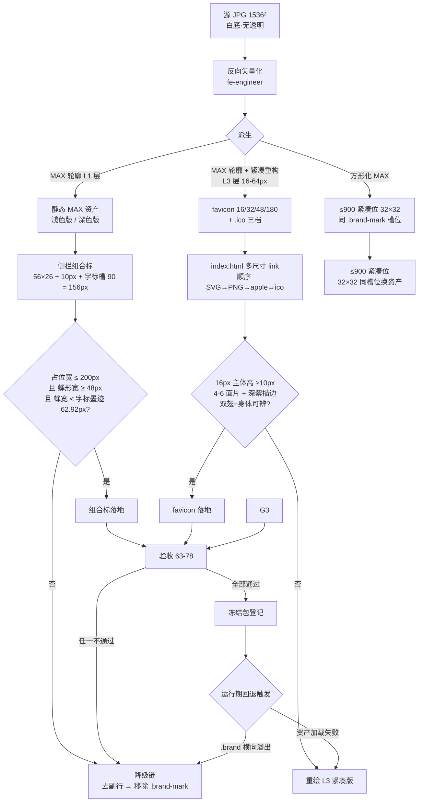
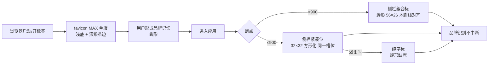

# SiMuseor 蝉形辅助图形 · 应用与体验规范

> 阶段：Phase 2 补充（蝉形辅助图形接入）　·　编制：体验设计
> 上游依据：`artifacts/vis/SiMuseor-VIS.md` **v1.0**（459 行）· `artifacts/vis/_phase2-experience.md` **v1.1**（888 行 / 61 条验收项 + 1 条主理人补遗 = 62 条口径）· `artifacts/vis/_phase1-logo-v2.md`（修订二/三）· `artifacts/vis/_v2-delta.md`（主理人汇编蓝图）
> 数据来源：`artifacts/vis/_cicada-measurements.md`（**全部实测数字的唯一出处**）· 图证 `artifacts/vis/assets/cicada-preview/`
> 本阶段边界：**零落地**。本文只产出规范；未修改 `web/src/`、`tests/`、`angular.json`、`web/public/` 下任何文件；未生成任何 SVG / PNG（由 fe-engineer 负责）。
> 本文不含矢量化的工程做法、不含标识系统本体的意象与配色裁决（属 visual-architect）；只规定**应用位、交互、a11y、响应式、验收与回退**。

---

## 0. 结论速览

| # | 议题 | 结论 |
|---|---|---|
| 1 | 静态接入位用哪一帧 | **MAX**（favicon + 侧栏组合标）。MIN / MID **本版不接入**，全保留在资产库 |
| 2 | favicon 底色 | **必须自带不透明底板**（已拍板）。**浅底**（品牌纸色 `#f8f6f1`），描边用深紫 `#2a0a2e` / `#3a0a3a` |
| 3 | 深浅两版 favicon 是否需要区分 | **不需要，只要一版（浅底）。** 决定性依据：深底会吃掉定义轮廓的 plum / 品红边缘（1.24:1 / 2.02:1），浅底保住它们（14.7:1 / 9.0:1）。详见 §3.3 |
| 4 | favicon 深浅切换机制 | **无切换**（单版）→ 没有「切换时机」问题。**in-app 组合标**才是双版，走 `data-theme` + 独立资产。**两者不可混谈**，详见 §3.5 |
| 5 | 组合标版式 | MAX **56×26px** + 10px gap + 字标槽 90px = **占位宽 156px**（视觉宽 **128.9px**），品牌位可用宽 **200px**，余量 **44px** |
| 6 | 对齐 | **地脚线对齐**：蝉形**腹部尖端 ≡ 字标 baseline**。**禁止** `align-items: center` |
| 7 | DOM 落位 | 蝉形占用**现有 `.brand-mark` 槽位**（30×30 → 56×26），**不新增节点**；`.brand-text` 保持竖列承载字标 + 副行 |
| 8 | 蝉形可访问名 | **零贡献**：`aria-hidden="true"` + `alt=""`。不朗读、不重复品牌名 |
| 9 | 组合标中蝉形最小可辨宽度 | **≥ 48px**。低于此值实测不可辨 → **移除整个蝉形**，不缩小 |
| 10 | 展翅动效 | **本版不落地。** 不替代 spinner、不作加载反馈；reduced-motion 降级帧 = **MAX** |
| 11 | 副行文案 | **「剧集导演台」**（D-24 = B）；样式规格不变（10px / 500 / `letter-spacing:0` / `--muted`） |
| 12 | 需要回写既有规范的点 | **6 处**（见 §8） |

---

## 1. 前提与不可动摇的约束

### 1.1 用户已拍板的事实（本文全部结论建立在此之上）

1. 蝉形是**蝉**，不是蛾。
2. **字标是主视觉，蝉形是辅助图形**；两者一般共存。蝉形**单独出现当前只作为网站 favicon**。
3. 三帧（MIN 闭翅 / MID 单翅 / MAX 双翅）**全部保留**在资产库。
4. 走**反向矢量化**路线（用户不提供矢量源）。

### 1.2 本轮新增定位（2026-11-13 用户拍板）

- **品类**：剧集（电影）AI 导演台。
- **品牌名**：**SiMuseor / 司梦**。
- **蝉镜 AI 竞品 P0 风险：经用户判定解除**（品类不重叠 + 命名不冲突）。本轮不因此改变任何视觉或体验决策，仅在 §12.1 如实登记为「已关闭」。

### 1.3 新定位对蝉形的直接约束（本轮体验侧的根判断）

品类从「通用创作平台」细化为「**剧集（电影）AI 导演台**」后，蝉形的应用标准**变严，不变松**：

- 导演台是**精密工序台**，用户是以审美为职业的创作者。**一个高饱和渐变图形占据唯一常驻位是可接受甚至讨喜的；在导演台里它是错的** —— 它直接损害工具的专业感与可信度。
- 因此「**蝉形必须小、必须在左、必须不承载信息**」不是对蝉形的贬低，而是让品牌位服务于品类定位的必然。**辅助地位的量化阈值不得因为「蝉形很好看」而放宽**（`_phase1-logo-v2.md` §1.2 修订三复核结论）。
- 这条根判断直接决定了本文 §4 的全部尺寸阈值与 §3.4 的落位克制。

### 1.4 从既有规范继承的硬约束

| 来源 | 条款 | 对本轮的约束 |
|---|---|---|
| VIS §7.1 第 3 行 | 侧栏 `.brand` 是**唯一常驻位** | 蝉形进侧栏 = 合法；其他位另行判定 |
| VIS §7.1 第 4 行 | 页头 `ui-page-header` **禁止**加品牌徽章 | 蝉形不得进页头（且会破坏首个 `ui-badge` 断言） |
| VIS §7.1 第 5 行 | 空状态 / 弹层 / 错误态 **禁止**品牌元素 | 蝉形不得进这三处 |
| VIS §7.1 第 6 行 | 封面铭牌 **硬禁止** SiMuseor 进入（20px 槽是第三方模型家族标） | 蝉形不得进铭牌 |
| VIS §7.2 | 状态不得只靠颜色表达 | 蝉形是静态图形，不承载状态，无需额外状态语义 |
| VIS §7.3 | 焦点 2px 实线 ≥3:1；`prefers-reduced-motion` 全局生效，spinner 降级为静态 + 文字；触摸目标 ≥24×24（≤900 建议 ≥40px） | 直接约束 §5 / §6 / §7 |
| VIS §7.6 | Playwright `name` 是**子串匹配**；禁止新增可访问名含「模型 / 安装 / 下载任务 / 设置 / 安装实例」的元素；禁止给现有元素加覆盖性 `aria-label` | 直接约束 §5 |
| VIS §2.4 第 ⑦ 条 / §3.6 | 禁止 `filter: invert()`；反白走**独立资产 + 明暗切换** | 直接约束 §4.6 |
| VIS §2.6 | 「冻结只改 3 处」继续有效，**不动 DOM 节点数量** | 蝉形走**槽位替换**，不新增 DOM 节点（§4.1） |
| `_phase2-experience` §1.3 | `<span>` 是 generic role，部分读屏不暴露 generic 上的 `aria-label`；占位期靠**可见文本**承担可访问名 | 决定 §5.1 的命名方案 |

### 1.5 蝉形的资产性质（决定一切应用规则）

| 事实 | 实测值 | 对应用的含义 |
|---|---|---|
| 亮端（橙红 / 浅粉 / 浅紫 / 近白接缝）占主体 | **74.5%** | 主体是**亮调**资产 |
| 暗端（深紫 plum 5.8% + 品红 19.7%）占主体 | **25.5%** | 暗部是**轮廓与体积**角色，不是主导色 |
| plum / 品红在**浅底**上的对比 | **14.7:1 / 9.0:1** | 定义轮廓的边缘色在浅底上**完整保留** |
| plum / 品红在**深底** `#15151a` 上的对比 | **1.24:1 / 2.02:1** | 定义轮廓的边缘色在深底上**消失** |
| 浅粉 / 浅紫在**浅底**上的对比 | **2.30:1 / 1.33:1** | 渐变的**高光**在浅底上会淡 |
| 浅粉 / 浅紫在**深底**上的对比 | **7.90:1 / 13.70:1** | 高光在深底上完整 |
| 接缝线占主体 | **1.26%**；@1536 宽 1–3px | 16px → **0.021px**、32px → **0.042px**、48px → **0.062px**，**任何尺寸下都消失** |
| 32px 实测近白像素 | MAX 220px 主体中 **0px = 0.0%** | 小尺寸下**没有接缝线**，只有面片色块 |
| 源格式 | 1536×1536 **白底 JPG，无透明通道** | favicon 与组合标**都必须自带底板**，不能依赖背景透明 |

> **关键推论（本文所有尺寸决策的根）**：这枚资产的**轮廓**由深端承载、**高光**由亮端承载。**浅底丢高光（渐变的亮部），深底丢轮廓（形体的边界）**。而小尺寸下能读出「双翅 + 身体」靠的是**轮廓**不是高光 → **浅底是 favicon 的唯一正确地面**。这是 §3.3 的全部依据。

---

## 2. 落地场景矩阵

> 「用哪一帧」列：`MAX` = MAX 帧；`—` = 蝉形不出现。
> 「尺寸」列为该位的**最终渲染像素**，不是源图尺寸。

| # | 落位 | 允许? | 用哪一帧 | 尺寸 | 明暗如何切 | **何时不出现** |
|---|---|---|---|---|---|---|
| 1 | **浏览器 favicon** | ✅ 允许 | **MAX** | 16 / 32 / 48px **各自独立重绘**（L3 层），非缩放；`.ico` 含三档；`apple-touch-icon` 180×180 | **单版浅底**，无切换（§3.3 / §3.5） | 资产未交付 → 退回 `data:,`（VIS §7.1 占位期约定） |
| 2 | **侧栏品牌位 `.brand`**（组合标） | ✅ 允许，**唯一常驻位** | **MAX** | **56×26px**，蝉形在左、字标在右、间距 10px；**地脚线对齐** | `:host-context([data-theme='dark'])` 切**两份独立资产**（禁 `filter:invert()`） | 组合标占位宽 > 200px，或蝉形渲染宽 < 48px → **整块移除蝉形**（§4.5） |
| 3 | 侧栏 ≤900px 紧凑位 | ✅ 允许（**同槽位换资产**） | **MAX**（方形化） | **32×32px**，与字标 baseline 对齐 | 同 #2 | 品牌位溢出时同 #2 的降级链 |
| 4 | 登录页 | **不适用** | — | — | — | 本产品为本地单机工具，`web/src/app/pages/` 下**无任何认证页**，无登录页可接入 |
| 5 | 空状态 `ui-empty` | ❌ 禁止 | — | — | — | VIS §7.1 第 5 行；`.empty-icon` 只放功能图标，且须 `aria-hidden="true"` |
| 6 | 卡片角标 / 徽章 | ❌ 禁止 | — | — | — | 会成为页面首个 `ui-badge`，破坏 `app.spec.ts:227` 的 `ui-badge.first()` 断言；且 `ui-badge` 的 `tone` 五档是功能语义，混入会污染「已安装 / 未安装」的读出 |
| 7 | 移动端顶栏（≤900 横条） | ⚠️ 条件允许 | **MAX** | 同 #3（32×32 方形化） | 同 #2 | ≤900 已是紧凑位的正常形态；再窄时走 #2 降级链 |
| 8 | 页头 `ui-page-header` | ❌ 禁止 | — | — | — | VIS §7.1 第 4 行：会破坏首个 `ui-badge` 断言 |
| 9 | 弹层 / 主题菜单 / 错误态 | ❌ 禁止 | — | — | — | VIS §7.1 第 5 行；弹层是任务流焦点，品牌元素是干扰 |
| 10 | 封面铭牌 `app-cover-plate` | ❌ **硬禁止** | — | — | — | VIS §7.1 第 6 行：20px 槽是第三方模型家族标（9 家族色编码模型），蝉形进入即语义错位 |
| 11 | 卡片 / 面板 / 列表项 / 工具栏 | ❌ 禁止 | — | — | — | VIS §1.3 第 5 条「装饰只做减不做加」；品牌只在品牌位出现 |
| 12 | 关于 / 设置页〔目〕新增 | ⚠️ 允许**一次** | **MAX** | 按版式尺寸（L1 层） | 同 #2 | 沿用 VIS §7.1 第 7 行「允许一次」；不得做成 banner / 渐变 / notice；**不得新增第二个 `.brand-wordmark`** |
| 13 | 分享卡 / 导出 / 打印物〔冻〕 | ✅ 允许（品牌展示面） | **MAX** | 按版式尺寸（L1 层） | 暖纸底 + 墨黑字标 + 反白资产；不用交互靛紫 | 本版不实现；将来独立排期（VIS §7.1 第 8 行） |
| 14 | 加载态 / 进度环 / 骨架 | ❌ **禁止** | — | — | — | §7：加载反馈由 spinner 承担，蝉形不介入（VIS §1.3 第 5 条 + §7.3） |

### 2.1 落位决策的三条判据（可复算）

1. **常驻性**：蝉形只允许出现在**页面生命周期内常驻**的品牌位（#2 / #3），其余常驻位（#5–#11）一律禁止。
2. **语义纯净性**：蝉形不得出现在承载**第三方模型家族编码**（#10）或**功能状态**（#6）的槽位。
3. **任务流干扰度**：蝉形不得出现在用户等待结果时注视的位置（#9、#14）—— 这是 §7「不作为加载反馈」和 #5「不进入空状态」的共同根因。

---

## 3. favicon 专项

### 3.1 选帧与构图

- **帧：MAX。** 依据（主理人实测）：16px 下 MAX + fill 是**唯一**仍读出「横向双翅 + 中央身体」的方案；MIN + fill @16px 退化成一根竖直色条；MID @16px 左右不对称，易读成「飞鸟」。
- **策略：fill**（长边铺满方画布、短边居中）。
- **已知代价（必须记录在验收里）**：MAX 宽高比 **2.1693:1**，fill 进方画布后主体高度只占约 **46%**、上下各留约 53% 空白。**因此 16px 档必须重绘成「紧凑版」**（见 §3.2），不能沿用 fill 的原比例。
- **资产层级**：favicon 全部尺寸落在 **L3 区段（16–64px）**，按 `_phase1-logo-v2.md` §5.3b 的 L3 规则处置（§3.2）。

### 3.2 尺寸档与 L3 简化版验收口径

**硬约束：三个尺寸档是三个独立重绘源，不得由同一 SVG 统一缩放导出。** 理由：接缝线 2px@1536 → 16px 为 **0.021px**、32px 为 **0.042px**；32px 实测近白像素 **0.0%**；缩放导出只会得到一团糊掉的色块。`_phase1-logo-v2.md` §5.3b 已明确：「L2 / L3 必须是独立绘制的文件，而不是同一 SVG 的缩放」。

| 档 | 交付 | 几何要求 | 面片 / 描边要求 |
|---|---|---|---|
| **16px** | `favicon-16.png` + `.ico` 内 16 档 | 主体宽 = 画布宽 **≥ 13px**（留 1px 安全边）；**主体高 ≥ 10px**（主体高/宽 ≥ 0.71，明显高于 MAX 原比例 0.461）→ **必须缩短翼展、抬升身体** | **4–6 个大面片** + **深紫描边 `#2a0a2e` / `#3a0a3a`** + **面片间隙 ≥ 1px**；**不保留原发丝白线**；**禁止**沿用 L1 渐变细节 |
| **32px** | `favicon-32.png` + `.ico` 内 32 档 | 主体宽 = 画布宽 ≥ 30px；主体高 ≥ 15px | 同 L3：4–6 大面片 + 深紫描边 + 间隙 ≥ 1px |
| **48px** | `favicon-48.png` + `.ico` 内 48 档 | 主体宽 = 画布宽 ≥ 46px | 同 L3（48px 仍在 L3 区段 16–64） |
| **矢量** | `favicon.svg` | `viewBox` 与 16px 版构图一致（**以 16px 版的紧凑比例为基准**），`width`/`height` 属性写死 | 同 L3 |
| **180×180** | `apple-touch-icon.png` | iOS 会加圆角遮罩并铺自己的底 → **图标自身必须满幅不透明**，蝉形居中缩放至画布宽 ~86% | 同 L3，间隙按 180px 档等比放大 |

**16px 简化版验收口径（四条同时满足才算过）**：

1. **可辨性**：最近邻放大到 16px 实际像素后，仍能读出「横向双翅 + 中央身体」三段结构。
2. **占幅**：主体高度 ≥ **10px**（画布 16px 的 62.5%）。低于 10px 判为「一条横线」，不合格。
3. **跨档一致性**：32px 版缩到 16px 与 16px 版并排，**主体外接框宽高比一致**，平均色接近；两者不得看起来像两个图标。
4. **文件独立性**：16px 档必须是**独立绘制的文件**，与 MAX 源文件**路径不同、可区分**（`_phase1-logo-v2.md` S-L3）。

### 3.3 底色与「深浅两版是否需要区分」——定案

#### 3.3.1 实测依据（全部来自 `_cicada-measurements.md` §2.3 + 主理人像素实测）

| 色 | 占主体 | vs **浅底** `#fff` | vs **深底** `#15151a` | 承担什么 |
|---|---|---|---|---|
| 深紫 plum `#4b0350` | **5.8%** | **14.7:1** ✅ | **1.24:1** ❌ | **形体边界 / 轮廓** |
| 品红 `#8d095f` | **19.7%** | **9.0:1** ✅ | **2.02:1** ❌ | 轮廓过渡 / 体积 |
| 橙红 `#d83030` | — | **4.79:1** ✅ | **3.80:1** ✅ | 主体色 |
| 浅粉 `#f09090` | — | **2.30:1** ❌ | **7.90:1** ✅ | 渐变高光 |
| 浅紫 `#f0d8f0` | — | **1.33:1** ❌ | **13.70:1** ✅ | 渐变高光 |

#### 3.3.2 结论：单版，**浅底**

**favicon 只出一版，底板为不透明浅底（品牌纸色 `#f8f6f1`），描边用深紫 `#2a0a2e` / `#3a0a3a`。**

**四条决定性理由**：

1. **深底会吃掉定义轮廓的边缘色。** plum 在 `#15151a` 上 **1.24:1**、品红 **2.02:1** → 翅膀的外缘与腹部尖端直接溶进底板，**轮廓消失**。而在 16px 下能读出「双翅 + 身体」靠的正是轮廓，不是高光。**深底丢失的恰好是最不能丢的那部分。**
2. **浅底丢的只是高光。** 浅粉 / 浅紫在白底上 2.30:1 / 1.33:1，但它们是渐变的**亮部**，承担体积感不承担边界；而 plum 14.7:1、品红 9.0:1 **完整保留**，加上 L3 规定的深紫描边，**16px 的剪影由描边 + plum 边缘双重保证**。
3. **与 in-app 组合标同调。** favicon 与侧栏组合标共用 MAX 资产族、同一底色域 → 浏览器标签页与侧栏看到的是**同一个标记**，不制造「两个品牌」的割裂。
4. **单版 = 零切换时机风险。** favicon 渲染在浏览器标签栏，其底色由**浏览器 / OS 主题**决定，与页面 `data-theme` **无关**；一旦做双版就必然出现「应用主题 ≠ OS 主题」时的错配（详见 §3.5）。一版直接消灭这个风险，也把资产数减半。

> **与主理人「深底观感更出彩」实测的调和**：该实测针对**原始 MAX 渐变帧**直接压在深底上，深底确实让高光更跳。但 favicon 不是原始帧 —— 它是 **L3 独立重画**（4–6 大面片 + 深紫描边 + 间隙 ≥1px，**不保留原发丝白线、不沿用 L1 渐变细节**）。L3 资产的识别由**剪影 + 深紫描边 + 面片色差**承担，**浅底恰好是深紫描边最有效的地面**（`#2a0a2e` on `#f8f6f1` ≈ 16:1）。**故：深底更出彩的是原帧，浅底更可辨的是 L3 资产。**

#### 3.3.3 方案 B（**不采用**）：双版 + `prefers-color-scheme` 切换

- 资产 ×2（16/32/48/180 + `.ico` 各两套）；
- 两版的**描边色必然不同**（浅底用深紫、深底用白 `#ffffff` 18.20:1），同一枚标识在两个环境下呈现两套配色 → 违反 VIS §1.3 第 1 条一致性；
- 切换机制仍要依赖 `prefers-color-scheme`，而**应用内 `data-theme` 与 OS 主题可以相反**，一旦有人用 `data-theme` 实现就出错配（§3.5）。

#### 3.3.4 方案 C（**登记为备选，本轮不采用**）：实色容器 + 反白挖空

研究侧先例（`_research-cicada-reference.md` §2.5 / §3）：**「实色圆角方块 + 字形反白挖空」被行业称为「最可靠的 favicon 模式」** —— 底色用品牌纯色（plum `#4b0350` 或 magenta `#c31d72`），蝉形用白 / 纸墨色实心挖空；行业论据是「保证在浅/深标签栏都有对比，并定义出清晰外轮廓」。

**它确实比本方案更稳的一点**：容器是不透明的实色块，在**浅标签栏与深标签栏下外观完全一致**，不存在「深色 OS 下变成一块突兀白方」的落差。

**本轮仍不采用它的三条理由**：

1. **它把 favicon 降级成单色剪影**，与 in-app 组合标的**品红→橙渐变**标记**彻底脱钩** → 标签页与侧栏变成两个不同的品牌标记（违反 VIS §1.3 第 1 条）。
2. 它牺牲了 L3 层保留下来的**面片色差**（4–6 大面片 + 色相带），而这正是 `_research-cicada-reference.md` 推论 2.4 认可的 Havsule 路线本体。
3. 行业模式的价值来自「容器色 = 品牌色」；本项目的品牌色是**纸墨中性**（VIS §3.2 品牌层六枚），蝉形的高饱和品红→橙**不在品牌层 token 内**，用 plum 作容器等于把资产暗部提为品牌色，超出本轮范围。

> **若将来因 favicon 在浅/深标签栏下的外观落差被判不可接受**，则切换到方案 C（实色容器 + 反白挖空）是一条干净的退路，且它**天然只需一版**，与本方案的「单版」结论不冲突。

#### 3.3.5 明确区分：favicon 单版 ≠ in-app 组合标单版

| 位 | 资产版本 | 切换 | 原因 |
|---|---|---|---|
| **favicon** | **单版浅底** | **无** | 自带不透明底板 → 底板即背景 → 与 chrome 明暗**解耦** |
| **in-app 组合标** | **深浅双版** | `data-theme` + 独立资产 | 它**直接坐在产品表面上**，必须随产品主题；深色主题下 plum 1.24:1 / 品红 2.02:1 不可见（§4.6） |

**这两件事经常被混为一谈，是本节最需要防止的实现错误。**

### 3.4 底色板规格

| 项 | 值 |
|---|---|
| 底色 | `--brand-paper #f8f6f1`，**不透明**，满幅（SVG / PNG / `.ico` 全部零透明像素） |
| 深紫描边 | `#2a0a2e` / `#3a0a3a`（L3 层专用） |
| 面片间隙 | ≥ **1px**（16px 档），以**实底色**呈现，不留透明 |
| 禁止 | 透明底裸蝉；`filter: invert()`；把 16px 档由 MAX 帧缩放/降采样得到 |
| 判定 | **整幅图形与底色之间 ≥ 3:1**（`_phase1-logo-v2.md` §5.3b） |

### 3.5 favicon 深浅切换机制（回答「ThemeService 怎么切 / 标签页切换时机」）

**本方案是单版，没有切换，因此没有切换时机问题** —— 不需要任何 JS 参与，首屏零额外请求、零闪烁、零错配。

若将来因品牌需要改为双版，机制**必须**是：

```html
<link rel="icon" type="image/svg+xml" href="favicon-light.svg">
<link rel="icon" type="image/svg+xml" href="favicon-dark.svg" media="(prefers-color-scheme: dark)">
```

**不得**用 `ThemeService` 改 `link.href`，三条理由：

| # | 理由 |
|---|---|
| 1 | **信号错配**：favicon 渲染在**浏览器标签栏**，其底色由**浏览器 / OS 主题**决定；页面 `data-theme` 只管页面内。本产品应用内支持「浅色 / 深色 / 跟随系统」三态，应用主题与 OS 主题**可以相反**（用户在浅色 OS 上把应用强制成深色）。用 `data-theme` 切，就会出现「应用深色、标签栏浅色 → 贴一枚深色 favicon 在浅标签栏上」。 |
| 2 | **闪烁**：改 `href` 会触发一次新的图标请求，浏览器标签栏图标在请求完成前继续显示旧图，用户看到一次**图标闪变**。`media` 方案由浏览器原生判定，切换无请求、无闪烁。 |
| 3 | **永久错配**：用户改 OS 主题时，若 favicon 挂在 `data-theme` 上，只有应用偏好为「跟随系统」时才会跟着变；否则图标与标签栏底色**长期不一致**，直到下次刷新。 |

> **对既有条款的修订**：VIS §7.1 第 3 行「〔冻〕`icon-32.svg` 深浅两版 + `ThemeService` 同步 href」与 `_phase2-experience` §1.2 第 4 行 / §7.6「〔冻〕favicon href 随 `data-theme` 切换」**必须改写**。本轮 favicon 为**单版**；即使将来做双版，也应改为 `prefers-color-scheme` 的双 `<link>`。回写项见 §8。

### 3.6 favicon 多尺寸声明顺序（`index.html`）

**顺序规则：SVG 在前、PNG 按尺寸从大到小、`.ico` 垫底。** 依据：浏览器在多候选中取**最后一条匹配且受支持**的声明（与 `<link rel=stylesheet>` 的层叠直觉一致），要靠后声明覆盖就把更特定的放后面。

```html
<!-- 1) 可缩放矢量主源（现代浏览器） -->
<link rel="icon" type="image/svg+xml" href="favicon.svg">
<!-- 2) 位图档（按 sizes 从大到小） -->
<link rel="icon" type="image/png" sizes="48x48" href="favicon-48.png">
<link rel="icon" type="image/png" sizes="32x32" href="favicon-32.png">
<link rel="icon" type="image/png" sizes="16x16" href="favicon-16.png">
<!-- 3) iOS 主屏 -->
<link rel="apple-touch-icon" sizes="180x180" href="apple-touch-icon.png">
<!-- 4) 遗留兜底，必须最后 -->
<link rel="icon" href="favicon.ico" sizes="any">
```

**约束**：

- `.ico` 必须在**最后** —— 旧浏览器只认 `.ico`，放前面会被支持 SVG 的浏览器跳过。
- `sizes="16x16"` / `32x32` / `48x48` 必须**逐档声明**，不得只声明一个 `sizes="any"` 的 PNG。
- **不得**使用 `<link rel="shortcut icon">`（已被 `rel="icon"` 取代）。

### 3.7 favicon 的无障碍暴露方式

| 问题 | 结论 |
|---|---|
| `<link rel="icon">` 会被屏幕阅读器朗读吗？ | **不会。** `<link>` 是文档元数据，不进入可访问性树；屏幕阅读器从 `<title>` 取窗口 / 标签页名称（VIS §2.5 已规定 `<title>` = `SiMuseor`）。 |
| 需要给 favicon 加 `aria-label` 吗？ | **不需要，且无效。** `<link rel="icon">` 不支持有意义的 `aria-label`。**不得**添加。 |
| 标签页名称来源 | 仍是 `<title>`。favicon 只提供视觉标识，**不承担命名**。 |
| 需要 `<link rel="apple-touch-icon">` 吗？ | **需要**，180×180 PNG，**满幅不透明**（iOS 用图标自身像素铺底，透明区会被压成黑块）。成本 1 个 PNG，零风险。 |
| 需要 `<link rel="mask-icon">` 吗？ | **不需要。** Safari pinned tab 只在 macOS Safari 收藏场景生效，本产品不投放该场景。 |
| 需要 `<link rel="manifest">` 吗？ | **本版不需要。** 产品未做 PWA 安装；将来若做，`manifest` 的 `icons` 复用同一套 192/512 档，**不得**另画。 |

---

## 4. 组合标落地规范（侧栏品牌位）

### 4.1 目标 DOM 结构（沿用 `_phase1-logo-v2.md` §4.5 的唯一规范形态）

```html
<!-- 侧栏品牌位 · > 900px -->
<div class="brand">
  <!-- 蝉形：占用现有 .brand-mark 槽位（30×30 → 56×26），零可访问名贡献 -->
  <span class="brand-mark" aria-hidden="true">
    
  </span>
  <!-- 文字列：竖列，承载字标 + 中文副行 -->
  <span class="brand-text">
    <span class="brand-wordmark" lang="en">SiMuseor</span>
    <small class="brand-sub">剧集导演台</small>
  </span>
</div>
```

**结构约束（逐条可验）**：

| # | 约束 | 依据 |
|---|---|---|
| 1 | `.brand` 仍是 `.sidebar` 的**第一个子元素**、`.nav` 的**兄弟节点**；**不得**把品牌位塞进 `.nav`、不得给 `.nav` 加包裹层 | E2E `.nav > a[href="/models"]` 是直接子选择器（VIS §7.6） |
| 2 | 全站 `.brand-wordmark` 仍**恰好 1 个实例** | VIS §2.5 / `_phase2-experience` §7.1 |
| 3 | **蝉形占用现有 `.brand-mark` 槽位**（30×30 渐变方块 → 56×26 的 ``），**不新增 DOM 节点** | VIS §2.6「冻结只改 3 处…不动 DOM 节点数量」；`_phase1-logo-v2.md` D-19 = A |
| 4 | `.brand` 内**不得**出现任何 `ui-badge` | `.brand` 在 DOM 中先于内容区，`ui-badge.first()` 必须是环境卡徽章（`app.spec.ts:227`） |
| 5 | `.brand-text` 保持**竖列**（`flex-direction:column`），承载字标 + 副行 | 平铺三子项 = 56 + 10 + 90 + 10 + 50 = **216px > 200px**，必然溢出（`_phase1-logo-v2.md` D-19） |
| 6 | `` 必须写死 `width="56" height="26"` 属性 → 避免 CLS；样式层 `flex:none` | 布局稳定 |
| 7 | 蝉形元素是**单个自包含节点**（`.brand-mark` 包裹一个 ``）→ 回退 = 删掉这一个节点 | §12.2 回退开关 K1 |

### 4.2 版式数值（定案）

| 项 | 值 | 依据 |
|---|---|---|
| 蝉形帧 | **MAX** | §5.3 尺寸实测 |
| 蝉形渲染尺寸 | **56×26px** | 修订三定案；等比，宽高比 **2.1693**（MAX bbox 1397×644） |
| 蝉形高 ÷ 字标 cap-height | 26 ÷ 14.00 = **1.86 倍** | 「蝉形必须小」的量化落地：低于 2× cap，蝉形不与字标争视觉重量 |
| 蝉形宽 vs 字标墨迹宽 | **56px < 62.92px**，余量 **11.0%** | **辅助地位的量化保证**。蝉形上调至 **≥ 63px** 即击穿 → 必须同步下调 |
| 图–字间距 | **10px** | 复用 `.brand` 既有 `gap:10px`（`styles.css:183`），**不新增 token / margin** |
| 字标 | Barlow Condensed **400** / **20px** / `.028em` / cap **14.00px** / x-height **10.12px** / 墨迹宽 **62.92px** | v1.0 §2.5 已定，实测值 |
| 字标槽宽 | **90px**（`.brand-wordmark` 的 `min-width` 120px → **90px**） | 组合标场景的显式改写 |
| **组合标占位宽** | 56 + 10 + 90 = **156px** | — |
| **组合标视觉宽** | 56 + 10 + 62.92 = **128.9px** | 蝉形 + 间距 + 字标墨迹 |
| **品牌位可用宽上限** | **200px** | 源码逐行核验：`--sidebar-w 236 − .sidebar padding 12×2 − .brand padding 6×2` = **200px**。**更正 VIS §2.3 的 190px**（漏算 `.brand` 6px 双内边距） |
| 余量 | **44px**（占位口径 156 / 200） | — |
| `--brand-min-width` token | **120px 不变**，语义改为「**组合标最小视觉总宽**」 | `_phase1-logo-v2.md` §4.3；实测组合标 128.9px ✓ 达标 |

> **注意两个宽度不是一回事**：`156px` 是**占位宽**（按 90px 字标槽算，抵抗字体回退变宽）；`128.9px` 是**视觉宽**（按 62.92px 墨迹算，实际看到的）。`--brand-min-width: 120px` 校验的是**视觉总宽**。

### 4.3 排布与对齐（定案）

| 项 | 结论 |
|---|---|
| **左右** | **蝉形在左，字标在右。** 理由：中文与英文 UI 均为 LTR 阅读序，「图形 → 名称」是读序；把图形放右会让「名称 → 图形」倒序，在 LTR 界面里形成罕见的右置标识。 |
| **垂直对齐** | **地脚线对齐**：蝉形**腹部尖端**（bbox 最低点）与字标 **baseline** 重合。蝉形「站在」基线上 = 附属语义（`_phase1-logo-v2.md` §1.2）。实现口径：`.brand-mark` 与 `.brand-wordmark` 置于同一 baseline 对齐上下文。**禁止 `align-items: center`** —— 那会让蝉形相对 baseline 上浮，破坏「站在基线上」的语义。 |
| **为什么不用 cap 中心对齐** | cap 中心对齐会让蝉形浮在字标中段，视觉上像「与字标并排的两个图形」；地脚线对齐让蝉形成为字标的**基座**，从属关系一眼可读。 |
| **副行位置** | `剧集导演台` 在**字标正下方**，左边缘与**字标**左边缘对齐，不参与图–字间距计算。 |
| **整体读法** | 「蝉形 + 字标」读作**一个标识组**；副行是该组的第二行说明。 |

**验收口径**：截图人工量测，蝉形腹部尖端与字标 baseline 的偏差 **≤ ±1px**；副行左边缘与字标左边缘偏差 **≤ 1px**。

### 4.4 `min-width` 改写：120px → 90px（VIS §2.5 / §2.6 的显式改写）

| 项 | 现状 | 本轮定案 | 影响 |
|---|---|---|---|
| `.brand-wordmark { min-width }` | **120px** | **90px** | 组合标占位宽 56 + 10 + 90 = **156px**，余量 44px |
| `.brand-text` | 无 min-width | **90px** | 字标槽的宽度约束落在竖列容器上 |
| `--brand-min-width` token（VIS §2.6 三常量之一） | `120px`，语义＝横向字标最小宽 | **值不变 `120px`**，语义改为「**组合标最小视觉总宽**」 | 属「冻结只改 3 处」的合法改动范围，随冻结包一并覆盖 |

**为什么必须改**：品牌位被 `.brand` 的双内边距吃掉 12px 后只剩 **200px**；字标槽若仍锁 120px，占位宽 = 56 + 10 + 120 = **186px**，余量仅 14px，**蝉形再无任何上调空间**，而蝉形一旦上调就会击穿「蝉宽 < 字标墨迹宽」的辅助地位保证。

**语义守恒（VIS §2.3 的原意必须保住）**：原「120px」这条下限保护的是**品牌标识的视觉体量**，不是某个数字。改写后保护量纲从「字标槽宽」换成「**组合标视觉总宽 ≥ 120px**」—— 实测 128.9px **达标**，**下限的保护强度不降反升**。字标自身 90px 仍大于其 20px Barlow Condensed 墨迹宽 62.92px，`white-space:nowrap` 下**不会截断、不会出省略号**。

### 4.5 组合标的可辨性下限（定案）

| 项 | 阈值 | 依据 |
|---|---|---|
| **蝉形渲染宽度下限** | **≥ 48px** | 主理人实测：MAX 帧在**高 19.7px 时仍有 42px 宽**仍可辨；**MIN 帧在同尺寸仅 9px 宽**，接缝线已 100% 消失，糊成竖条 → **42px 是「可辨」与「不可辨」之间的实测参考点**。取 **48px**（高于该参考点，保留一级余量），保证任意降级路径都不落入 MIN 式的竖条。 |
| **触发后果** | 低于 48px → **移除整个 `.brand-mark` 节点**，不是缩小 | 一个认不出的图形占据品牌位，**传递零品牌信息**，却仍占掉字标的宽度预算 —— 净负收益。 |
| **不得** | 禁止把蝉形缩到 48px 以下继续显示 | 同上 |

**降级链（按序尝试）**：

```
蝉形 56×26 + 字标槽 90 + 副行     → 占位宽 156px ≤ 200px  ✅ 目标态
        ↓ 若占位宽 > 200px（字标回退字体变宽等）
去掉副行（.brand-sub）             → 156px 不变（副行不占横向）
        ↓ 若仍 > 200px
移除整个 .brand-mark                → 纯字标，min-width 回到 120px
```

**回退触发条件（可自动判定）**：`.brand` 的 `scrollWidth > clientWidth`（横向溢出）即触发降级。**不得**用 `overflow:hidden` 裁掉字标或蝉形 —— 品牌标识被裁比缺席更糟。

### 4.6 明暗双资产

| 主题 | 资产 | 调色要求 |
|---|---|---|
| 浅色（`--panel #fff` / `--bg #f5f5f6`） | 浅色版 | plum **14.7:1** / 品红 **9.0:1** / 橙红 **4.79:1** —— **原色阶即可**，轮廓完整保留 |
| 深色（`--bg #0b0b0d` / `--panel #141417`） | 深色版 | plum **1.24:1** / 品红 **2.02:1** → **暗部必须提亮或换线**。三条路径（`_cicada-measurements.md` §2.3）：① 暗部提亮到 ≥3:1（基准 `#a3389c` 对 `#15151a` = 3.12:1、对 `#0b0b0d` = 3.37:1）② 暗剪影 + **白色骨架线**（`#ffffff` = 18.20:1）③ 单色化剪影 + 反白线 |

**本轮对深色版的推荐（主理人倾向 ② / ③，理由是「① 提亮暗部会破坏原色阶」）**：

> **采用 ② —— 暗部提亮到 ≥3:1（选项 ①）**，不采用 ②③。
>
> 理由：②「暗剪影 + 白骨架线」与 ③「单色化剪影 + 反白线」都要求**在 56×26px 的渲染尺寸下画出可见的线**。而实测接缝线 @1536 宽 1–3px，缩到 26px 高后宽度 ≈ **0.03px** → **画不出来**；L3 层也已规定「**不保留原发丝白线**」。**②③ 的载体在组合标尺寸上不存在**。选项 ① 只改 5.8% 的 plum 与部分品红（合计 ≤ 25.5% 的像素），**主色阶（橙红 / 品红主体 / 渐变走向）完整保留**，破坏远小于「整枚改单色」的 ③。
>
> **「白线换深线」明确排除**（`#2a0a2e` on `#15151a` = **1.02:1**，完全不可见）。

- 切换用 `:host-context([data-theme='dark'])`，沿用 `cover-plate.component.ts:256-261` 范本；**禁止 `filter: invert()`**（VIS §2.4 第 ⑦ 条）。
- 蝉形的浅/深两版是**资产级派生色**，**不进 token 层**（不新增第 7 枚 `--brand-*`）；色值登记在资产包说明里，供视觉架构师按「资产派生色」登记（§8 W6）。
- 切换是**资产切换**，不涉及 `data-theme` 之外的任何第二套主题开关（VIS §3.6）。

### 4.7 ≤900px 紧凑位

| 项 | 结论 |
|---|---|
| 形态 | **同一 `.brand-mark` 槽位换资产** —— 方形化 MAX（fill 进方框），读 `--brand-icon-light/dark`。**不是第二个实例** |
| 尺寸 | **32×32px**（方形化蝉形最小尺寸 = `--brand-icon-min: 32px`，值不变） |
| 对齐 | 槽位**底边 ≡ 字标 baseline**（与桌面同一条基线规则） |
| 间距 | 图–字间距仍 **10px**；占位宽 = 32 + 10 + 90 = **132px** ≤ 200px ✓ |
| DOM | **不变**（同一节点、同一类名、同一 `alt`）→ 天然不新增可访问名、不破坏 E2E |
| 文字 | `.brand-sub` 隐藏（`styles.css:1616` 的 `.brand-text{display:none}` **必须**改为 `.brand-sub{display:none}`，否则会连字标一起隐藏） |

---

## 5. 可访问性与 E2E 安全

### 5.1 命名安全方案（逐字给出属性值）

| 元素 | 属性值 | 说明 |
|---|---|---|
| `.brand-mark`（外层） | `aria-hidden="true"` | 从可访问性树中整体移除 |
| `.brand-mark__img` | `alt=""` | 装饰性图片的标准写法；与 `aria-hidden` 构成双保险 |
| `.brand-mark__img` | **不写** `title` | `title` 会产生 tooltip，并可能成为可访问名来源 |
| `.brand-mark__img` | **不写** `aria-label` | 同上 |
| `.brand-mark__img` | **不写** `role="img"` | `alt=""` 已使其为 presentation |
| `.brand-wordmark` | `lang="en"`；可访问名由**可见文本 `SiMuseor`** 承担 | `lang="en"` 防中文 TTS 误读拉丁串 |
| `.brand-wordmark` | 可保留 `aria-label="SiMuseor"`（VIS §2.5 占位写法），**但不得**换成任何与可见文本不同的字符串 | 两种写法产生的可访问名相同，无重复播报 |
| `.brand-sub` | 无 | 可见文本「剧集导演台」自证 |
| `.brand`（容器） | **不得**加 `role="group"` / `aria-label` / `aria-labelledby` | 见 §5.4 |

**禁止出现在蝉形上的字符串（逐条）**：

- `SiMuseor 蝉形 LOGO` —— 重复朗读品牌名（蝉形不携带品牌名信息）。
- `蝉` / `蝉形` / `Cicada` / `logo` —— 装饰性图形不应被朗读。
- 任何含「模型 / 安装 / 下载任务 / 设置 / 安装实例」的字符串 —— E2E 禁令（VIS §7.6）。

### 5.2 `aria-hidden` 的判定与理由

**结论：蝉形用 `aria-hidden="true"`，且内层 `` 的 `alt=""`。**

| 理由 | 展开 |
|---|---|
| **不重复播报** | 蝉形是品牌标识的**图形化复述**。品牌名已由 `.brand-wordmark` 承担。若蝉形也暴露，读屏输出会变成「SiMuseor，蝉形标志，SiMuseor，剧集导演台」—— 品牌名播报两次。重复内容违反 WCAG 2.3.1 精神，是典型的可访问性反模式。 |
| **蝉形不携带独立信息** | 蝉形是**辅助图形**，不表达状态、不编码数据、不区分家族（家族编码在封面铭牌）。移除它不损失任何信息。 |
| **`alt=""` 单独已够，`aria-hidden` 是显式化** | HTML-AAM 规定 `alt=""` 使 `` 成为 presentation，不产生可访问名。再加 `aria-hidden="true"` 是**双保险**：防止后续有人误加 `alt` / `title` 后静默污染朗读，也防止 `getByRole('img')` 命中。 |
| **反面：为什么不加 `role="img"` + `aria-label="SiMuseor 标志"`** | ① 重复朗读；② 「标志 / LOGO」引入无意义朗读噪音；③ 落入 Playwright 子串匹配的射程（VIS §7.6）。 |
| **反面：为什么不加 `role="presentation"`** | `role="presentation"` 在 `` 上冗余，且在 `<span>` 外层上语义不如 `aria-hidden` 明确。 |

### 5.3 屏幕阅读器预期播报

| 断点 / 状态 | 预期播报（顺序） | 说明 |
|---|---|---|
| ≥901px（完整） | 「SiMuseor」→ 「剧集导演台」 | 蝉形**零贡献** |
| ≤900px（`.brand-sub` 隐藏） | 「SiMuseor」 | `display:none` 使副行离开可访问性树 |
| 键盘 Tab 遍历 | 品牌位**不出现**在 Tab 序列中 | `.brand` 不是交互元素，蝉形与字标都无 `tabindex` |
| 浏览器标签页 / 窗口名 | 「SiMuseor」（来自 `<title>`） | 与 favicon 无关 |

### 5.4 一个必须避开的陷阱：不要给 `.brand` 容器加命名

**禁止** `<div class="brand" role="group" aria-label="SiMuseor">`。理由：给容器命名后，读屏进入该分组时先播报容器名「SiMuseor」，再逐字播报内部文本「SiMuseor」+「剧集导演台」→ **品牌名播报两次**，与 §5.2 的理由完全冲突。`.brand` 保持**无 role、无 aria-label**。

### 5.5 E2E 逐条核对（VIS §7.6）

| E2E 约束 | 蝉形接入后是否安全 | 依据 |
|---|---|---|
| Playwright `name` 是**子串匹配** | ✅ 安全 | 蝉形**零可访问名贡献**（`aria-hidden` + `alt=""`），不产生任何 name |
| 禁止新增可访问名含「模型」的元素 | ✅ | 蝉形无 name；组合标文字仍只有「SiMuseor」+「剧集导演台」 |
| 禁止新增可访问名含「安装」的元素 | ✅ | 同上 |
| 禁止新增可访问名含「下载任务」的元素 | ✅ | 同上 |
| 禁止新增可访问名含「设置」的元素 | ✅ | 同上 |
| 禁止新增可访问名含「安装实例」的元素 | ✅ | 同上；且「安装实例」是**按钮**，蝉形不是按钮 |
| 禁止给现有元素加**覆盖性** `aria-label` | ✅ | 蝉形是**槽位内容替换**（`.brand-mark` 的 ``），不是给现有元素加名；`.brand-wordmark` 的可见文本 `SiMuseor` 不变 |
| `.nav > a[href="/models"]`（不是 `/library`） | ✅ | 蝉形在 `.brand` 内，`.brand` 是 `.nav` 的**兄弟**；`.nav` 结构零改动 |
| 首个 `ui-badge` 必须是环境卡徽章 | ✅ | `.brand` 内**禁止**任何 `ui-badge`；蝉形用裸 `<span>` + `` |
| 「安装实例」全页唯一 | ✅ | 蝉形不产生文本 |
| `test.describe('Model Downloader Web UI')` 保留 | ✅ | 本轮不碰 `tests/` |
| 5 条负向断言（`三项一次装到` / `.panel-lead` / `待检测` / `这台电脑可以启用显卡加速|安装后即可使用` / `重新检测` 均 count 0） | ✅ | 蝉形贡献零文本；「SiMuseor」「剧集导演台」与任何负向串无子串关系 |
| `getByRole('link', { name: '设置' })`（`:31`） | ✅ | 蝉形非链接；组合标非链接；品牌位无 `role="link"` |
| `getByRole('link', { name: '下载任务' })`（`:27`） | ✅ | 同上 |
| `getByTitle('收藏')`（`:75`） | ✅ | 蝉形**不写** `title` |
| `getByText('★')`（`:76`） | ✅ | 蝉形无文本节点 |
| 负向断言用 `getByText`（子串匹配） | ✅ | 「SiMuseor」「剧集导演台」与 5 个负向串无子串关系 |

**结论：蝉形接入对 E2E 的影响面 = 0 项断言需要改动。**

### 5.6 favicon 的无障碍补充

- favicon **不进入**可访问性树，因此不参与任何 `getByRole` / `getByText` 检索（§3.7）。
- `<link>` 元素不产生可访问名，**不得**加 `aria-label`。
- 新增 `<link>` 标签**不改变** `document.title`，E2E 无 `toHaveTitle` 断言（`_phase2-experience` §1.2 第 3 行），安全。

### 5.7 触摸目标与命中区

| 元素 | 是否可点击 | 命中区要求 |
|---|---|---|
| favicon | 不可点击（浏览器 chrome） | **不适用**。命中区由浏览器标签栏决定，VIS §7.3 的 ≥24×24 只约束页面内可交互元素 |
| `.brand` 品牌位（当前） | **不可点击**（现状即非链接） | **不适用**。蝉形 56×26 是静态装饰 |
| `.brand` 品牌位（**若将来**做成「返回首页」链接） | 可点击 | 整个 `.brand` 构成一个命中区：≥ **24×24**（VIS §7.3）；≤900 建议 ≥ **40×40** → 届时须给 `.brand` 补纵向 padding 至 40px。蝉形本身 56×26 已满足 24px 高度 |
| 未来的「关于页」品牌块 | 按实际交互定 | 同上规则 |

**结论：本轮品牌位保持非交互** —— 蝉形是品牌识别，不是导航动作；给它加链接会新增一个焦点目标、一个新的可访问名（须再过一遍 §5.5 的子串禁令），收益不抵成本。`_phase1-logo-v2.md` N-4 亦明令：**禁止**把 `.brand-mark` 或 `.brand-wordmark` 包在 `<a>` 内。

---

## 6. 响应式策略

### 6.1 断点行为

| 断点 | 侧栏形态 | 蝉形 | 字标槽 | 副行 | 占位宽 |
|---|---|---|---|---|---|
| **>1040px** | 236px 竖侧栏 | **56×26**（MAX 横版） | 90px | 显示 | **156px** |
| **1041–900px** | 236px 竖侧栏，双栏改单列 | **56×26** | 90px | 显示 | **156px** |
| **≤900px** | 横条侧栏，`overflow:visible` 保留 | **32×32**（**同槽位换方形化资产**） | 90px | **隐藏**（`.brand-sub{display:none}`，替换 `styles.css:1616` 的 `.brand-text{display:none}`） | **132px** |
| **≤860px** | 横条侧栏，导航整行平铺 | 同 ≤900（32×32） | 90px | 隐藏 | **132px** |

**≤900px 的关键性质**：紧凑位是**同一 `.brand-mark` 槽位换资产**，**DOM 不变、类名不变、`alt` 不变** → 天然不新增可访问名、不新增节点、不破坏 E2E。这与「≤860 移除蝉形」是**两种不同方案**，本文采纳**换资产**（`_phase1-logo-v2.md` N-3 / §4.5 ≤900 紧凑位行）。

### 6.2 「蝉形在窄屏是否消失」——明确结论

**不消失。** ≤900px 蝉形以 32×32 方形化形态**继续在场**，理由：

1. 32×32 方形化 MAX 在 16px 实测仍可辨（`_phase1-logo-v2.md` §0.6 / L-d），32px 是保守下限；
2. 「蝉形在侧栏缺席」会让浏览器标签页（favicon 有蝉形）与应用内（无蝉形）**品牌不连续**，反而制造割裂；
3. 32px 方形占位宽仅 132px，顶栏横向预算充足（§6.1）；
4. **但**：若品牌位仍溢出（字标回退字体变宽），走 §4.5 的降级链 → **整块移除 `.brand-mark`**，而不是压缩蝉形。

**不可协商项**：**蝉形的缺席永远伴随字标在场**，品牌识别不丢失。蝉形是辅助图形（用户拍板事实 2），字标是主视觉。移除辅助图形不构成品牌降级。

### 6.3 明暗切换

- 蝉形**双资产**（浅 / 深），通过 `:host-context([data-theme='dark'])` 切换（VIS §2.4 / §3.6 范本 `cover-plate.component.ts:256-261`）。
- **禁止 `filter: invert()`**（VIS §2.4 第 ⑦ 条 / §3.6）。
- **「白线换深线」明确排除**（§4.6）。
- 与字标的切换**同源**：两者都读同一个 `data-theme`，不得一个走 `:host-context`、另一个走 JS。

### 6.4 320px 窄屏

320px 下顶栏为 32×32 紧凑位 + 90px 字标槽 = 132px，`.brand` 保持 `overflow:visible`（`styles.css:1613`），`.theme-pop` 不被裁（`_phase2-experience` §7.6）。**不得**出现横向滚动。

---

## 7. 动效规范（本版不落地 · 前置条件已定义）

### 7.1 结论

**结论 A：蝉形展翅动效本版不落地。** 三帧全保留在资产库作为未来品牌演绎素材；**静态接入位（favicon / 组合标 / 紧凑位）恒为 MAX 帧**。

### 7.2 为什么不落地（四条）

| # | 理由 |
|---|---|
| 1 | **加载态的真实需求与蝉形序列不匹配。** 现有 spinner 规范是「降级为静态环 + `role="status"` 文字」（VIS §7.3 / `_phase2-experience` §3.8）。蝉形是**三帧一次性叙事序列**（闭翅 → 单翅 → 双翅），语义是「蜕变完成」，不是「还在进行」。把它当循环 spinner 会出现「做完一次又缩回去」的倒退感；做无限循环又要把叙事倒放。**结论：蝉形动画不替代 spinner、也不承担加载反馈；加载态仍用 spinner（静态环 + `role="status"` 文字）。** |
| 2 | **视觉跳变未经归一化。** 三帧留白 **20.1% → 13.5% → 4.8%**（差 **4.2 倍**），主体宽高比 **0.463 → 1.191 → 2.153**，明度 V **0.745 → 0.752 → 0.815**。直接播放 = 观众看到「虫忽大忽小 + 画面忽明忽暗」，读成渲染抖动而非展翅。 |
| 3 | **接缝线不可用。** 32px 实测近白像素 **0.0%**，任何尺寸下接缝线都消失。**静态版**可以保留描摹线，**动效版**必须用「面片间隙法」—— 这意味着动效版与静态版**天然不是同一件资产**，两者并置会露馅。 |
| 4 | **品牌位唯一性。** VIS §7.1 第 2 行规定侧栏 `.brand` 是唯一常驻位；把品牌动画放进加载态意味着品牌图形出现在**任务流热区**，违反「装饰只做减不做加」（VIS §1.3 第 5 条）与 §2 落位矩阵 #14。 |

### 7.3 若将来启用的前置条件与参数（定义，不落地）

**前置条件（全部满足才允许启用）**：

| # | 门槛 | 判定 |
|---|---|---|
| P1 | 三帧**按主体**归一化：同一主体包围盒、同一画布锚点（以身体中轴为不动点），三帧主体**高度差 ≤ 2%** | 实测 |
| P2 | 三帧**平均明度归一**：V 极差 ≤ **0.03**（当前 0.070，需压 MAX 的 0.815 或提前两帧） | 实测 |
| P3 | 三帧**外留白一致**：最小留白极差 ≤ **3%**（当前 20.1% vs 4.8%，差 15.3%） | 实测 |
| P4 | 动画版**改面片间隙法**，且与静态版的**轮廓**在同尺寸下可叠合（主体外接框偏差 ≤ 2px） | 目视叠图 |
| P5 | 动效资产与静态资产**分开交付**，在资产包内分别标注 | 资产包清单 |

**参数（若 P1–P5 全过）**：

| 项 | 值 |
|---|---|
| 播放位 | **仅**侧栏 `.brand-mark` 槽位内，**不进入加载态 / 弹层 / 空态 / 卡片** |
| 播放时机 | 页面首屏、字标首次绘制**之后**播放**一次**；不因路由切换重播 |
| 时长 | 总 **1200ms**：MIN→MID **400ms**，MID→MAX **800ms**（不对称，展开后减速） |
| 缓动 | MIN→MID：`cubic-bezier(.4,0,.2,1)`；MID→MAX：`cubic-bezier(.2,.8,.2,1)`（减速展开） |
| 循环 | **不循环**。播完停在 **MAX** 帧 |
| 与 spinner 的关系 | **完全独立**：spinner 仍按 VIS §7.3 承担加载反馈，两者不同时出现于同一屏 |

### 7.4 `prefers-reduced-motion` 降级帧

**结论：降级到静态 **MAX** 帧。**

| # | 理由 |
|---|---|
| 1 | **状态一致性**：降级后呈现的必须是非降级用户**最终看到**的同一帧（MAX）。若降级到 MIN，同一产品的两类用户看到两种品牌形态，违反 VIS §1.3 第 1 条一致性原则。 |
| 2 | **可辨性**：MAX 是三帧中唯一在 ≤16px 保住「横向双翅 + 中央身体」的帧（MIN @16px 退化为竖直色条，MID 易读成飞鸟）。reduced-motion 的降级**不得**降低可辨性。 |
| 3 | **前提澄清**：主理人提到「MIN 在 32/48px 最清晰」—— 这在「轮廓稳定、无接缝噪点」的意义上成立，但 **「清晰 ≠ 可辨认为蝉」**。MIN 的蝉特征（展开的翅、触角）在闭翅态全部收掉，任何尺寸下它都只能读成「一根竖立的菱形 / 甲虫 / 水滴」。MAX 才是唯一自带识别信息的帧。 |
| 4 | **落地形态**：本轮静态位（favicon / 组合标 / 紧凑位）**本来就是 MAX 静态帧**，所以 reduced-motion 用户与非 reduced-motion 用户**在产品内看到完全一致**的组合标；无需任何 CSS 动画分支。 |

**CSS 要求**：`@media (prefers-reduced-motion: reduce)` 下**不得**存在任何引用蝉形资产的 `animation` / `transition`；若将来启用动画，该媒体查询内必须把动画**停掉并停在 MAX 帧**，而不是 `display:none`（VIS §7.3「不能凭空消失」）。

---

## 8. 与既有规范的差异 / 待回写项

> 本轮是**应用层新增**，以下 6 处必须回写 VIS v1.0 与 `_phase2-experience`，否则两份文档与本规范互相矛盾。

| # | 既有条款 | 现状 | 本轮定案 | 回写目标 |
|---|---|---|---|---|
| **W1** | VIS §2.3 / §2.5 / §2.6「横向字标最小宽 120px；侧栏可用宽约 190px」 | 120px / 190px | `.brand-wordmark` `min-width` **120px → 90px**；**品牌位可用宽 200px**（更正 190px）；`--brand-min-width` token 值不变 120px、语义改为「组合标最小视觉总宽」 | VIS §2.3、§2.5、§2.6、§7.1；`_phase2-experience` §1.2 第 1 行、§7.1、§7.6 |
| **W2** | VIS §7.1 第 3 行「〔冻〕`icon-32.svg` 深浅两版 + `ThemeService` 同步 href」；`_phase2-experience` §1.2 第 4 行、§7.6「favicon href 随 `data-theme` 切换」 | 深浅两版 + `data-theme` 切换 | **单版浅底 + 自带不透明底板**；若将来双版，机制改为 `media="(prefers-color-scheme: dark)"` 双 `<link>`，**不得**用 `data-theme` | VIS §7.1、§8-I；`_phase2-experience` §1.2、§7.6 |
| **W3** | VIS §2.5 占位 DOM（`.brand` 直接包含 `.brand-wordmark` + `.brand-sub`，无列容器） | 与 `.brand{display:flex}` 的横排布局**不自洽**（子元素会并排而非堆叠） | `.brand` 子项改为**竖排两行**：`.brand-mark`（蝉形）+ `.brand-text`（字标 + 副行）；平铺三子项 = 216px > 200px 必然溢出 | VIS §2.5；`_phase2-experience` §1.2 第 1 行、§1.3 |
| **W4** | `_phase2-experience` §7.6「≤900 `styles.css:1616` 已替换为 `.brand-sub{display:none}`」 | 已规定 | 追加：本轮引入 `.brand-text` 竖列容器后，`:1616` 的 `.brand-text{display:none}` **必须**改成 `.brand-sub{display:none}`，否则 ≤900 会连字标一起隐藏 | `_phase2-experience` §1.2 第 1 行、§7.6 |
| **W5** | VIS §7.1 第 2 行「侧栏 `.brand` 占位期纯文字；冻结后同一元素换资产，节点不增删」 | 已规定 | 明确蝉形走**现有 `.brand-mark` 槽位内容替换**（30×30 → 56×26 的 ``），**不是新增节点** —— 与 VIS §2.6「不动 DOM 节点数量」一致 | VIS §7.1 第 2 行、§2.5 |
| **W6** | VIS §3.2 品牌层六枚 `--brand-*` | 六枚 | **不新增 token**；蝉形的深浅两版是**资产级派生色**，色值登记在资产包说明（深底端 `#a3389c` / `#c74a9e`） | 资产包清单；VIS §3.2 备注「另有资产级派生色，不进 token 层」 |

> **W3 是既有规范内部的一处冲突**（不是本轮引入的）：VIS §2.5 的 DOM 与 `_phase2-experience` §1.4 的线框（字标与副行上下堆叠）互相矛盾。成因与最终解法归主理人裁决（`_phase1-logo-v2.md` D-19 = A 已给出解法），本文只记录事实与本轮采用的结构。

---

## 9. 任务流程图

### 9.1 资产 → 落位 → 验收 → 回退



### 9.2 用户侧品牌识别流程（蝉形出现与缺席）



> **不变式**：无论哪个断点、哪个主题，**品牌识别由字标承担**；蝉形是增益，不是依赖。

---

## 10. 关键界面线框要点

### 10.1 侧栏品牌位（>900px，浅色主题）

```
┌────────────────┐
│ .sidebar 236px │   ← .brand 仍在 .sidebar 首位，是 .nav 的兄弟
│ ┌────────────┐ │
│ │ .brand     │ │   ← display:flex; gap:10px; align-items:baseline
│ │ ┌──────┐   │ │
│ │ │ 蝉形 │   │ │   ← .brand-mark[aria-hidden=true]
│ │ │ 56×26│   │ │      MAX 帧；腹部尖端 ≡ 字标 baseline
│ │ └──────┘   │ │
│ │  SiMuseor   │ │   ← .brand-wordmark（live text, 20px Barlow Condensed 400）
│ │  剧集导演台  │ │   ← .brand-sub（10px, --muted, letter-spacing:0）
│ └────────────┘ │
│ ┌────────────┐ │
│ │ .nav       │ │   ← 结构零改动
│ │ 资产与发现  │ │
│ │  工作流     │ │
│ │  模型库  ◀ │ │   ← .nav > a[href="/models"] 保持直接子
│ │  节点管理   │ │
│ │  下载任务   │ │
│ └────────────┘ │
└────────────────┘
  占位宽 156px ｜ 视觉宽 128.9px ｜ 品牌位可用宽 200px ｜ 余量 44px
```

### 10.2 ≤900px 顶栏（同一槽位换资产）

```
┌──────────────────────────────────────────────┐
│ [▣] SiMuseor  [工作流][模型库][节点管理][发现▾]  [外观▾] │
│    ↑ 32×32 方形化 MAX（同一 .brand-mark 槽位，DOM 不变） │
│    副行 .brand-sub 已隐藏                          │
└──────────────────────────────────────────────┘
  占位宽 132px ｜ 与导航共享横向预算
```

### 10.3 favicon 在标签栏中的形态

```
浅色标签栏：  ┌──┐  SiMuseor
             │▓▓│  ← #f8f6f1 不透明底板 + 深紫描边 #2a0a2e（≈16:1）
             └──┘
深色标签栏：  ┌──┐  SiMuseor
             │▓▓│  ← 浅底方块在深色标签栏上是高对比白块，完全可读
             └──┘
             16px 档：主体高 ≥10px，占画布 ≥62.5%；4-6 大面片 + 间隙 ≥1px
```

---

## 11. 验收清单（新增，接 VIS v1.0 的 62 条之后）

> 校验方式：`CSS` = 计算样式 / CSS 声明断言；`DOM` = DOM 结构与属性断言；`E2E` = 跑现有 Playwright；`A11Y` = axe / 读屏走查；`人工` = 截图目视与量测；`资产` = 资产包清单核对。
> 〔目〕= Phase 3 待落地。**本轮零落地，故全部为〔目〕。**
> 本清单**接在 62 条之后**，编号 **63–78**，共 **16 条**。

### 11.1 资产与 favicon（63–67）

- [ ] **63**〔目〕**蝉形资产存在性**：`web/public/`（或约定资产目录）下存在三帧 MAX / MID / MIN 的矢量资产（文件名可枚举、尺寸属性齐备），**且**存在由 MAX 派生的 favicon 档：`favicon.svg`、`favicon-16.png`、`favicon-32.png`、`favicon-48.png`、`favicon-180.png`（apple-touch）、`favicon.ico`；**且**存在方形化 MAX 档（≤900 紧凑位用）。**任一缺失即 FAIL**（`资产` + `DOM`）
- [ ] **64**〔目〕**favicon 已替换且非空图标**：`index.html` 存在 `<link rel="icon">` 且 `href` **不是** `data:,`、不是空串、不含任何字标 SVG；16 / 32 / 48 三档 **均为非空图标**（文件体积 > 0、尺寸为 16×16 / 32×32 / 48×48），`favicon.ico` 内含三档（`DOM` + `资产` + `人工`）
- [ ] **65**〔目〕**favicon 多尺寸声明顺序**为 **SVG → 48 → 32 → 16 → apple-touch-icon → .ico**；`.ico` 在最后；每个 PNG 档有对应 `sizes` 属性；**无** `rel="shortcut icon"`（`DOM`）
- [ ] **66**〔目〕**favicon 自带不透明底板 + 浅底**：全部 favicon 档（SVG / PNG / `.ico`）**零透明像素**，底色为 `#f8f6f1` 不透明；L3 描边为深紫 `#2a0a2e` / `#3a0a3a`；**整幅图形与底色之间 ≥ 3:1**；`.ico` 三档同底同调色（`资产` + `人工`）
- [ ] **67**〔目〕**L3 独立重画（未缩放 MAX 帧）+ 16px 可辨性**：16px 档**主体高 ≥ 10px**（占画布 ≥62.5%）、**主体宽 ≥ 13px**；**4–6 个大面片**、**面片间隙 ≥ 1px**、**不保留原发丝白线**；最近邻放大后仍能读出「横向双翅 + 中央身体」；32px 档主体高 ≥ 15px；16px 与 32px 档的主体外接框宽高比一致；**16px 档必须是独立绘制的文件，与 MAX 源文件路径不同、可区分**；**禁止**由 MAX 帧缩放 / 降采样得到（`人工` + `资产`）

### 11.2 组合标（68–72）

- [ ] **68**〔目〕**组合标占位宽 ≤ 200px**：`.brand` 的 `scrollWidth ≤ clientWidth`；占位三段实测 = 蝉形 56px + gap 10px + 字标槽 90px = **156px**；品牌位可用宽按源码核验为 **200px**（`236 − 12×2 − 6×2`）（`CSS` + `人工`）
- [ ] **69**〔目〕**组合标尺寸实测**：`.brand-mark__img` 的 `getBoundingClientRect()` = **56×26px**（等比，宽高比 2.1693，**不得拉伸**）；图–字间距实测 = **10px**（复用 `.brand` 既有 `gap`，无新增 margin / token）（`CSS` + `DOM`）
- [ ] **70**〔目〕**辅助地位保证**：蝉形渲染宽 **< 字标墨迹宽 62.92px**（实测蝉形 56px，余量 ≥ 11%）；若字标回退字体导致墨迹宽 ≤ 蝉形宽 → **必须同步下调蝉形**，不得放宽（`人工` + `CSS`）
- [ ] **71**〔目〕**蝉形渲染宽度下限 ≥ 48px**：`.brand-mark` 的 `getBoundingClientRect().width ≥ 48`；若因任何原因低于 48px，**整个 `.brand-mark` 节点被移除**（不得缩小显示）（`CSS` + `DOM` + `人工`）
- [ ] **72**〔目〕**版式与对齐**：蝉形在左、字标在右；**蝉形腹部尖端 ≡ 字标 baseline**（偏差 ≤ ±1px）；**禁止 `align-items: center`**；副行 `剧集导演台` 在字标正下方、左边缘与字标左边缘偏差 ≤ 1px；`.brand-wordmark` 的 `min-width` 为 **90px**；`white-space:nowrap` 且**无省略号 / 无截断**（`人工` + `CSS`）

### 11.3 可访问性与 E2E（73–77）

- [ ] **73**〔目〕**侧栏品牌位 DOM 结构（蝉形占用 `.brand-mark` 槽位）**：`.brand` 是 `.sidebar` 的第一个子元素且是 `.nav` 的兄弟；`.brand` 内**恰有 1 个** `.brand-mark` 与 **1 个** `.brand-wordmark`；`.brand-mark` 内 `` 的 `alt=""` 且外层 `aria-hidden="true"`；`.brand-text` 为竖列承载字标 + 副行；**DOM 节点数量与占位期同构**（无新增节点）；`.brand` 内**无任何** `ui-badge`；`.brand` 容器**无** `role` / `aria-label` / `aria-labelledby`（`DOM` + `A11Y`）
- [ ] **74**〔目〕**可访问名不被污染**：蝉形及其后代在可访问性树中**不出现**（`aria-hidden="true"` + `alt=""`）；`` **无** `title`、**无** `aria-label`、**无** `role`；`getByRole('img')` 在品牌位**不命中**；读屏在品牌位只听到「SiMuseor」+「剧集导演台」，品牌名**只播报一次**（`DOM` + `A11Y`）
- [ ] **75**〔目〕**E2E 文案白名单零改动**：`tests/e2e/app.spec.ts` 未被修改；全套跑绿；蝉形与组合标**未新增**任何含「模型 / 安装 / 下载任务 / 设置 / 安装实例」的可访问名（`E2E`）
- [ ] **76**〔目〕**深色版对比度 ≥ 3:1 + 接缝线三层策略**：深色主题下组合标蝉形的**关键轮廓线**（plum / 品红区）对 `--bg #0b0b0d` / `--panel #141417` 的对比 **≥ 3:1**（基准 `#a3389c`：对 `#0b0b0d` 3.37:1、对 `#15151a` 3.12:1）；**深色版接缝线为白色骨架线**（`#ffffff` = 18.20:1），**不得**出现「白线换深线」（`#2a0a2e` on `#15151a` = 1.02:1）；浅 / 深两版均为**独立资产**并按 `:host-context([data-theme='dark'])` 切换；全仓**无** `filter: invert()`；**L1 ≥1024px 保留原比例接缝 / L2 64–1024px 改由面片色差承载（相邻面片明度差 ≥ 12%）/ L3 16–64px 独立重画**三层规则在资产包中落地（`CSS` + `A11Y` + `人工`）
- [ ] **77**〔目〕**favicon 无障碍 + 一键回退到纯文字字标**：`<link rel="icon">` **无** `aria-label` / **无** `role`；`<title>` 仍为 `SiMuseor`（favicon 不承担命名）；存在 `<link rel="apple-touch-icon" sizes="180x180">`；**无** `rel="mask-icon"`、**无** `rel="manifest"`（本轮）；**回退演练**：删除 `.brand-mark` 节点后侧栏仍完整显示字标（+ 副行），`.brand` 横向无溢出，E2E 仍全绿（`DOM` + `E2E` + `人工`）

### 11.4 动效与响应式（78）

- [ ] **78**〔目〕**本版无蝉形动画 + 响应式行为**：任何媒体查询下**都不存在**引用蝉形资产的 `animation` / `transition` / `@keyframes`；静态位（favicon / 组合标 / ≤900 紧凑位）恒呈现 **MAX** 帧；加载态**仍为** spinner（静态环 + `role="status"` 文字），**未被**蝉形替代；`.brand-mark` 在 reduced-motion 下**不消失**；≤900 时 `.brand-sub` 隐藏、字标可见、`.brand-mark` **同槽位换 32×32 方形化资产**（DOM / 类名 / `alt` 均不变）；≤860 行为与 ≤900 一致；横向溢出走降级链，**不得**用 `overflow:hidden` 裁切品牌（`CSS` + `DOM` + `人工`）

---

## 12. 风险与回退

### 12.1 风险清单

| # | 风险 | 等级 | 触发条件 | 缓解 / 回退 |
|---|---|---|---|---|
| **R1** | **视觉突兀**：品牌层是纸墨 / 靛紫的克制体系，蝉形是全站唯一高饱和品红→橙图形。放在侧栏顶部每天可见，在「剧集（电影）AI 导演台」的精密工序台语境下，可能被读成「贴上去的贴纸」而不是品牌的一部分 | **中** | 组合标落地后首轮视觉评审 | 降级到纯字标（移除 `.brand-mark` 一个节点）；蝉形仍留在 favicon。**回退开关 K1** |
| **R2** | **E2E 破坏**：`ui-badge.first()` 断言、`name` 子串匹配、可访问名重复 | **低**（本轮核对影响面 = 0） | 任何人给蝉形加 `alt` / `title` / `aria-label`，或用 `ui-badge` 承载蝉形 | 验收项 73 / 74 / 75 拦住；紧急回退 = 删掉 `.brand-mark` 节点（§4.1 约束 7 保证它是单节点） |
| **R3** | **深色主题失衡**：plum 在 `#0b0b0d` 上仅 **1.24:1**、品红 **2.02:1** → 深色主题下蝉形的轮廓边缘消失 | **中** | 深色资产未按 §4.6 提亮即接入 | 采用选项 ①（暗部提亮到 ≥3:1）；若仍不达标，改用单色化剪影（选项 ③）；再不行 → 移除深色版蝉形，保留浅色主题 |
| **R4** | **加载动效干扰任务流**：若采纳展翅动画会与 spinner 争夺注意力并放大尺度 / 明度跳变 | **低**（本版不落地） | 有人绕过 §7.3 的 P1–P5 门槛启用动画 | 本轮已**不落地**；启用门槛写在 §7.3，验收项 78 拦住 |
| **R5** | **宽度预算溢出**：字标回退字体（无 Barlow 时走 Segoe UI，更宽）可能把占位宽推过 200px | **中** | 字体未落地（M0 只落 Barlow，VIS §4.4）+ 窄视口 | 降级链（§4.5）：去副行 → 移除 `.brand-mark`；**不得**裁切 |
| **R6** | **辅助地位被击穿**：蝉形上调到 ≥ 63px 就会宽过字标墨迹（62.92px），字标不再是「主视觉」，蝉形喧宾夺主 | **中** | 任何一次「蝉形看起来太小」的调整冲动 | 验收项 70 拦住；**下调字标字号或下调蝉形，不得上调蝉形**（字标字号是 v1.0 冻结基线） |
| **R7** | **深色 OS 标签栏错配**：若将来做双版 favicon 却用 `data-theme` 切换，应用主题与 OS 主题相反时图标与标签栏底色不匹配 | **低**（本轮单版，无切换） | 将来做双版 | 用 `media="(prefers-color-scheme: dark)"` 双 `<link>`（§3.5） |
| **R8** | **小尺寸糊成色块**：接缝线 32px 已 100% 消失，若 favicon 由原图缩放导出，16px 档是一条横线 | **中** | 资产交付方式不当 | 验收项 67 拦住；重绘 L3 紧凑版 |
| **R9** | **反向矢量化质量不稳**：源为 1536² 白底 JPG，矢量化后可能出现锯齿 / 色带 / 面片破碎 | **中** | 资产交付阶段 | 退回纯字标 + `data:,` favicon（VIS §7.1 占位期约定）；这是**零成本**的终局回退 |
| **R10** | **副行文案与新定位不一致**：「创作工作台」沿用**已作废的旧定位**，与「剧集（电影）AI 导演台」矛盾 | **中** | 副行未同步改写 | 已按 D-24 = B 定为「**剧集导演台**」（5 字，与现行同宽，不改 §4.5 的占位宽）；待用户拍板确认 |
| **R11** | **蝉镜 AI 竞品 P0** | **已关闭** | — | **经用户判定解除**：品类不重叠（剧集（电影）AI 导演台 ≠ 蝉镜 = 一站式 AI 内容创作工作台 / 数字人营销）+ 命名不冲突（SiMuseor / 司梦 ≠ 蝉镜）。**该解除依赖新定位成立**，品类定义回退则需重审 |

### 12.2 回退开关（每个接入位一个开关）

| 开关 | 位置 | 动作 | 效果 | 恢复到 |
|---|---|---|---|---|
| **K1 · 组合标蝉形** | `.brand-mark` | **删除该节点**（DOM 级） | 品牌位回到纯字标；`.brand` 的 `gap` 不变；字标 `min-width` 回到 120px | VIS §2.5 占位态 |
| **K2 · 组合标整体** | `.brand` 的 `.brand-mark` + `.brand-text` | 恢复 VIS §2.5 占位 DOM | 品牌位完全回到 LOGO 冻结前的目标态 | VIS §2.5 |
| **K3 · favicon** | `index.html` 的 `<link rel="icon">` | `href` 改回 **`data:,`** | 消除 404、标签页回到空图标 | VIS §7.1 占位期（**必须是 `data:,`，不得回退到任何字形**） |
| **K4 · 深色主题蝉形** | 深色版蝉形资产 | 该资产不切换（浅色版在深色下也用）或改单色化剪影 | 深色主题不再出现低对比暗部 | 纯字标 |
| **K5 · ≤900 紧凑位** | `.brand-mark` 的 `--brand-icon-*` 变量 | 指向 `none`（槽位置空） | ≤900 顶栏只剩字标 | 纯字标 |
| **K6 · 动效（若将来启用）** | `prefers-reduced-motion` 之外的动画声明 | 删除动画声明 | 组合标恒为静态 MAX 帧 | 本轮的静态态 |

**回退总原则（可复述）**：

1. 每个开关都**只影响一个落位**，互不牵连。
2. 最坏情况（资产完全不可用）的终局是：**侧栏纯字标 + favicon `data:,`** —— 即 VIS v1.0 的 M0 占位态，**零视觉回归、零 E2E 回归**。
3. **回退不得**产生「比蝉形更糟」的状态：宁可缺席，不可残缺（不裁切、不缩小到不可辨、不用 `filter:invert()`）。

---

## 13. 交给下一环的接口

| 承接方 | 需要什么 |
|---|---|
| **visual-architect** | 确认深色版蝉形的提亮基准色（§4.6 的 `#a3389c` / `#c74a9e`）与「资产级派生色不进 token 层」的登记方式（§8 W6）；确认「深底更出彩但浅底更可辨」的取舍（§3.3.2）是否接受；确认深色主题下组合标的轮廓可辨性（§11.3 第 76 条） |
| **fe-engineer** | favicon 四档 + `.ico` 三档的 **L3 独立重绘**（4–6 大面片 + 深紫描边 + 间隙 ≥1px，§3.2）；16px 主体高 ≥10px、宽高比 ≥0.71；浅底 `#f8f6f1` 不透明底板；方形化 MAX 32×32；组合标 ``；`styles.css:1616` 规则替换（§8 W4）；`:host-context([data-theme='dark'])` 双资产切换；**禁止** `align-items: center`，须 baseline 对齐 |
| **主理人** | 裁决 §8 的 **6 处回写**（W1–W6）；确认副行文案「剧集导演台」（D-24 = B，§12.1 R10）；确认 §3.3 的 favicon 单版结论 |

---

## 附录 A · 本轮对既有 62 条验收口径的影响

| 既有条目 | 状态 |
|---|---|
| `_phase2-experience` §7.1「存在 `<link rel="icon">`；占位期 `href="data:,"` 且不含任何字形引用」 | **占位期仍为 `data:,`**（本轮零落地）；**冻结后**改为蝉形资产（§11.1 第 64 条） |
| `_phase2-experience` §7.1「全站 `.brand-wordmark` 恰好 1 个实例，且是 `.sidebar > .brand` 的子元素」 | **仍然成立**（第 73 条）。注意「子元素」在引入 `.brand-text` 竖列容器后应理解为「后代」—— §8 W3 的回写需一并澄清 |
| `_phase2-experience` §7.6「≤900 `.brand-sub{display:none}`，`.brand-wordmark` 在 ≤900 可见且 `min-width:120px`」 | `min-width` 改为 **90px**（§8 W1）；其余不变 |
| `_phase2-experience` §7.6「〔冻〕favicon href 随 `data-theme` 切换」 | **作废**，改为**单版浅底**；若将来双版，机制为 `prefers-color-scheme`（§8 W2） |
| VIS §7.6 五条负向断言与 `ui-badge` 首元素断言 | **零改动**（§5.5 逐条核对） |
| VIS §7.3 reduced-motion 条款 | **零改动**；蝉形在 reduced-motion 下是静态 MAX 帧，不是「消失」（第 78 条） |
| VIS §2.6「冻结只改 3 处，不动 DOM 节点数量」 | **零改动**；蝉形走 `.brand-mark` 槽位内容替换，不新增节点（§4.1 约束 3） |

## 附录 B · 引用的实测数据出处

| 数据 | 出处 |
|---|---|
| 三帧 bbox / 宽高比 / 留白 / 饱和度 / 明度 V | `_cicada-measurements.md` §1 |
| 面片色占比（plum 5.8% / 品红 19.7% / 其余 74.5%） | 同上 §2.1 |
| 深色底 7 组对比度 | 同上 §2.3 |
| 接缝线占主体 1.26%、@16/32/48 的折算宽度、32px 近白 0.0% | 同上 §3 / §3.1 |
| favicon 六变体 16px 可辨性、fill 上下留白 53% | 同上 §4 |
| 品牌位可用宽 200px（源码逐行核验） | 同上 §5.1 |
| 蝉形在各尺寸下的实际渲染宽度 | 同上 §5.2 |
| 组合标候选尺寸与观感（62×29 = 162px，历史版本） | 同上 §5.3 |
| 三帧分工定案 | 同上 §6 |
| **组合标 56×26 / 字标墨迹 62.92px / 视觉总宽 128.9px / 基准对齐 / L1-L3 分层 / D-19** | `_phase1-logo-v2.md` §1.2 / §4.3 / §4.5 / §5.3b / §6；`_v2-delta.md` §3.2 / §3.5 |
| 图证 | `assets/cicada-preview/`：`favicon-candidates.png`、`favicon-legibility.png`、`lockup-test.png`、`lockup-sizes.png`、`lockup-final.png` |
