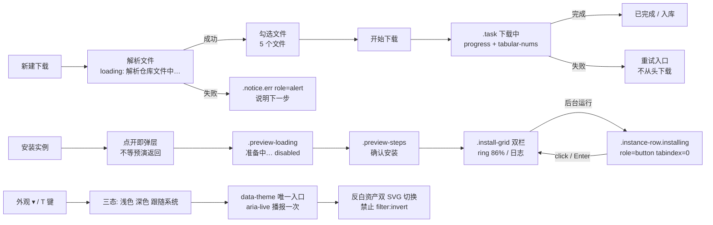

# SiMuseor VIS · Phase 2 应用系统与体验规范

> 阶段：Phase 2（应用系统 / 体验规范） / 共 3 阶段　·　编制：体验设计
> 工作区：`E:/Projects/model-downloader`（Windows）
> 上游依据：`artifacts/vis/_phase1-visual.md` **v1.1 / 620 行**（已逐节打开核实；v1.0 为 602 行）
> 对齐记录：视觉架构师已就本文附录 A 的 4 项差异逐条回传确认，Phase 1 升 v1.1；本文已同步 §8 计数（13 → **15 项**）、indigo 400 白字实算、`lab-theme` 深字语义边界与 placeholder 措辞（见附录 A-8 / A-9）。
> 本阶段边界：**只产出本规范**。未修改 `web/src/` 或 `tests/` 下任何文件；未产出 HTML 手册；未引入任何 LOGO 实验稿字形。
> 核实过的代码：`app.component.ts`、`styles.css`(1641 行)、`theme.service.ts`、`index.html`、`cover.ts`、`ui/{badge,empty,field,page-header,panel,model-card,cover-plate}.component.ts`、`pages/*.ts`、`tests/e2e/app.spec.ts`(828 行)、`lab/lab-theme.ts`。
> 所有对比度数值按 WCAG 2.x 相对亮度公式 `(L1+0.05)/(L2+0.05)` 实算，取值保留两位小数，见 §3.2。

> **⚠️ 标识状态警示（贯穿全文）**
> LOGO 仍在迭代；`design-options` 六方向、`r2-*` 八方向、Cormorant `preview.html`、`smallcaps`、designkit「终稿」全部为实验稿 / 已否，**无一为终稿**。
> 本文所有界面规范一律通过 `.brand-wordmark` 单一占位接入，**不引用任何实验稿字形、不依赖月桂几何**（Phase1 §2.2 / §2.5 / §2.6、附录 1）。
> **全仓无 `@font-face`**（Phase1 冲突 F），Barlow Condensed 基线字体在产品中**尚未生效**；本文不把它当作已落地事实。

---

## 0. 应用原则与「现状 / 目标态 / 冻结后」三态说明

### 0.1 三态定义（本文所有条目的判读前提）

| 标记 | 名称 | 含义 | 是否已被代码满足 |
|---|---|---|---|
| 〔现〕 | **现状** | 当前 `web/src/`、`tests/` 里真实跑着的代码 | 是，即仓库此刻状态 |
| 〔目〕 | **目标态** | Phase 1 + Phase 2 规范描述的应然界面，由 Phase 3 排期落地 | **否** |
| 〔冻〕 | **冻结后** | 品牌主理人裁定字形 → 用户拍板 → 出冻结包 → 按 Phase1 §2.6 **只改 3 处**之后的态 | 否，且依赖 LOGO 冻结 |

**关键声明（回应 Phase1 §8 v1.1）**：VIS 是**目标态**，不是已落地状态。Phase1 §8 冲突裁决表 v1.1 共 **15 项**（A / A′ / B / C / D / E / F / G / H / I / J / K / L，及新增 M、N）**全部标注「本轮执行 = 否」**，仅登记供 Phase 3 排期；其中 M（3 处填充改 `--primary`）与 N（21 处 `--faint` 文本引用迁移）属 Phase 3 立即项、与 LOGO 冻结解耦。因此：

- 本文凡写「现状 `.brand-mark` / `Model Downloader` / `Local Studio`」时，指的是**代码里现在还挂着**，不是主张保留；
- 凡写「目标态应…」时，指的是**Phase 3 待办**，不得被引用为「产品已经这样了」；
- 凡写「冻结后…」时，指的是**必须等 LOGO 冻结**，不得提前实现；
- **Phase 2 自身零落地**：本阶段不改 CSS、不改 DOM、不改测试、不加字体文件。

### 0.2 Phase1 §8 目标态声明（逐条状态继承，不重新论证）

| # | 冲突 | Phase1 裁决要点（引用章节） | 本轮执行 | Phase 2 是否需知 |
|---|---|---|---|---|
| A | 暖纸墨黑 vs zinc+靛紫 | §3.1 分层双轨；UI 两套 `:root` 原样保留 | 否 | 是（色彩边界） |
| A′ | 两份品牌稿纸色不一致 | §3.2 统一取 `preview.html` 组 | 否 | 否 |
| B | Barlow 400 vs Inter/雅黑 + 非标字重 | §4.2 字重白名单 `400/500/600/700` | 否 | 是（状态表字重） |
| C | 侧栏 MD / 旧称 | §2.5 占位；`<title>` 改 `SiMuseor`；§2.7 favicon | 否 | **是（§1 品牌落位）** |
| D | 圆角三档 vs 实存中间档 | §6.4 `12/8/5` + 弹层 16 + 胶囊 999 | 否 | 是（状态表圆角） |
| E | 边框优先 vs **3 处** hover 阴影 / 位移 | §6.5 hover 只动 `border-color`/`background`；v1.1 补登记 `model-card.component.ts:109-117` 组件 scoped 样式 | 否 | **是（§2 状态机）** |
| F | 品牌字体根本没加载 | §4.4 转 woff2 + 2 条 `@font-face` | 否 | **是（§2.10 降级）** |
| G | 深色主色 300 vs 400 | §7.3 `lab-theme.ts` 归一到 `{primary.300}`；**v1.1 语义边界**：归一化对象仅「文字 / 描边 / 图形型 `--accent`」，两套实心填充分开处理，`contrastColor` 深字不得改白字 | 否 | 是（§4 明暗 / §3.2） |
| H | 参照站全大写 vs 混合大小写 | §1.4 不采纳全大写 / wght500 | 否 | 否 |
| I | `index.html` 无 favicon / title 旧称 | §2.7；**依赖 LOGO 冻结** | 否 | **是（§1 / §8）** |
| J | r2 八方向 / designkit「终稿」 | §2.2、§9 全部标迭代中 / 已否 | 否 | 是（治理） |
| K | 900px `.brand-text{display:none}` 只留方块 | §2.5 隐藏 `.brand-sub`、保留 `.brand-wordmark` | 否 | **是（§4.4）** |
| L | 对外「下载器」措辞 | §1.1 品牌自称 SiMuseor；功能名保留 | 否 | **是（§5）** |
| **M** | **`--accent` 作白字填充**（v1.1 新增，WCAG 派生） | 三处填充改 `--primary`；§7.2 升级为对比度硬约束、§3.5-10 列禁止组合 | 否（**Phase 3 立即项**） | **是（§2.10-3 / §3.2）** |
| **N** | **`--faint` / `--placeholder` 承载文本**（v1.1 新增，WCAG 派生） | 不改色值，21 处文本引用迁到 `--muted`/`--text-2`；`::placeholder` 元素与文本保留 | 否（**Phase 3 立即项**） | **是（§3.3）** |

> 结论：**本文是「目标态的可核对行为准则」，不是「现状清单」**。全部 15 项仍为「本轮不执行」，由 Phase 3 执行；Phase 2 只提供可验收的判据与选择器。M / N 虽由 Phase 2 实算派生，但**只改使用位置、不改任何 token 值**，不触碰裁决 A「零覆盖、零回归」。

### 0.3 六条应用原则（可验收，非形容词）

1. **标识单点接入**：SiMuseor 在产品 UI 里**只允许**通过 `.brand-wordmark` 一个元素/类名引入（Phase1 §2.6-2）。禁止第二处手写 ``、禁止把标识写成 `aria-label` 满屏撒、禁止在页头/空态/弹层各放一份。〔现〕无；〔目〕建立；〔冻〕只换资产与 URL 变量。
2. **交互色只给可点/选中**：`--accent`/`--primary` 的语义沿用 Phase1 §1.3-1、§3.4（单屏 ≤5%、实心块 ≤2 处）。**新增硬规则（v1.1 §7.2 / §3.5-10）**：`--accent` 只作文字/描边/图形色，**绝不可作承载白色文字的填充色**——实测白字 on indigo 300 `#a5b4fc` = 1.99:1、on **400 `#818cf8` = 2.98:1**、on `--accent-hover #c7d2fe` = 1.49:1，**连 3:1 都不到**；主 UI 实心填充一律 `--primary #4f46e5` + 白字（6.29:1）。**但两套填充分开处理**：`lab-theme.ts` dark primary 走「亮底 + `contrastColor:{primary.950}` 深字」另一条合法路线（§3.2 / 附录 A-9），不得据裁决 G 把它改成白字。
3. **状态必须可被程序读出**：任何「选中 / 展开 / 加载 / 错误 / 禁用」不得只靠颜色或阴影表达（WCAG 1.4.1 / 4.1.2）。颜色变化必须配 `aria-*`、`role`、可见文案或边框宽度变化之一。
4. **不堆解释文案**：量化判据见 §5.4，直接复用 `tests/e2e/app.spec.ts` 里已有的 `toHaveCount(0)` 断言作为可执行规则。
5. **不假装字体已生效**：`Barlow Condensed` 基线在缺 `@font-face` 时回退 Segoe UI / 微软雅黑；任何截图验收、字距 `.028em` 核验都标为〔冻〕+〔目·Phase3〕，不标〔现〕。
6. **不碰 E2E 契约**：所有规范不得删除或改名 §8.4 列出的选择器 / 文案 / `data-testid` / `aria` 可访问名；确需改动的一律进「E2E 影响清单」。

### 0.4 与 Phase 1 的接口（本文不复述色板 / 字阶数值）

| 需要时查 | Phase1 章节 | 本文引用方式 |
|---|---|---|
| 品牌层六枚 `--brand-*`、zinc 阶、indigo 阶、语义色 | §3.3 | 只写 `var(--x)`，不重列 HEX |
| 字重白名单、字号阶梯、字距四档 | §4.2 / §4.3 | 只写 `400/500/600/700` 与 `var(--radius-*)` |
| 间距 4px 基准、栅格、z-index、圆角三档 | §6.1–§6.4 | 只引用数值，不重列全表 |
| 关键组件视觉状态速查 | §6.6 | 本文 §2 扩为 8 态 × 11 组件 |
| 明暗映射、焦点双通道 | §7.1 / §7.2 | 本文 §2.2 / §4 落地为属性级规则 |
| 月桂边界、封面铭牌、图标网格、几何母题 | §5.1–§5.4 | 本文 §6 转为「允许 / 禁止」清单 |
| 占位 DOM、安全替换协议、安全区 / 最小尺寸 | §2.5 / §2.6 / §2.3 | 本文 §1 转为逐位置落位表 |

---

## 1. 品牌落位地图

### 1.1 `.brand-wordmark` 唯一接入点约束（硬约束）

| 项 | 规则 |
|---|---|
| 唯一元素 | 全站 `.brand-wordmark` **有且仅有 1 个实例**，位于 `app.component.ts` 的 `.brand` 容器内（〔现〕`app.component.ts:25-31` 为 `.brand-mark` + `.brand-text`，〔目〕替换为 Phase1 §2.5 DOM） |
| 唯一类名 | 品牌图形/字标只认 `.brand-wordmark`；`.brand-sub` 是副行文本，**不是**标识 |
| 唯一变量 | 冻结后只通过 `--brand-logo-light` / `--brand-logo-dark`（+ 紧凑图标分支的 `--brand-icon-light` / `--brand-icon-dark`）切换资产；明暗判定复用 `:host-context([data-theme='dark'])`，参照 `cover-plate.component.ts:256-261` |
| 唯一真源 | 主题唯一入口 `data-theme`（`theme.service.ts:47`）；**禁止**第二套开关；**禁止** CSS `filter: invert()`（`cover.ts:43`） |
| 禁止 | 在 `ui-page-header`、`ui-panel`、`ui-empty`、`.modal`、`.theme-pop`、`app-cover-plate`、错误态里再放一份字标或 ``；禁止把 `cover-plate` 的家族标槽 `.brand` 重命名或注入 `--brand-logo-*`（见 §6.2 同名冲突） |
| 冻结只改 3 处 | ① 资产文件 ② 双（/四）URL 变量 ③ 3 个 CSS 常量（`--brand-clear-space` / `--brand-min-width:120px` / `--brand-icon-min:32px`）。**不动布局、不动颜色 token、不动字号**（Phase1 §2.6） |

### 1.2 逐处落位表（允许 / 禁止 · 占位期 DOM + aria · 冻结后动作）

| # | 位置 | 允许 SiMuseor? | 〔目〕占位期 DOM / aria | 〔冻〕替换动作 | 依据 / E2E 约束 |
|---|---|---|---|---|---|
| 1 | **侧栏品牌位** `.brand`（`app.component.ts:25-31`） | ✅ **允许，唯一常驻位** | `<div class="brand"><span class="brand-wordmark" aria-label="SiMuseor" lang="en">SiMuseor</span><small class="brand-sub">创作工作台</small></div>`；`.brand` 保持 `display:flex;align-items:center;gap:10px;padding:2px 6px 16px`（`styles.css:179-184` 不改）；删 `.brand-mark` 渐变方块、`Model Downloader`、`Local Studio` | 同一 `.brand-wordmark` 元素改为渲染 `--brand-logo-*` 资产（`` 或 `role="img" aria-label="SiMuseor"` + CSS 背景图），`.brand-sub` 文案不变；**元素节点不增删、类名不变** | Phase1 §2.5 / §2.7；E2E 不引用 `.brand*`，替换安全 |
| 2 | **页头** `ui-page-header`（`page-header.component.ts`） | ❌ **禁止** | 保持 `<h1>` 单页唯一、`.page-kicker` 栏目标签、`.page-hint`；不得把 kicker 换成 SiMuseor，不得加品牌 `<h1>`，不得加 `ui-badge` | 不变 | E2E `getByRole('heading',{name:'模型库'/'发现模型'/'环境管理'/'设备详情'/'基础环境'/'ComfyUI 实例'/'节点管理'/'发现节点'/'Hugging Face'})`（`app.spec.ts:33,37,90,114,123,126,127,779,813`）；**新增品牌徽章会破坏 `ui-badge.first()`**（见 §8.4） |
| 3 | **`<title>`**（`index.html:5`） | ✅ **允许且必须** | 〔现〕`<title>Model Downloader</title>` → 〔目〕`<title>SiMuseor</title>`；同步 `<html lang="zh-CN">` 保持 | 不变（title 是文本，不是图形资产） | E2E **无 `toHaveTitle` 断言**，改动安全 |
| 4 | **favicon**（`index.html`，现状完全缺失） | ✅ 允许；**但不得伪造字形** | 〔目〕补 `<link rel="icon" href="data:,">`（空图标，仅消除 `/favicon.ico` 404，**不含任何字形/月桂**）；不得用 8 字母全字标、不得用系统字体渲染的字母 S 当品牌标 | 〔冻〕换成 `<link rel="icon" type="image/svg+xml" href="brand/icon-32.svg">` + `icon-64.svg`/PNG 深浅两版；**favicon 无法感知 `data-theme`**，需在 `ThemeService.sync()` 里同步 `link[rel=icon].href`（仍以 `data-theme` 为唯一真源），并加 `media="(prefers-color-scheme: dark)"` 作无 JS 兜底 | Phase1 §2.7 / §8-I「依赖 LOGO 冻结」；E2E 无断言 |
| 5 | **空状态** `ui-empty`（`empty.component.ts`） | ❌ **禁止** | `.empty-icon` 是字符/emoji 装饰 → 〔目〕加 `aria-hidden="true"`；`.empty-title` / `.empty-hint` 保持功能文案；不得放字标、月桂、家族标、品牌色块 | 不变 | E2E `getByText('已创建下载任务')`(`:103`)、`没有找到…` 等；不得改名 |
| 6 | **关于 / 设置**（`settings.component.ts`，现状无「关于」区） | ⚠️ **允许一次，属〔目〕新增** | 若在设置页尾新增「关于 SiMuseor」：用品牌层 `--brand-paper`/`--brand-ink`/`--brand-muted`（不进 UI zinc），`<section role="group" aria-labelledby="about-h">` + 一个 `h2#about-h`；**不做通栏 banner、不加渐变、不加 notice** | 该区的字标**仍走同一个 `.brand-wordmark`**（用 CSS 变量引用同一资产，不新增 `` 实例） | 约束：不得新增任何文本为「安装」「环境检测」「重新检测」「安装实例」的按钮（E2E `:146,:147-149,:142`） |
| 7 | **弹层** `.modal` / `.theme-pop` | ❌ **禁止** | `.modal-head .mc-title` 是模型名 / 安装标题，保持；`.tp-title`「外观」保持 | 不变 | E2E `.modal-overlay`、`.preview-steps`、`.preview-loading`、`.check-box`、`#comfy-tag`、`data-testid="dialog-*"`、按钮名 `准备中…`/`确认安装`/`取消`/`后台运行`/`修复`/`删除` |
| 8 | **分享卡 / 导出**（现状无此功能） | ✅ 允许（品牌展示面） | 〔目〕**不实现**；〔冻〕若新增，仅用 `--brand-paper` 底 + `--brand-ink` 字标 + 反白资产（`--brand-ink-reverse` 暖白 `#f1ede4`，**不是纯白**），不进产品 UI 高频流，不用交互靛紫 | 冻结资产就绪后由 Phase 3 独立排期 | Phase1 §2.4 / §3.3-(1) |
| 9 | **封面铭牌** `app-cover-plate` | ❌ **禁止**（硬约束） | 20px 槽位放的是**第三方模型家族标**（`cover.ts:13-49`）；9 家族色 × 明暗两套 + 5 构图 `mo-0..4` **保留不改** | 不变 | Phase1 §5.2；SiMuseor 标识不进入铭牌；`cover-plate.component.ts:62` 的 `<span class="brand">` 与外壳 `.brand` **同名不同物**（组件样式为 scoped），不得重命名、不得注入 `--brand-logo-*` |
| 10 | **错误页 / 错误态** | ❌ **禁止品牌自称** | 现状无独立 404/错误页；错误由 `.notice.err` / `.check-box` / `.err-text` / `.log-line.err` 承载。〔目〕加 `role="alert"`（§3.9），文案必须给下一步（§5.3）；不得用品牌色/标识做错误插画 | 不变 | E2E `.notice.err`(`:84`)、`删除失败：目录被占用`(`:684`)、`PyTorch 不可用`(`:198`)；负向断言 `:118,:121,:134,:135,:278,:538-540` |

### 1.3 占位期 aria 细节（a11y 修正，不改变 Phase1 的类名/布局决定）

- `.brand-wordmark` 〔目〕保留 Phase1 §2.5 的 `aria-label="SiMuseor"`；但 `<span>` 是 generic role，**部分读屏不暴露 generic 元素上的 `aria-label`**。降级：占位期依赖可见文本 `SiMuseor` 本身作为可访问名（已足够）；〔冻〕换成 `` 或 `role="img" aria-label="SiMuseor"`，此时必须把内部装饰性 `<span>` 标 `aria-hidden="true"`，避免重复播报。
- 可选 `lang="en"` 标注字标为拉丁串，避免 `lang="zh-CN"` 下中文 TTS 误读；不改变 DOM 结构。
- `.brand-sub` 是中文「创作工作台」：按 Phase1 §4.1 / 附录 3「中文 `letter-spacing:0`」，〔目〕应把 §2.5 表格里沿用旧英文副行的 `letter-spacing:.06em` 收敛为 `0`（**这是把 §2.5 的一处沿用值对齐到 §4.1 硬约束，不是推翻字体结论，待主理人确认 1 处数值**）；同时 `text-transform:uppercase` 必须去掉。
- `.brand-sub` 的 `color:var(--faint)` 实测 **2.56:1 不达 AA**（§3.2）→ 〔目〕改 `var(--muted)`（白底 4.83:1）。这是 WCAG 派生裁定，见 §3.3。
- 〔现〕`app.component.ts:36,45,51,67,72,88,97,115,136` 全部 `<svg aria-hidden="true">` **已合规，保持**。

### 1.4 关键界面线框要点

```
〔目·桌面 >1040px〕                          〔目·900–1040px〕
┌──────────────┬───────────────────────┐   ┌──────────────┬──────────────────┐
│ .sidebar 236 │ .content              │   │ .sidebar 236 │ .content         │
│ ┌──────────┐ │  .container 1240max   │   │ 同左（品牌位  │  .env-layout 1fr │
│ │.brand    │ │  ┌ ui-page-header ┐   │   │ 完整显示）    │  .settings 1fr   │
│ │ SiMuseor │ │  │ kicker / h1   │   │   │              │  （DOM/视觉顺序  │
│ │ 创作工作台│ │  │ [page-actions]│   │   │              │   错位，见 §2.10）│
│ └──────────┘ │  └───────────────┘   │   └──────────────┴──────────────────┘
│ .nav         │  ui-panel / .grid     │
│  资产与发现   │  grid: minmax(250px)  │  〔目·≤900px〕 横条侧栏，overflow:visible 必须保留
│  [工作流]…   │  gap 14px              │  ┌──────────────────────────────────────┐
│  [发现 ▸]    │                        │  │ [.brand-wordmark] [nav item…] [外观▾] │
│   ├ 工作流   │  .save-bar (sticky)   │  │ .brand-sub{display:none}  ← 替换 :1616│
│   ├ 模型     │  ↑ 需 scroll-padding  │  │ .nav 横向 wrap；.nav-sub 整行平铺      │
│   ├ 节点     │                        │  │ .theme-pop top:calc(100%+8px) w184    │
│   └ 下载任务 │                        │  └──────────────────────────────────────┘
│  基础设置     │                        │  〔冻·≤900px〕.brand-wordmark 走 icon 分支
│  [环境][设置] │                        │   30×30 + --brand-icon-dark 深色资产
│ .sidebar-foot│                        │
│  [外观 ▾]    │                        │
└──────────────┴───────────────────────┘
```

**线框要点（可核对）**：
1. `.brand` 是 `<aside class="sidebar">` 的**第一个子元素**、`<nav class="nav">` 的**兄弟节点** —— 冻结前后都不变；**不得把品牌位塞进 `.nav` 内或给 `.nav` 加包裹层**（E2E `.nav > a[href="/models"]` 是直接子选择器）。
2. `.brand-wordmark` 在桌面宽度区间 `120px ≤ w ≤ 190px`（Phase1 §2.3）；≤900px 横条里仍 `white-space:nowrap; flex:none`，不得压缩到 <120px。
3. `.sidebar` 〔现〕`z-index:20` sticky；`.theme-pop` `z-index:40`；`.modal-overlay` `z-index:100`；`.save-bar` `z-index:5`（Phase1 §6.3）。焦点不得被 sticky 条遮挡 → `scroll-padding-bottom`（§3.4）。
4. `.nav-sub` 竖线 `::before` 在 ≤900 隐藏（`styles.css:1623`），子项整行平铺；`role="group" aria-label="发现"` 保留。

### 1.5 核心任务流程图（状态可见性 + 反馈点）



**每步必须有可见反馈**（Nielsen #1 状态可见 / #9 错误可恢复）：加载态必须有文字 + `role="status"`；按钮禁用必须保留原生 `disabled` 属性（E2E `:235,:349` 用 `toBeDisabled()`／`isDisabled()`，**只给 `aria-disabled` 会失败**）；错误必须给出「重试 / 换个源 / 去设置」之一。

---

## 2. 组件状态机（Phase1 §6.6 扩展为 8 态 × 11 组件）

### 2.1 状态字典与共享记号

**8 个状态**：`默认 / hover / focus-visible / active·selected / disabled / loading / error / empty`。

| 记号 | 完整取值（全部可在 CSS / DOM 上断言） |
|---|---|
| `F` | `:focus-visible { outline: 2px solid var(--accent); outline-offset: 2px; }`（`styles.css:142`）；键盘焦点**唯一合规指示器**。实测与相邻底色对比 5.62–6.29:1（浅）/ 8.14–9.86:1（深），≥3:1 ✓ |
| `R` | `--ring`（`:70` 浅 `0 0 0 3px rgb(79 70 229/.14)`；`:121` 深 `rgb(99 102 241/.28)`），由 `input:focus`/`select:focus`/`textarea:focus` 的 `box-shadow:var(--ring)` + `border-color:var(--accent)` 触发（`:649-652`）。**3px 软环，装饰性，不是 WCAG 焦点指示器** |
| `D` | `opacity:.45; cursor:not-allowed` + hover 不还原（`:617-619`）；导航 `.is-disabled opacity:.42`（`:262`）；`select:disabled opacity:.6`（`:671`）。**必须同时有原生 `disabled`**（见上） |
| `L` | `aria-busy="true"` + `.dot-spin` / `.skeleton` / `.loading-line`；**必须保留可见文字**（E2E `:347`、`:349`、`:352-354`） |
| `E` | `color:var(--err)` + `background:var(--err-soft)` + `border:1px solid color-mix(in oklab, var(--err) 18~20%, transparent)`（`:851`, `:1314`）；`role="alert"` |
| `S` | `background:var(--accent-soft)` + `color:var(--accent)` + `font-weight:600`（`:256-259`）；**填充态一律 `--primary`/`--on-primary`**（§2.10 风险 3） |
| `Z` | 空态：`ui-empty` / `.empty-state`(`:866`) / `.inst-empty` 虚线槽(`:1176-1184`)；`aria-live="polite"` 仅在结果容器上（§3.9） |

**新增类名（〔目〕，不改动现有类名）**：`.is-loading`、`.is-error`、`.is-empty`、`[aria-busy]`、`[aria-invalid]`、`[aria-pressed]`、`[aria-checked]`、`[aria-current="page"]`、`[aria-selected]`、`role="progressbar"`、`role="status"`、`role="alert"`、`role="log"`。

### 2.2 「鼠标聚焦 3px 软环」与「键盘焦点 2px 实线」为什么不冲突

| 维度 | 3px 软环 `R` | 2px 实线 `F` |
|---|---|---|
| 触发伪类 | `:focus`（鼠标点击、程序聚焦**也会**触发） | `:focus-visible`（键盘 / AT / 程序化无指针聚焦） |
| CSS 属性 | `box-shadow` + `border-color` | `outline` + `outline-offset` |
| 几何 | 紧贴边框外扩 3px，无 offset | 外扩 2px 处再画 2px 线（offset 2px） |
| 对比度 | 浅色 `.14` / 深色 `.28` alpha，实测对白底 ≈1.1:1，**装饰性** | `--accent` 实色，5.62–6.29:1 / 8.14–9.86:1，满足 1.4.11 + 2.4.7 + 2.4.13 |
| 作用 | 告诉鼠标用户「正在编辑这个字段」 | 告诉键盘用户「焦点在这里」，是**唯一合规指示器** |

**结论：两者作用于不同属性、不同伪类、不同几何层，可叠加不互斥** —— 键盘聚焦输入框时同时得到 `R` + `F`；鼠标聚焦只得到 `R`。三条硬规则：

1. **永不以 `R` 作为唯一焦点指示器**；`:focus-visible` 的 `outline` 不得被 `outline:none` 覆盖。注意 `styles.css:644` 的 `input,select,textarea{outline:none}` 会被 `:focus-visible`（0,1,0）在特异性上压过 `input`（0,0,1），**顺序无关**，键盘焦点实线仍会出现 —— Phase 3 不得把 `:focus-visible` 规则收窄到 `button` 上，否则输入框键盘焦点会消失。
2. `outline-offset` 统一 `2px`；〔目〕把 `.instance-row.installing:focus-visible{outline-offset:1px}`（`:1253`）收敛为 `2px`。
3. 不得在 `:focus-visible` 里把 `box-shadow` 置 `none`；不得用 `filter`/`transform` 表达焦点。

### 2.3 完整状态表

> 每行给「现有选择器」或「拟新增类名」+ 具体数值 / 变量。字重一律按 Phase1 §4.2 白名单 `400/500/600/700`；圆角按 §6.4 `12/8/5` + 弹层 16 + 胶囊 999。

| 组件 | 状态 | 选择器（现 / 拟新增） | 具体数值 / 变量 |
|---|---|---|---|
| **按钮 `button`** `:579-619` | 默认 | `button` | `h32;padding:0 13px;border-radius:var(--radius-sm)=8px;1px solid var(--border);background:var(--panel);color:var(--text-2);12.5px/500` |
| | hover | `button:hover` `:599` | `background:var(--hover);border-color:var(--border-strong);color:var(--text)`；**不加阴影**（Phase1 §6.5） |
| | focus-visible | `button:focus-visible` = `:focus-visible` `:142` | `F`（2px 实线） |
| | active·selected | `button.primary` `:602` / `button.danger` `:613` / `button.ghost` `:615` | primary `background:var(--primary);color:var(--on-primary)`（**6.29:1，双主题**）；danger `color:var(--err)`；ghost `border-color:transparent;background:none` |
| | disabled | `button:disabled` `:617` | `D` + **原生 `disabled` 属性**；`.primary:disabled:hover` 保持 `--primary`（`:619`） |
| | loading | `button.is-loading`（拟新增） | `disabled` + `aria-busy="true"` + 文案改「准备中…」/「检测中…」（**E2E `:349` 依赖该文案**）；`opacity` 保持 `D`，不加 spinner 覆盖文字 |
| | error | `button.danger` + `.notice.err`（承载层） | `E`；按钮自身不改边框为红（Phase1 §6.6） |
| | empty | — | 按钮不进空态；空态 CTA 由 `ui-empty` 的 `<ng-content>` 提供（`:869`） |
| **导航父项 `.nav-parent`** `:282-302` | 默认 | `.nav-item.nav-parent` | `h32;border-radius:8px;color:var(--muted);13px/500`；`aria-expanded` + `aria-controls="nav-discover"`（`app.component.ts:63-64`） |
| | hover | `.nav-item:hover` `:255` | `background:var(--hover);color:var(--text)` |
| | focus-visible | `button:focus-visible` | `F` |
| | active·selected | `.nav-parent.on` `:293` | `color:var(--accent);font-weight:600`；`.nav-parent.open .nav-caret{transform:rotate(90deg)}`（`:301`）→ 〔目〕加 `aria-expanded="true"` 已是真值来源，旋转仅为视觉补强 |
| | disabled | `.nav-item.is-disabled` `:262` | `opacity:.42;cursor:default`；≤900 被 `display:none`（`:1618`）→ 〔目〕若要保留 AT 感知，改 `aria-disabled="true"` 而非移除 |
| | loading | — | 无此态（纯开合，无异步） |
| | error | — | 无此态 |
| | empty | — | 无此态 |
| **导航子项 / 一级项** `:230-263`,`:319-332` | 默认 | `.nav-item` / `.nav-sub-item` | `h32 / h29`（≤900 为 30）；`color:var(--muted);13px / 12.5px /500`；`svg 15px,stroke-width 1.6` → 〔目〕统一 `1.5`（Phase1 §5.3） |
| | hover | `.nav-item:hover` / `.nav-sub-item:hover` | `background:var(--hover);color:var(--text)` |
| | focus-visible | `a:focus-visible` | `F` |
| | active·selected | `.nav-item.active` `:256` / `.nav-sub-item.active` `:332` | `S`（`--accent-soft` / `--accent` / 600）；〔目〕**再加 `aria-current="page"`**，因为「颜色 + 600 字重」在 13px 下不足以作为唯一状态线索（1.4.1） |
| | disabled | `.nav-item.is-disabled` | `D` |
| | loading | — | 无 |
| | error | — | 无 |
| | empty | — | 无 |
| **输入 `input,select,textarea`** `:634-671` | 默认 | `input,select,textarea` | `h32;padding:0 10px;border:1px solid var(--border);border-radius:8px;background:var(--input-bg);color:var(--text);12.5px`；`outline:none`(`:644`)；〔目〕`border-color` 用 `--border-control`（§3.5） |
| | hover | `:648` | `border-color:var(--border-strong)` |
| | focus-visible | `input:focus` `:649` + 全局 `:focus-visible` `:142` | 鼠标 `R`；键盘 `R + F`；**两者叠加**（§2.2） |
| | active·selected | `.radio-row:has(input:checked)` `:690` | `border-color:var(--accent-line);background:var(--accent-soft)`；⚠️ `--accent-line` 对白底仅 **1.49:1**、深底 **2.33:1** → 〔目〕改 `border-color:var(--accent)`（6.29 / 9.22:1）并加 `aria-checked` 原生 radio 语义 |
| | disabled | `select:disabled` `:671` / `button[disabled]` | `opacity:.6` + 原生 `disabled`；`input[readonly]` `:654` → `background:var(--panel-2);color:var(--muted)`，加 `aria-readonly="true"` |
| | loading | `input.is-loading`（拟新增） | `aria-busy="true"`；**保留 placeholder 文案**（E2E `:54,:92`） |
| | error | `.notice.err` / `.check-box`（**不改输入框自身边框**） | `aria-invalid="true"` + `aria-describedby` 指向错误节点；`E` |
| | empty | `ui-field`（`field.component.ts`） | 〔现〕`<label>` 无 `for`、输入经 `<ng-content>` 投射 → **标签未关联**（1.3.1/3.3.2）→〔目〕补 `for`/`id` 或 `aria-labelledby`；`#comfy-tag` 必须保留（E2E `:434`） |
| **卡片** `.panel`/`.model-card`/`.task`/`md-model-card .card` | 默认 | `:542,:1000,:949` / `model-card.component.ts:76-98` | `border-radius:var(--radius)=12px;1px solid var(--border);background:var(--panel);**无阴影**`；`.card::after` 用 `inset 0 0 0 1px var(--border)` 内描边（登记例外，照片贴边需要） |
| | hover | `.task:hover` `:958` / `.card:hover` `model-card:109` | 〔目〕**只改 `border-color:var(--border-strong)` + `background:var(--hover)`**；移除 `:960` 的 `box-shadow:var(--shadow-sm)` 与 `model-card:111` 的 `transform:translateY(-2px)` + 外阴影（Phase1 §8-E **v1.1 已由 2 处补登记为 3 处**，组件 scoped 样式需单独收敛，见 §2.10 风险 13） |
| | focus-visible | `.card:focus-within` `model-card:110` | 〔目〕保留 `focus-within` 但改为 `box-shadow:inset 0 0 0 1px var(--accent)`（6.29:1）+ 内部可聚焦元素自身的 `F`；不得只靠整卡外发光 |
| | active·selected | `.instance-row.installing` `:1247` | `background:var(--accent-soft);border-color:var(--accent-line)`；〔目〕整行补 `role="button" tabindex="0"` + `(keydown.enter)/(keydown.space)`（**现状仅 `(click)`，键盘不可达**；E2E `:610` 的 `.click()` 仍可通过） |
| | disabled | `.skel-card{pointer-events:none}` `:881` | 骨架态 `aria-hidden="true"` + `aria-busy="true"` 于父容器 |
| | loading | `.skeleton` `:871` / `.skel-line` | `shimmer 1.6s linear infinite`；〔目〕`prefers-reduced-motion` 下改静态 `--border-soft` 填充（§3.8） |
| | error | `.check-box` `:1311` | `E` + `role="alert"` |
| | empty | `.inst-empty` `:1176` / `ui-empty` | `1px dashed var(--border-strong);border-radius:8px;min-height:220px`；`Z` |
| **徽章 `ui-badge`** `badge.component.ts`,`:757-772` | 默认 | `.badge` | `border-radius:999px;padding:1px 8px;11px/600;line-height:18px`；`tone` 五档 `gray/blue/green/orange/red` |
| | hover | — | 无（非交互） |
| | focus-visible | — | 无（非交互，不应进 Tab 序） |
| | active·selected | `.badge.blue` `:769` 等 | `S` 语义色对；〔目〕**不得只靠颜色** → 徽章文本本身即状态词（「已安装 / 未安装 / 已禁用 / 已安装 / 清单未收录」），满足 1.4.1 |
| | disabled | — | 无 |
| | loading | `.badge` + `job.stage`（`nodes.component.ts:96`） | 〔目〕容器加 `aria-live="polite"`，**徽章本身不加**（避免轮询刷屏） |
| | error | `.badge.red` `:772` | `E` + `role="alert"` |
| | empty | — | 无（**不得用 `ui-badge` 表达空态/品牌**，会破坏 `ui-badge.first()`，§8.4） |
| **chips** `.filter-chip`/`.segmented`/`.chip` `:698-755` | 默认 | `.filter-chip` `:726` / `.segmented` `:698` | `h26 / h24;padding:0 10px / 0 11px;border-radius:999px;1px solid var(--border);11.5px/500` |
| | hover | `:736`,`:717` | `border-color:var(--border-strong);background:var(--hover);color:var(--text)` |
| | focus-visible | `button:focus-visible` | `F` |
| | active·selected | `.filter-chip.active` `:737` / `.segmented button.active` `:718` | ⚠️ **`.filter-chip.active` 用 `background:var(--accent);color:var(--on-primary)`，深色下白字 1.99:1 不达标** →〔目〕改 `background:var(--primary);color:var(--on-primary)`（6.29:1 双主题）；hover 不再用 `--accent-hover`（深色 1.49:1），改为保持 `--primary` 只动 `border-color`。`segmented.active` 用 `--panel`+`--accent` 文字，合规。〔目〕补 `aria-pressed="true"` / `aria-checked` |
| | disabled | `button:disabled` | `D` |
| | loading | `.chip-count.is-loading`（拟新增） | `aria-busy="true"`；`font-variant-numeric:tabular-nums`（`:744` 已有，保留） |
| | error | — | 无此态 |
| | empty | — | 无此态 |
| **弹层** `.modal`/`.theme-pop` `:891-930`,`:386-466` | 默认 | `.modal` `:901` / `.theme-pop` `:386` | `width:min(680px,100%);max-height:min(82vh,760px);border-radius:16px;1px solid var(--border);box-shadow:var(--shadow-lg)`；`z-index:100 / 40` |
| | hover | — | 无 |
| | focus-visible | 内部控件 `F` | 〔目〕首次打开把焦点移入弹层（`.tp-opt` 首项 / 弹层首个可聚焦控件）；关闭时**焦点回到触发按钮**（现状 `onEscape()` 只 `themeMenu.set(false)`，焦点会掉到 `body`，见 §2.10 风险 6） |
| | active·selected | `.tp-opt.on` `:427` | `color:var(--accent);font-weight:600` + `.tp-check`（`aria-hidden="true"`）→ ⚠️ **选中态未程序化暴露**（1.4.1/4.1.2）→〔目〕加 `aria-pressed` 或 `role="menuitemradio" aria-checked`；方向键 † 导航 |
| | disabled | `.modal` 内 `button:disabled` | `D` + 原生 `disabled` |
| | loading | `.preview-loading` `:1519` / `.pl-title` | `role="status"` + `aria-busy="true"`；「准备中…」按钮 `disabled`（E2E `:347-354`） |
| | error | `.notice.err` / `.err-text` `:1338` | `E` + `role="alert"` |
| | empty | `ui-empty` in dialog（`discover.component.ts:292`） | `Z`；瞬态成功态加 `role="status"`，**静态空态不加** |
| **进度环** `.prg-ring` `:1359-1391` | 默认 | `.ring-track` / `.ring-value` `:1364-1370` | `stroke-width:8`（124px 环；≤860 环为 100px）；`transform:rotate(-90deg)`；`tabular-nums` 于 `.ring-label strong`（`:1388`） |
| | hover | — | 无 |
| | focus-visible | — | 非交互；不进 Tab 序 |
| | active·selected | `.prg-ring.done .ring-value{stroke:var(--ok)}` `:1372` / `.failed{stroke:var(--err)}` `:1373` | 〔目〕**加 `role="progressbar"` + `aria-valuemin=0 aria-valuemax=100 aria-valuenow aria-valuetext="86%，正在安装 PyTorch"`** 于 `.ring-wrap`；仅阶段变化/完成/失败播报一次，**不给每秒刷新的数字加 `aria-live`** |
| | disabled | — | 无 |
| | loading | `.progress.indeterminate > div` `:1413` / `phase-slide 1.4s infinite` | `aria-busy="true"`；`prefers-reduced-motion` 下降级为静态 40% 宽条（§3.8） |
| | error | `.prg-ring.failed` / `.progress.failed > div` `:840` | `stroke/background:var(--err)` + `role="status"` 一次「安装失败」 |
| | empty | — | 无（无进度即显示 `.preview-loading`） |
| **表格** `table` `:774-824` | 默认 | `table` / `th` / `td` | `border-collapse:separate;border-spacing:0;th 10px/600 uppercase,letter-spacing:.08em,color:var(--faint)` → ⚠️ **`--faint` 2.56:1 不达标**（§3.3）→〔目〕`th` 改 `var(--muted)`；`.table-wrap{overflow-x:auto}` |
| | hover | `tbody tr:hover td` `:799` | `background:var(--hover)` + 首/末格 `border-radius:8px`；〔目〕补 `:focus-within` 等价反馈供键盘用户 |
| | focus-visible | `a/button in td:focus-visible` | `F`；〔目〕`.table-wrap` 加 `role="region" aria-label="…" tabindex="0"` 使横向滚动可键盘操作（2.1.1），**不改变 `<table>` 的隐式 `table` role**（E2E `:816` `getByRole('table')`） |
| | active·selected | — | 〔目〕选中行 `aria-selected="true"` + `--accent-soft` 背景，不只靠 hover 底色 |
| | disabled | `td button:disabled` | `D` |
| | loading | `tbody.is-loading`（拟新增） | `.skeleton` 行 + `aria-busy="true"` |
| | error | 行内 `.notice.err` | `E` |
| | empty | `ui-empty` / `.nd-row` 空 | `Z` |
| **主题切换 `.theme-toggle` / `.theme-pop`** `:348-466`, `app.component.ts:108-144` | 默认 | `.theme-toggle` / `.tp-opt` | `h32;border-radius:8px;color:var(--muted);13px/500`；`aria-expanded` + `aria-haspopup="dialog"` **已有**（`:112-113`） |
| | hover | `.theme-toggle:hover` `:374` / `.tp-opt:hover` `:426` | `background:var(--hover);color:var(--text)` |
| | focus-visible | `button:focus-visible` | `F` |
| | active·selected | `.tp-opt.on` `:427` | `color:var(--accent);600` + `.tp-check`；〔目〕加 `aria-checked`/`aria-pressed`（见上） |
| | disabled | — | 无 |
| | loading | — | 无（`data-theme` 同步写入，非异步） |
| | error | — | 无 |
| | empty | — | 无 |
| | **三态偏好** | `themeOptions`（`app.component.ts:166-170`） | `light / dark / system`，存储键 `md-theme`，`prefLabel()` 显示于 `.theme-toggle em`（`:120`）；〔目〕加 `aria-controls="theme-pop"` + `id="theme-pop"`（现状缺失），并给 `.theme-toggle` 补 `[attr.aria-label]="'外观，当前：'+prefLabel()"`（因 ≤900 时 `em` 被 `display:none`，`:1627`） |

† 方向键规范见 §3.5。

### 2.4 通用状态规则（跨组件）

- **hover 只动 `border-color` / `background`**（Phase1 §6.5）：实测 `--border` 1.27:1 → `--border-strong` 1.48:1、`--panel` #fff → `--hover` #f4f4f5 ≈1.06:1，**视觉 Δ 极小** → 因此 **hover 不得作为「可点 / 已选中」的唯一提示**；可点性由 `cursor:pointer`、语义标签（`<a>`/`<button>`）、`F` 共同承担；持久选中态必须 ≥3:1 或带非颜色线索（1.4.1 / 1.4.11）。
- **禁用态**是 WCAG 1.4.3 的「非活动组件」豁免项，实测 blended 后浅 2.34:1 / 深 3.41:1 可豁免；但仍须 `aria-disabled` + 原生 `disabled` + 必要时 `title` 说明原因（现状 `comfy.component.ts:240` 已有 `title="请先安装基础环境"`，**保留**）。
- **loading 不得只剩 spinner**：`.loading-line` 必须带文字（"等待态：一个转圈 + 一句话"，`styles.css:855` 注释已如此设计）。
- **error 不得只报错**：见 §5.3。

### 2.5 高风险交互与降级方案（汇总，逐条可验收）

| # | 风险 | 实测 / 依据 | 降级方案（Phase 3 可立即用） |
|---|---|---|---|
| 1 | LOGO 未冻结 | Phase1 §2.2 / §9 | 任何规范不依赖字形；`data:` 空 favicon + 纯文字 `.brand-wordmark`；冻结后仅改 3 处 |
| 2 | 品牌字体未生效 | 全仓无 `@font-face`（Phase1 冲突 F） | 回退 `"Segoe UI","Microsoft YaHei"`；补 woff2 + `font-display:swap` 后**用截图实测** `.028em` 与「缩小等效 190px」；不宣称已生效 |
| 3 | **`--accent` 作白字填充**（Phase1 §8-M） | 白字 on 300 `#a5b4fc` = **1.99:1**、on **400 `#818cf8` = 2.98:1**、on `--accent-hover #c7d2fe` = **1.49:1**，全部 FAIL（400 连 3:1 都不到）；`--primary #4f46e5` + 白字 = **6.29:1** ✅ | `.filter-chip.active`(`:737`)、`.filter-chip.active:hover`(`:743`)、`.step-row.active .step-dot`(`:1469`) 填充改 `var(--primary)`；Phase1 **v1.1 §7.2** 已把「`--primary` 深色保持 600 不翻」由审美偏好升级为**对比度硬约束**、§3.5-10 列为禁止组合。**裁决 G 边界**：归一化对象仅「文字/描边/图形型 `--accent`」，**不得把 `lab-theme.ts:72` 的 `contrastColor:'{primary.950}'` 深字改成白字**——该深字 on 400 = **5.36:1**、on 300 = **8.02:1** ✅；主 UI 与 lab 实验区两套实心填充各自合规、字色相反，无需互相拉齐（Phase1 §7.3 v1.1） |
| 4 | 全局单键 `T` | WCAG **2.1.4 Character Key Shortcuts (A)**；`app.component.ts:227-235` 只挡 `INPUT/TEXTAREA/SELECT/isContentEditable` 与修饰键 | 补 `event.isComposing || event.keyCode===229`（中文拼音输入时按 t 会误切主题）、`event.repeat`（长按反复翻转）、`event.defaultPrevented`、弹层内不触发；并在设置里提供「关闭 T 快捷键」开关（2.1.4 要求可关闭/可重映射/仅聚焦时生效，三选一） |
| 5 | `aria-controls` 悬空 | `app.component.ts:64` 指向 `#nav-discover`，但 `@if(discoverOpen())` 折叠时元素不存在 | 容器常驻 DOM + `hidden` 属性；或折叠时移除 `aria-controls` |
| 6 | Esc 只关 `.theme-pop`、焦点丢失 | `app.component.ts:218-221` 仅 `themeMenu.set(false)`；页面 `.modal-overlay` 无 Esc 处理 | Esc 按 z-index 关最顶层（modal 100 > pop 40）；关闭后焦点回 `.theme-toggle` / 触发按钮；页面弹层补 `role="dialog" aria-modal="true" aria-labelledby` + 焦点陷阱（三者必须一起做，单独加 `aria-modal` 反而更糟） |
| 7 | `.instance-row.installing` 键盘不可达 | `comfy.component.ts:253` 是 `<div (click)>` | 补 `role="button" tabindex="0"` + Enter/Space；E2E `:610` 的 `.click()` 仍有效 |
| 8 | `--faint` / `--placeholder` **两个色值**承载文本（Phase1 §8-N） | 浅 2.33–2.56:1、深 2.57–3.11:1，**全部 <4.5** | 见 §3.3 逐条替换；**禁止的是「用这两个色值承载文本」，不是禁止 placeholder 元素**——`::placeholder` 元素与其文本必须保留（E2E `:54,:92` 依赖），只把 `color` 换 `--muted`；不改 token 值，只改使用位置 |
| 9 | ≤900 侧栏 `overflow:visible` | `styles.css:1611-1613` 注释明确：改回 `auto` 会裁掉 `.theme-pop` | 保持 `visible`；若必须滚动，把 pop 挂到 `body` 或改 `position:fixed` |
| 10 | DOM / 视觉顺序错位 | `.env-layout` DOM 先 `.env-side`（右栏）后 `.inst-panel`（左栏）；≤1040 又用 `grid-row` 把实例提到第 1 行 | 保持 DOM 顺序不动（会动到 E2E 的 `.first()`）；补 `role="region" aria-label="基础环境"/"ComfyUI 实例"`；**禁止在该区新增前置可聚焦元素**；记为已接受的例外并人工走查 2.4.3 |
| 11 | 控件边界 1.27:1 | `--border #e4e4e7` on `--panel #fff` = 1.27:1；`--input-bg` 与 `--panel` 同为 `#fff`，输入框**只靠这条线辨认**（1.4.11 需 3:1） | 〔目〕**新增** `--border-control:#8b8b94`（浅：白底 3.38:1 / `--bg` 3.10:1 ✓；深：`#141417` 5.44:1 ✓），仅用于 `input/select/textarea/.radio-row` 静止边框，**不覆盖现有 `--border`**；若视觉过重，降级为「每个控件都有可见 `<label>` + `F` 焦点环 + `aria`」的冗余方案并登记例外 |
| 12 | `prefers-reduced-motion` 全局缺失 | 全仓**只有** `model-card.component.ts:119-123` 一处；`styles.css` 有 `shimmer / dot-spin / phase-slide / nav-sub-in / theme-pop-in / fade-in / pop-in` 共 7 个动画 + 多处 transition | 全局 `@media (prefers-reduced-motion: reduce)`：`animation-duration:.01ms;animation-iteration-count:1;transition-duration:.01ms;scroll-behavior:auto`；**spinner 不能凭空消失** → 降级为静态 `border-top-color:var(--accent)` + `role="status"` 文字；`shimmer` → 静态 `--border-soft` 填充 |
| 13 | 组件 scoped 样式未被 Phase 1 **v1.0** 审到（**v1.1 已补登记**） | `model-card.component.ts:109-117` `.card:hover/:focus-within` 加 `transform:translateY(-2px)` + 外阴影；Phase1 §8-E 由「2 处」改为「**3 处**」 | 收敛为**第 3 处待收敛**；移除位移与外阴影，保留 `inset 0 0 0 1px var(--accent)` 内描边；该文件已有的 `@media (prefers-reduced-motion: reduce)` 保留并作为全局实现范本 |
| 14 | 900px 规则变死规则 | `styles.css:1616 .brand-text{display:none}`；〔目〕`.brand-text` 已删除 | 显式替换为 `.brand-sub{display:none}` + `.brand-wordmark` 保留（§4.4），**不得留空规则** |
| 15 | 两处 `.brand` 同名 | 外壳 `.brand`（全局）vs `cover-plate.component.ts:62` 家族标槽 `.brand`（scoped） | 不重命名、不互注 `--brand-logo-*`；验收加一条 DOM 断言：`app-cover-plate .brand` 内无 `.brand-wordmark` |

---

## 3. 无障碍规范（WCAG 2.2 AA）

### 3.1 适用条款清单

| 条款 | 级别 | 本文落点 |
|---|---|---|
| 1.3.1 Info and Relationships / 1.3.2 Meaningful Sequence | A | §2.3 `ui-field` 标签关联、§2.10-10 顺序错位 |
| 1.4.1 Use of Color | A | §2.3 选中态必须带 `aria-*` / 文本 / 边框宽度 |
| 1.4.3 Contrast (Minimum) | AA | §3.2 实测、§3.3 灰阶裁定 |
| 1.4.10 Reflow / 1.4.11 Non-text Contrast / 1.4.12 Text Spacing | AA | §4.5 / §3.5 / §3.7 |
| 2.1.1 Keyboard / 2.1.2 No Keyboard Trap / **2.1.4 Character Key Shortcuts** | A | §3.5、`T` 键风险 4 |
| 2.2.1 Timing / 2.2.2 Pause, Stop, Hide | A | §3.8 spinner / shimmer |
| 2.4.3 Focus Order / 2.4.7 Focus Visible / **2.4.11 Focus Not Obscured (Minimum)** / 2.4.13 Focus Appearance | A / A / **AA(2.2 新增)** / AAA | §3.4 |
| **2.5.7 Dragging Movements / 2.5.8 Target Size (Minimum)** | **AA(2.2 新增)** | §3.7；现状无拖拽交互 → 2.5.7 天然满足 |
| 3.3.1 / 3.3.2 Labels or Instructions / 3.3.7 Redundant Entry | A | §5.3 / §2.3 输入 error / §5.4 |
| 4.1.2 Name, Role, Value / **4.1.3 Status Messages** | A / AA | §3.9 |
| 2.1.4 / 3.2.6 Consistent Help | A | `T` 键可关闭；kbd 提示只在 `.theme-pop` 一处，不重复堆帮助入口 |

### 3.2 对比度实测（WCAG 相对亮度公式，全部实算）

**浅色主题**（表面 `--panel #ffffff`，除非另注）

| 前景 | 背景 | 比值 | 判定 |
|---|---|---|---|
| `--text #18181b` | `--panel #ffffff` | **17.72:1** | ✅ 正文 |
| `--text #18181b` | `--bg #f5f5f6` | 16.26:1 | ✅ 正文 |
| `--text-2 #3f3f46` | `--panel #ffffff` | **10.44:1** | ✅ 正文 |
| `--muted #71717a` | `--panel #ffffff` | **4.83:1** | ✅ 正文（勉强） |
| `--muted #71717a` | `--panel-2 #fafafa` | 4.63:1 | ✅ 正文 |
| `--muted #71717a` | `--bg #f5f5f6` | **4.44:1** | ❌ <4.5 |
| `--muted #71717a` | `--panel-3 #f4f4f5` | **4.40:1** | ❌ <4.5 |
| `--faint #a1a1aa` | `--panel #ffffff` | **2.56:1** | ❌ 文本 / 非文本均不达 |
| `--faint #a1a1aa` | `--bg #f5f5f6` | 2.35:1 | ❌ |
| `--faint #a1a1aa` | `--panel-3 #f4f4f5` | 2.33:1 | ❌ |
| `--placeholder #a1a1aa` | `--input-bg #ffffff` | **2.56:1** | ❌ 占位符文本 |
| `--accent #4f46e5` | `--panel #ffffff` | **6.29:1** | ✅ 文字 / 图形 / 焦点实线 |
| `--accent #4f46e5` | `--accent-soft #eef2ff` | 5.62:1 | ✅ |
| `--on-primary #fff` | `--primary #4f46e5` | **6.29:1** | ✅ 实心按钮 |
| `--err #b91c1c` / `--ok #15803d` / `--warn #b45309` | `--panel #ffffff` | 6.47 / 5.02 / 5.02:1 | ✅ |
| `--err/ok/warn` | 对应 soft | 5.91 / 4.79 / 4.84:1 | ✅ |
| `--star #d97706` | `--panel #ffffff` | **3.19:1** | ✅ 仅作非文本字形（≥3:1）；作文本 ❌ |
| `--border #e4e4e7` | `--panel #ffffff` | **1.27:1** | ❌ 不可作控件边界（1.4.11 需 3:1） |
| `--border-strong #d4d4d8` | `--panel #ffffff` | 1.48:1 | ❌ 同上 |
| `--accent-line #c7d2fe` | `--panel #ffffff` | **1.49:1** | ❌ 不可作「选中」唯一线索 |
| 进度条 `--accent` | `--track #ececee` | 5.33:1 | ✅ 图形（≥3:1） |

**深色主题**（表面 `--panel #141417`，除非另注）

| 前景 | 背景 | 比值 | 判定 |
|---|---|---|---|
| `--text #ededf0` | `--panel #141417` | 15.74:1 | ✅ |
| `--text-2 #d4d4d8` | `--panel #141417` | 12.44:1 | ✅ |
| `--muted #8b8b94` | `--panel #141417` / `--bg #0b0b0d` / `--panel-3 #202025` / `--input-bg #17171b` | **5.44 / 5.82 / 4.80 / 5.29:1** | ✅ 全部表面达标 |
| `--faint #5f5f68` | `--panel #141417` / `--panel-3 #202025` / `--input-bg #17171b` | **2.91 / 2.57 / 2.83:1** | ❌ |
| `--faint #5f5f68` | `--bg #0b0b0d` | 3.11:1 | ⚠️ 仅 ≥3:1（大字号/非文本），**仍 <4.5 不能作正文** |
| `--placeholder #5f5f68` | `--input-bg #17171b` | 2.83:1 | ❌ |
| `--accent #a5b4fc` | `--panel #141417` | **9.22:1** | ✅ |
| `--accent #a5b4fc` | `--accent-soft` 18% 合成底（#1f1d3c ~ #282748） | **7.15–8.77:1** | ✅ |
| `--on-primary #fff` | `--primary #4f46e5`（**深色保持 600 不翻**） | **6.29:1** | ✅ 双主题一致 |
| **`--on-primary #fff`** | **`--accent #a5b4fc`（错误用法）** | **1.99:1** | ❌ **FAIL** |
| **`--on-primary #fff`** | **`--accent-hover #c7d2fe`（错误用法）** | **1.49:1** | ❌ **FAIL（更差）** |
| `--on-primary #fff` | `--primary-hover #6366f1`（深色 hover） | 4.47:1 | ⚠️ 临界，<4.5 |
| `--on-primary #fff` | **indigo 400 `#818cf8`**（v1.1 独立复算） | **2.98:1** | ❌ **FAIL，连 3:1 都不到**；「深色亮靛紫不能配白字」不只针对 300 |
| `contrastColor #1e1b4b`（深字） | **indigo 400 `#818cf8`** | **5.36:1** | ✅ `lab-theme.ts:72` 现行方案合规 |
| `contrastColor #1e1b4b`（深字） | **indigo 300 `#a5b4fc`** | **8.02:1** | ✅ 归一到 300 后更优，**保持深字、不得改白字** |
| `--err #f87171` / `--ok #4ade80` / `--warn #fbbf24` | `--panel #141417` | 6.65 / 10.55 / 11.01:1 | ✅ |
| `--accent-line #4338ca` | `--panel #141417` | **2.33:1** | ❌ 选中线索不达标 |
| 进度条 `--accent #a5b4fc` | `--track #232329` | 7.84:1 | ✅ |

**品牌层（Phase1 §3.3-(1)，仅作资产 / 展示面，不进高频 UI）**

| 前景 | 背景 | 比值 | 判定 |
|---|---|---|---|
| `--brand-ink #1b1b1e` | `--brand-paper #f8f6f1` | **15.91:1** | ✅ |
| `--brand-muted #6d6a64` | `--brand-paper #f8f6f1` | **4.99:1** | ✅ 辅助文字达标 |
| `--brand-ink-reverse #f1ede4`（暖白） | `--brand-paper-reverse #15151a` | **15.57:1** | ✅ |
| `--brand-line #dedbd3` | `--brand-paper #f8f6f1` | 1.28:1 | 仅装饰细线，非文本 |
| UI `--faint #a1a1aa` | 品牌纸 `#f8f6f1` | 2.37:1 | ❌ **不得跨层混用**（Phase1 §3.5-8） |

> **有意思的结论**：品牌层（纸墨）反而全部达标；**不达标集中在 UI 层的 `--faint` / `--placeholder` 与「`--accent` 当填充色」两处**。这不是色板设计问题，是**使用位置**问题 —— 因此修正不需要改任何 token 值，符合 Phase1 §3.1「零覆盖、零回归」。
> **v1.1 补充（裁决 G 语义边界）**：同一亮靛紫底，**白字 FAIL（1.99 / 2.98:1）而深字 PASS（8.02 / 5.36:1）**。所以「两套实心填充分开处理」是对比度结论而非风格偏好：主 UI = `--primary` 600 底 + 白字；`lab-theme` dark primary = 亮底 + `contrastColor:{primary.950}` 深字。Phase 3 执行 P3-4 的 `{primary.400}→{primary.300}` 时**只改色值，不得动 `contrastColor` 的字色**。

### 3.3 灰阶裁定（哪些灰只能用于非文本 / 装饰）

| 灰 | 裁定 | 受影响的现状选择器（`styles.css`，共 21 处） |
|---|---|---|
| **`--faint`（浅 `#a1a1aa` / 深 `#5f5f68`）** | 🚫 **禁止承载任何文本**。只允许作：1px 分隔线、装饰性图标描边、`.nav-item em` 禁用角标、`.empty-icon` 装饰、进度环 track 等非信息图形；且不得作为识别控件 / 状态的唯一线索 | `:214`(`.brand-sub`)、`:226`(`.nav-group`)、`:270`(`.nav-item em`)、`:380`(`.theme-toggle em`)、`:406`(`.tp-title`)、`:458`(`.tp-hint`)、`:462`(`.tp-hint kbd`)、`:524`(`.page-kicker`)、`:786`(`th`)、`:1111`(`.env-state`)、`:1128`(`.dev-vendor`)、`:1140`(`.dev-gpu-meta`)、`:1153`(`.spec-sub`)、`:1163`(`.spec-foot`)、`:1167`(`.spec-more p`)、`:1211`(`.inst-count`)、`:1294`(`.inst-sub`)、`:1391`(`.ring-label span`)、`:1432`(`.metric span`)、`:1465`(`.step-dot`)、`:1508`(`.log-line.cmd`) |
| **`--placeholder`（同 `--faint`）** | 🚫 **禁止的是「用 `--faint` / `--placeholder` 这两个色值承载文本」，不是禁止 placeholder 元素**。〔目〕`::placeholder` **选择器、元素与提示文本全部保留**（E2E `:54` `如 microsoft/Phi-3-mini-4k-instruct`、`:92` `搜索模型关键词，如 qwen / lora / flux` 依赖），仅把 `color:var(--placeholder)` 改为 `color:var(--muted)`：浅 `--input-bg #ffffff` → 4.83:1 ✅，深 `--input-bg #17171b` → 5.29:1 ✅；同时不得把 placeholder 当作**唯一**标签（仍需可见 `<label>` 或 `aria-label`） | `:653` |
| **`--muted`（浅 `#71717a`）** | ✅ **仅可用于 `--panel`(#fff, 4.83:1) / `--panel-2`(#fafafa, 4.63:1) 表面上的文本**；⚠️ 落在 `--bg`(#f5f5f6, 4.44:1) 与 `--panel-3`(#f4f4f5, 4.40:1) 上的**小字号文本**须改 `var(--text-2)`（9.50–10.44:1） | 现有 `var(--muted)` 用法约 30 处；仅需审查位于 `.chip`/`.badge.gray`/`.segmented`(背景 `--panel-3`/`--chip`) 上的文本 |
| **`--muted`（深 `#8b8b94`）** | ✅ **所有深色表面均达标**（4.80–5.82:1），无需额外限制 | — |
| **`--text-2` / `--text`** | ✅ 任意表面达标（浅 9.50–17.72:1；深 10.97–16.83:1） | 作为兜底替换色 |
| **`--star #d97706`** | ✅ 仅作非文本字形（3.19:1 ≥3:1）；★ 必须 `aria-hidden="true"` + 按钮 `aria-label="收藏"`/`aria-pressed`，**不得**当作文本色 | `:1040`, `:1042` |
| **`--border` / `--border-strong` / `--accent-line` / `--brand-line`** | 🚫 仅装饰性分隔 / 结构线；**不得单独承担控件边界或选中态识别**（1.27–1.49:1、深 1.22–2.33:1，均 <3:1） | 见 §2.10-11 的 `--border-control` 方案 |

**派生修复（不改 token 值，只改引用）**：
- `.brand-sub` `:214` → `var(--muted)`（白底 4.83:1）。
- `.page-kicker` `:524` / `.nav-group` `:226` / `.tp-title` `:406` / `th` `:786` / `.metric span` `:1432` / `.ring-label span` `:1391` 等 10px kicker → `var(--muted)`；其中位于 `--panel-3`/`--chip` 底上的（`.tp-title` 在 `--panel` 上、`.metric span` 在 `--panel-2` 上）均 ≥4.63:1 ✅。
- `.radio-row:has(input:checked)` `:691` / `.instance-row.installing` `:1250` 的 `var(--accent-line)` → `var(--accent)`（6.29 / 9.22:1）+ `aria-checked`。

### 3.4 焦点可见、焦点顺序、焦点不被遮挡

- **2.4.7 / 2.4.13**：全局 `F`（2px 实线 + 2px offset）是唯一合规指示器；实测与相邻底色最小 5.62:1（浅，`--accent` on `--accent-soft`）与 8.14:1（深，on `--panel-3`），均 ≥3:1 ✓。
- **不得** `outline:none` 而不给替代；`styles.css:644` 的 `input{outline:none}` 由 `:focus-visible` 特异性覆盖，**不能把 `:focus-visible` 收窄到 `button`**（§2.2）。
- **2.4.11 Focus Not Obscured (Minimum)（WCAG 2.2 新增 AA）**：`.save-bar` `position:sticky; bottom:16px; z-index:5`（`:1562-1575`）、`.sidebar` `z-index:20` sticky、`.theme-pop` `z-index:40` 均可能盖住靠近视口底部的焦点。〔目〕在滚动容器上 `scroll-padding-bottom: 80px`（`.save-bar` 高度 ≈52px + 16px 偏移 + 余量），`scroll-padding-top: 8px`；`.modal` 内焦点陷阱须保证焦点不落在遮罩下。
- **2.4.3 Focus Order**：`.env-layout` 的 DOM/视觉错位见 §2.10-10；`.sidebar` → `.content` → `.save-bar` 的 Tab 顺序与视觉一致；`.env-side` 先于 `.inst-panel` 是**代码注释明确接受的决策**（`comfy.component.ts:79-80`），保持不动但补 landmark。
- **焦点归还**：`.theme-pop` 关闭、`.modal` 关闭、`.nav-parent` 折叠后焦点必须回到触发者（现状缺失，§2.10-6）。

### 3.5 键盘操作（逐键）

| 键 | 行为 | 现状 / 目标 |
|---|---|---|
| `Tab` / `Shift+Tab` | 标准顺序；不得出现键盘陷阱；`.modal` 内焦点循环 | 〔目〕弹层焦点陷阱（现状无） |
| `Enter` / `Space` | 激活按钮 / 链接 / `.instance-row.installing` | 〔目〕给 `.instance-row.installing` 补（§2.10-7） |
| **`Esc`** | 关闭**最顶层**：`.modal-overlay`(100) > `.theme-pop`(40)；关闭后焦点回触发者；输入框重命名时先 `cancelRename()`（`comfy.component.ts:281` 已有 `(keydown.escape)`，需 `stopPropagation` 避免连带关弹层） | 〔现〕仅关 `themeMenu`；〔目〕补全 |
| **方向键 ↑↓←→ / Home / End** | `.segmented`、`.theme-pop .tp-opt`、`.nav-sub` 采用 roving tabindex：`ArrowRight/Down` 下一项、`ArrowLeft/Up` 上一项、`Home/End` 首/末；`.table-wrap` 横向滚动用左右键 | 〔现〕无；〔目〕新增 |
| **`T` 键** | 切换明暗（`.tp-hint` `:142` 的 `<kbd>T</kbd>` 提示保留） | 〔现〕已挡 `INPUT/TEXTAREA/SELECT/isContentEditable` 与 `ctrl/meta/alt` ✅；〔目〕**补** `isComposing`/`keyCode 229`、`repeat`、`defaultPrevented`、弹层内不触发、设置里可关闭（2.1.4） |
| `aria-keyshortcuts="T"` | 标在 `.theme-toggle` 上，让 AT 知道快捷键 | 〔目〕新增 |

### 3.6 `aria-expanded` / `aria-controls` / `role=group` / 状态语义

| 元素 | 现状 | 〔目〕补齐 |
|---|---|---|
| `.nav-parent`（`app.component.ts:58-66`） | `aria-expanded` ✅、`aria-controls="nav-discover"` ✅ | 修复折叠时 `#nav-discover` 不存在导致的悬空引用（§2.10-5） |
| `.nav-sub`（`:78`） | `id="nav-discover" role="group" aria-label="发现"` ✅ | 保持；≤900 时 `.nav-group` 被 `display:none` →〔目〕改用 `.visually-hidden`（clip）而非 `display:none`，让 AT 仍得到「资产与发现 / 基础设置」分组 |
| `.theme-toggle`（`:108-114`） | `aria-expanded` ✅、`aria-haspopup="dialog"` ✅ | **补 `aria-controls="theme-pop"` + `id="theme-pop"`**；补 `[attr.aria-label]="'外观，当前：'+prefLabel()"`（≤900 `em` 被隐藏）；补 `aria-keyshortcuts="T"` |
| `.theme-pop`（`:124`） | `role="dialog" aria-label="外观"` ✅ | 保持非模态（不加 `aria-modal`）；`.tp-opt` 补 `aria-pressed`/`aria-checked`；焦点首项 |
| 页面 `.modal-overlay` | ❌ 无 `role` / `aria-modal` / `aria-labelledby` | 〔目〕三者 + 焦点陷阱 + 焦点归还**一起做** |
| `.tp-opt.on` / `.segmented button.active` / `.filter-chip.active` | 仅 `[class.on]` / `[class.active]` + 颜色 | 补 `aria-checked` / `aria-pressed`；`.nav-item.active` 补 `aria-current="page"` |
| `ui-field` `<label>` | ❌ 无 `for`，输入经 `<ng-content>` 投射 | 补 `for`/`id` 或 `aria-labelledby`；保留 `#comfy-tag` |
| `app-cover-plate` `.plate`（`:41`） | `<div [attr.aria-label]="aria">` —— generic div 上的 `aria-label` 不被稳定暴露 | 〔目〕`role="img"` + `aria-label`（`cover-plate:642-646` 已生成家族码/规格/形态描述）；内部 ``/`<svg>` 全部 `aria-hidden="true"` / `alt=""`，避免重复播报 |
| `<table>` / `th` | 隐式 `table` role ✅；`th` 无 `scope` | 补 `scope="col"`；`.table-wrap` 补 `role="region" aria-label` + `tabindex="0"`；**不得**改成 `role="grid"` 或 div 表格（E2E `getByRole('table')` `:816`） |

### 3.7 触摸目标尺寸（WCAG 2.2 · 2.5.8 Target Size Minimum = 24×24 CSS px）

| 控件 | 现状尺寸 | 判定 |
|---|---|---|
| `button` / `.nav-item` / `.tp-opt` / `.theme-toggle` | `h32` | ✅ |
| `.btn-xs` `:621` | `h25` | ✅ 勉强（24 下限） |
| `.segmented button` `:706` | `h24`，`padding:0 11px` → 宽 ≥24 | ✅ 边界值，**不得再缩** |
| `.filter-chip` `:726` / `.favorite-btn` `:1033` | `h26` | ✅ |
| `.nav-sub-item` `:322` | `h29`（≤900 为 30） | ✅ |
| `.inst-add` `:1196` | `min-height:24px` | ✅ |
| `.tp-swatch` `:440` / `.tp-check` `:430` / `.step-dot` `:1457` / `.env-mark` `:1094` | 15 / 13 / 17 / 7px | ✅ 装饰性，非独立目标（外层 button/row ≥24） |
| `.src` / `.mc-link`（`model-card:171`,`styles:1028`） | 10–11.5px 行内链接 | ✅ 适用 2.5.8 的 **inline 例外**（位于句子 / 文本块内）；仍建议 ≥24px 行间距 |
| **≤900px 触控** | 〔目〕`.nav-item`/`.nav-sub-item`/`.theme-toggle`/`.btn-xs` 提到 `min-height:40px`、相邻 `gap ≥8px` | 推荐值（非 AA 强制）；E2E 不测高度，安全 |

**1.4.12 Text Spacing**：现状大量固定 `height`（`button 32`、`badge line-height:18px`、`filter-chip 26px`），在 200% 字距/行距下可能裁字 →〔目〕文字型控件优先 `min-height` 而非 `height`，允许换行；此项记为人工走查。

### 3.8 `prefers-reduced-motion`

- 现状：**全仓仅 `model-card.component.ts:119-123` 一处** reduce 规则；`styles.css` 有 7 个动画 + 若干 transition 无条件运行（清单见 §2.10-12）。
- 〔目〕全局 `@media (prefers-reduced-motion: reduce)`：`*,*::before,*::after { animation-duration:.01ms !important; animation-iteration-count:1 !important; transition-duration:.01ms !important; scroll-behavior:auto !important; }`。
- **降级不能让状态消失**：`.dot-spin` 保留静态 `border-top-color:var(--accent)` 环 + `role="status"` 文字「正在…」；`.skeleton` 改静态 `--border-soft` 填充；`.progress.indeterminate > div` 改静态约 40% 宽条 + `aria-busy`；`model-card` 已有的 `transform:none` 规则保留。
- `2.2.2 Pause, Stop, Hide`：`shimmer`/`phase-slide`/`dot-spin` 为无限循环且无暂停控件 → reduce 下必须停；非 reduce 下若有 >5s 动画应提供暂停（现状最长 1.6s，可接受）。

### 3.9 动态内容播报（4.1.3 Status Messages）

| 内容 | 〔目〕`role` / `aria-live` | 说明 |
|---|---|---|
| `.notice.err` / `.check-box:not(.ok)` / `.err-text` | `role="alert"`（assertive） | 插入即播报一次；E2E `page.locator('.notice.err')` 仍可用 |
| `.notice.ok` / `.notice.info` / `.loading-line` / `.preview-loading .pl-title` / 瞬态 `ui-empty`（"已创建下载任务"） | `role="status" aria-live="polite" aria-atomic="true"` | 静态空态**不加** live |
| 进度 `.ring-wrap` / `.prg-ring` | `role="progressbar" aria-valuemin=0 aria-valuemax=100 aria-valuenow aria-valuetext` | **不得**给每秒刷新的 `%` 数字加 `aria-live`（会刷屏）；只在阶段变化 / 完成 / 失败播报一次；`.ring-label` 的可见文本 `86%` / `47%` **必须保留**（E2E `:532,:597,:612`） |
| `.nd-progress` | 保留可见 `45%` 文本（E2E `:803`） | 加 `aria-valuetext` 于容器，不删文本 |
| `.log-view` | `role="log" aria-live="off"` | 日志逐行追加默认**不**播报，用户可主动开启（避免每秒刷屏） |
| `.head-count`（`discover.component.ts:106`） | 结果容器 `aria-live="polite"` + debounce ≥500ms | 搜索结果数变化播报一次 |
| 主题切换 | 一条 `aria-live="polite"` `"已切换到深色主题"` | 现状 `T` 键**无任何反馈**；且 ≤900 时 `prefLabel()` 隐藏，更需要播报 |
| 加载中的 `.modal` | `aria-busy="true"`，完成移除 | 与 `.preview-loading` 联动 |
| 全站 | **不得**给 `ui-badge` 本身加 live（轮询会刷屏）；加在其容器 | §2.3 徽章 loading |

### 3.10 图标 `aria-hidden`

- ✅ **已合规，保持**：`app.component.ts:36,45,51,67,72(`.nav-caret`),88,97,115,136(`.tp-check`)` 全部 `<svg aria-hidden="true">`；`cover-plate.component.ts:80` 自绘 `<svg aria-hidden="true">`；`:75` `.logo-dark` `alt="" aria-hidden="true"`；`:48` `.photo` `alt=""`；`model-card.component.ts:49` `.arrow` `aria-hidden="true"`。
- ❌ **待修**：
  - `discover.component.ts:217` `<ui-badge>{{ it.source }} ↗</ui-badge>`、`nodes.component.ts:143` `仓库 ↗`、`workflows.component.ts:180` `来源 ↗` —— `↗` 是**裸文本字符**，会被读成「右上箭头」。〔目〕统一为 `<span class="arrow" aria-hidden="true">↗</span>`，宿主链接补 `title` / `aria-label`「在新标签页打开 Hugging Face 上的原始仓库」（参照 `model-card.component.ts:48` 已正确实现的 `[title]`）。
  - `empty.component.ts:9` `.empty-icon` → 加 `aria-hidden="true"`。
  - `comfy.component.ts` 及 `library.component.ts` 的 `★` / `getByTitle('收藏')`：字标 `★` 保留可见文本（E2E `:76` `getByText('★')` 依赖），可给该字形 `aria-hidden="true"`（`getByText` 不受 aria-hidden 影响），按钮补 `aria-pressed` + `aria-label="收藏"` + **保留 `title="收藏"`**（E2E `:75` `getByTitle('收藏')`）。
- **禁止**：给任何承载唯一信息的图标加 `aria-hidden="true"` 而不提供等价文本 / `aria-label`。

---

## 4. 明暗与响应式

### 4.1 主题三态偏好与切换反馈

| 项 | 规则 |
|---|---|
| 唯一入口 | `ThemeService.sync()` 写 `document.documentElement.setAttribute('data-theme', resolved)`（`theme.service.ts:43-48`）；CSS 由 `:root` / `:root[data-theme="dark"]` 覆盖；组件内 `:host-context([data-theme='dark'])`。**不得**新增第二套开关，不得 `filter: invert()`（Phase1 §7.1） |
| 三态 | `light / dark / system`，存储键 `md-theme`（`theme.service.ts:7`）；`system` 监听 `matchMedia('(prefers-color-scheme: dark)')` 的 `change`（`:27-29`）实时跟随 |
| `T` 键语义 | `toggle()` → `setPref(theme()==='dark'?'light':'dark')`，**会把 `system` 偏好改写为具体值**；这是既定行为，需在 UI 上让 `.theme-toggle em` / `aria-label` 反映，避免用户以为还在「跟随系统」 |
| 〔目〕切换反馈 | ① `data-theme` 同步生效；② `aria-live="polite"` 播报一次（§3.9）；③ `.tp-opt` 的 `aria-checked` 与 `prefLabel()` 实时更新；④ `favicon` href 随 `data-theme` 同步（§1-4）；⑤ 反白资产走 `:host-context`（§4.2）；⑥ 焦点不丢（`T` 不改变焦点） |
| 〔现〕缺口 | `.theme-toggle em` 在 ≤900 被 `display:none`（`styles.css:1627`）→ 当前偏好在移动端**不可见**；补 `[attr.aria-label]` 兜底 |
| 深色主色 | `--accent:#a5b4fc`(300) **文字 / 描边 / 图形型**；`--primary:#4f46e5`(600) **不翻**（Phase1 §7.2 v1.1 硬约束）；`lab-theme.ts:71` 的 `{primary.400}` → `{primary.300}` 由 Phase 3 归一。**v1.1 边界**：G 的归一化对象仅文字/描边/图形型，不改 `lab-theme.ts:72` 的 `contrastColor:{primary.950}` 深字（400 底 5.36:1 / 300 底 8.02:1 ✅），两套实心填充各自合规、字色相反，不得合并成白字方案 |

### 4.2 反白资产切换（硬约束）

- 用**双份 SVG 资产** + `:host-context([data-theme='dark'])` 切换（`cover-plate.component.ts:256-261` 是现成范本：`.logo-light` / `.logo-dark` 两个 ``，深色版 `alt="" aria-hidden="true"`）。
- **禁止** CSS `filter: invert()`（`cover.ts:43`：「那等于改色」）。
- 品牌层反白：底 `--brand-paper-reverse #15151a` + 字标 `--brand-ink-reverse #f1ede4`（**暖白，非纯白**），实测 15.57:1（§3.2）。
- 深色下 `--accent-soft` 用 `rgb(79 70 229/.18)` 半透明而非浅色实色（Phase1 §7.2），实测合成后 `--accent` 文字 7.15–8.77:1 ✅。
- `.motif` 深色 `opacity:.66`（`cover-plate:419-421`）与斜纹降浓(`:424-430`) **保留不改**。

### 4.3 三断点行为表（`styles.css:1589/1599/1632`）

| 断点 | 品牌位 | 侧栏 | 导航折叠 | 卡网格 / 双栏 | 其它 |
|---|---|---|---|---|---|
| **>1040px** | `.brand-wordmark` + `.brand-sub` 全显，`120≤w≤190px` | `236px` 竖列 sticky，`z-index:20` | `.nav` 竖排；`.nav-parent` 展开 `.nav-sub` 缩进 28px + 1px 竖线 `::before`(`:310-318`)；`role="group"` | `.grid repeat(auto-fill,minmax(250px,1fr));gap:14px`；`.env-layout 1fr/320px`；`.settings-cols 3fr/7fr`；`.install-grid 46fr/54fr` | `.container max-width:1240;padding:26px 28px 72px` |
| **≤1040px** | 不变（仍完整显示） | 不变（仍 236px 竖列） | 不变 | `.env-layout:1fr`（`.inst-panel` row1 / `.env-side` row2）；`.settings-cols:1fr`；`.spec-more{margin-top:10px}` | ⚠️ **DOM 顺序（环境→实例）与视觉顺序（实例→环境）错位**，见 §2.10-10 |
| **≤900px** | **隐藏 `.brand-sub`、保留 `.brand-wordmark`**（替换 `:1616` 的 `.brand-text{display:none}`）；〔冻〕该位走 30×30 icon 分支并显示深色版资产 | `.shell` 改 `flex-direction:column`；`.sidebar` 横向 row、`height:auto`、`width:100%`、`border-bottom`、`padding:8px 12px`、**`overflow:visible` 必须保留** | `.nav` 横向 `wrap`；`.nav-group`/`.nav-item.is-disabled` 隐藏（〔目〕组标签改 `.visually-hidden`）；`.nav-parent{width:auto}`；`.nav-sub` 整行平铺、`padding-left:0`、`::before` 隐藏、`.nav-sub-item h30` | `.grid` / `.form-grid` **不改**（靠 `minmax` 自动降列）；`.container padding:18px 16px 56px` | `.sidebar-foot{margin:0 0 0 auto}`；`.theme-toggle{width:auto}`、`em{display:none}` → 补 `aria-label`；`.theme-pop{left:auto;right:0;bottom:auto;top:calc(100% + 8px);width:184px}` |
| **≤860px** | 同上（900 规则继续生效）；确认 `.brand-wordmark`、nav 项、外观按钮在单行内不溢出；`.theme-pop` `right:0` 且 184px < 320−24，窄屏不越界 | 同 900 | 同 900 | `.modal.install-modal{overflow-y:auto}`；`.install-grid:1fr`（日志移到下方）；`.install-left{overflow:visible;padding-right:0}`；`.log-view min-height:180px;max-height:240px`；`.progress-hero gap:14px`；`.ring-wrap/.prg-ring 124→100px`；`.ring-label strong 27→21px` | 进度环在 100px 下 `stroke-width:8` 占比变重，属登记例外，不改线宽（Phase1 §5.3） |

### 4.4 900px 品牌位专项规范（回应 Phase1 冲突 K）

**〔现】** `styles.css:1616` `@media(max-width:900px){ .brand-text{display:none} }` —— 只留 `.brand-mark` 渐变方块，占位期会出现「旧方块还在、字标没了」的破口；且〔目〕删除 `.brand-text` 后该规则变成**死规则**。

**〔目】占位期**（Phase 3 可立即落地，替换 1 条媒体查询）：

```css
@media (max-width: 900px) {
  .brand { padding: 0 8px 0 0; gap: 8px; }        /* 沿用 :1615，gap 收紧给横条留位 */
  .brand-sub { display: none; }                    /* 只隐藏中文副行 */
  .brand-wordmark {
    display: inline-block; flex: none;
    white-space: nowrap; min-width: 120px;         /* Phase1 §2.3 字标最小宽 */
    font-family: "Barlow Condensed", "Segoe UI", sans-serif; /* 未加载时回退，不宣称生效 */
    font-weight: 400; letter-spacing: .028em;
    font-size: 20px; line-height: 1.1; color: var(--text);
  }
}
```

**〔冻】冻结后**：`900px` 规则里 **预置**一个 icon 分支（占位期用中性 30×30 无字形占位），冻结时**只把 `--brand-icon-light` / `--brand-icon-dark` 指向 `icon-32.svg` 深浅两版**即可，无需改任何布局/颜色/字号：

```css
@media (max-width: 900px) {
  .brand-wordmark {
    min-width: 30px; width: 30px; height: 30px;
    font-size: 0;                                /* 纯文字占位让位给图形 */
    background-image: var(--brand-icon-light);
    background-size: contain; background-repeat: no-repeat;
  }
}
:host-context([data-theme='dark']) .brand-wordmark {
  background-image: var(--brand-icon-dark);       /* 必须配深色版资产，Phase1 §8-K */
}
```

> 这样既满足「冻结后该位保留 30×30 图标 + 深色版」，又不违反 Phase1 §2.6「冻结只改 3 处（资产 / URL 变量 / 3 个 CSS 常量）」—— **icon 分支的规则在占位期就写好，冻结只填 URL**。

### 4.5 Reflow 1.4.10（320 CSS px / 400% 放大）

| 元素 | 320px 下的表现 | 判定 |
|---|---|---|
| `.container` `padding:18px 16px` | 可用 288px | ✅ |
| `.grid minmax(250px,1fr)` | 288px → 1 列（250 可容） | ✅ 无横向滚动 |
| `.form-grid minmax(220px,1fr)` | 1 列 | ✅ |
| `.modal width:min(680px,100%)` + `.modal-overlay padding:20px` | ≈280px | ✅ |
| `.theme-pop width:184px; right:0` | 184 < 296 | ✅ |
| `.table-wrap{overflow-x:auto}` / `.log-view` | 二维数据表 / 日志允许横向滚动（1.4.10 例外） | ✅ 但需 `tabindex="0"` + `role="region"` 供键盘滚动（§3.6） |
| `.col-actions{width:196px;flex-wrap:nowrap}` | 表格内固定列 → 由 `.table-wrap` 承载滚动 | ✅ 例外 |

### 4.6 明暗映射不改章节（Phase1 §9.3 保证）

色彩分层双轨（§3.1）、字体两层（§4.1）、版式空间（§6）、图形边界（§5）**均不依赖 LOGO 冻结**，Phase 3 可立即排期；本文 §4 的明暗规则同样不依赖字形。

---

## 5. 文案与命名语气

### 5.1 对外自称 / 禁用词 / 功能名保留清单

| 类别 | 内容 | 处置 |
|---|---|---|
| ✅ 唯一对外书写 | `SiMuseor`（`S-i-M-u-s-e-o-r`，大小写固定） | 禁 `SIMUSEOR` / `Simuseor` / `Si Museor` |
| 🚫 禁用作品牌自称 | `Model Downloader`、`下载器`、`Local Studio`、旧 `MD` 方块 | 〔目〕从 `app.component.ts:26-30`、`index.html:5` 移除 |
| ✅ **保留不动（功能 / 工程名）** | 导航项「下载任务」(`app.component.ts:82`)、路由 `/downloads`、`DISCOVER_PATHS`、`md-*`（`md-theme`/`md-nav-discover`）、仓库名 `model-downloader`、CSS 前缀、后端字段名 | **不得改**（Phase1 §1.1 / §8-L；E2E `:27` `getByRole('link',{name:'下载任务'})`、`:108` `toHaveURL(/\/downloads/)`） |
| ✅ 保留不动（测试内字符串） | `test.describe('Model Downloader Web UI')`（`app.spec.ts:7`） | **这是测试套件标题，不是 UI 品牌自称**；本阶段不改 `tests/`，对外命名禁令不适用于测试元数据 |
| ✅ 第三方专名 | `ComfyUI`、`Hugging Face`、`ModelScope`、`Civitai`、`PyTorch`、`CUDA`、`GGUF`、`aria2`、`Qwen`、`FLUX` | 保持官方大小写；E2E `:33,:127,:130-131` 等依赖 |
| 🚫 不得重新引入 | `重新检测`（E2E `:146` count 0）、`待检测`(`:121`)、`三项一次装到`(`:134`)、`.panel-lead`(`:135`) | 命名 / 文案级禁令 |

### 5.2 标点与大小写（可断言）

- 中文用全角标点；短标签 / 按钮文案**不加句号**；省略号用 `…`（U+2026）而非 `...`（E2E `:349` `准备中…`、`:29` 等依赖）。
- kicker / 栏目标签为拉丁文时 `text-transform:uppercase` + `letter-spacing:+.09em`（Phase1 §4.3）；**中文一律 `letter-spacing:0`、禁止 uppercase**（§1.3）。
- 数字一律 `font-variant-numeric:tabular-nums`（Phase1 §4.1，现状 `:744,:797,:974,:1026,:1151,:1211,:1306,:1388,:1438` 已用，保留并补齐）。
- 品牌名 `SiMuseor` 混合大小写、`.028em` 字距、字重 400 —— **不得全大写、不得加粗**（Phase1 §1.4）。
- 时间 / 体积 / 进度等读数是**数据**，不是装饰，不得改成模糊描述；E2E `:532` `86%`、`:597/:612` `47%`、`:803` `45%`、`:529` `734.00 MB`、`:528` `MB/s` 必须保持可见文本。

### 5.3 状态文案：错误要说明下一步，而不是只报错

| 场景 | ❌ 反例（只报错） | ✅ 〔目〕文案（含下一步动作） | E2E 依赖 |
|---|---|---|---|
| 解析失败 | 「解析失败」 | 「解析失败：检查仓库 ID 或切换下载源后重试」 | `.notice.err` `:84` 定位器；新增文案不得破坏 `.toHaveCount(0)` 列表 |
| 删除失败 | 「删除失败」 | 「删除失败：目录被占用，关闭占用程序后重试」 | `:684` `删除失败：目录被占用` **原样保留**，不得删减 |
| 环境缺 PyTorch | 「PyTorch 不可用」 | 标题保留 + 「点「修复」重装基础环境」 | `:198` 标题、`:199` `修复` 按钮 |
| 未安装基础环境 | （静默禁用） | 按钮 `title="请先安装基础环境"`（现状 `comfy.component.ts:240` 已有，**保留**）+ `aria-describedby` | `:235` `安装实例` `toBeDisabled()` |
| 加载中 | （只有 spinner） | 「正在生成安装计划…」+ `准备中…` 禁用按钮 | `:347-354` |
| 空态 | 「暂无数据」 | 「下载完成后会自动出现在这里，或用上面的「扫描入库」导入已有目录」（`library.component.ts:95` 已有） | 保持 |

**规则**：错误文案 = `发生了什么` + `为什么（可选）` + `下一步动词`。长度 ≤30 字；**不得**堆版本号、绝对路径、命令细节（E2E `:539-540` 已断言 `.install-left` 不含 `E:/mock` / `下载 Python`）。

### 5.4 「不要堆解释文案」的量化判据（可直接跑）

用户明确反感：设计过度、单纯加粗、页面堆 notice / 解释文案（`.env-note`、页头 hint 曾被要求删）。**把 `tests/e2e/app.spec.ts` 已有的负向断言直接升格为验收规则**：

| # | 判据（可自动化） | 出处 |
|---|---|---|
| 1 | `getByText('三项一次装到')` count = 0 | `:134`, `:278` |
| 2 | `page.locator('.panel-lead')` count = 0 | `:135` |
| 3 | `getByText('待检测')` count = 0 | `:121` |
| 4 | `getByText(/这台电脑可以启用显卡加速\|安装后即可使用/)` count = 0 | `:118` |
| 5 | `getByRole('button',{name:'重新检测'})` count = 0 | `:146` |
| 6 | `getByText(/便携版/)` count = 0；`.install-left` 不含 `E:/mock` / `下载 Python` | `:538-540` |
| 7 | `.preview-steps` 在**基础环境预演**里不含 `获取 ComfyUI 代码` / `接入共享模型目录`（`:313-314`），但在**实例预演**里 `获取 ComfyUI 代码` **必须可见**（`:395`） | ⚠️ **上下文相关，不可一刀切**：文案取舍按弹层类型区分，禁止全局删串 |
| 8 | 常驻 `.notice.info` / `.notice.ok` 计数 = 0（notice 只在事件后出现，不常驻） | 由 §3.9 派生 |
| 9 | 每页 `ui-page-header` 的 `hint` ≤ 1 句 / ≤ 40 字；每屏解释性文案块（`.page-hint` + `.panel-hint` + `.device-note` + `.preview-note`）合计 ≤ 2 处 | 〔现〕8 个页头里 7 个带 `hint`（仅 `comfy.component.ts:77` 无）；`ui-panel` 另有 ~10 处 `hint` → **现状超标，属〔目〕收敛项** |

> ⚠️ 第 9 条是〔目〕建议，**执行时不得触碰 E2E 断言的文案白名单**（§8.4）；例如 `getByText('默认策略').first()`(`:32`)、`getByText('设置已保存')`(`:46`)、`getByText(/代理 .*可用/)`(`:44`) 必须保留。收敛顺序建议：先删 `.env-note` / `.panel-lead` 类整块解释（已被 E2E 断言 count 0），再逐页评估 `hint`，**不要一次全删**。

---

## 6. 图形应用边界

### 6.1 月桂（占位期亦成立的硬约束）

| 允许 | 禁止 |
|---|---|
| 只在**冻结后的字标**里，位于字母 M 的 V 形内腔；顶端低于 M 肩线 ≥ 字高 10%；单色与字标同色；独立图标 ≥32px 才保留；<20px 去月桂（Phase1 §2.3 / §5.1） | **本文任何应用规范不得引用具体实验稿字形、不得依赖月桂几何**；禁止提取月桂做独立纹样 / 平铺背景 / 水印 / loading 图形 / 家族色编码 / 通用「缪斯」装饰；禁止对称月桂环、盾形徽章、放射星芒、渐变字、字标投影（Phase1 §1.5） |

**〔目〕占位期**：产品里**完全没有月桂**。任何 `loading` 图形用 `.dot-spin`（几何圆环）或 `.skeleton`，**不得**用月桂/叶形做 spinner。冻结后月桂也只随 `.brand-wordmark` 资产出现，不扩散。

### 6.2 封面铭牌（`app-cover-plate` / `cover.ts`）—— **保留不改**

- 9 家族色 × 明暗两套（`.f-*`，`cover-plate:494-603`）+ 5 构图 `mo-0..4`(`:328-415`) **全部保留原值不改**（Phase1 §5.2）。它们编码「模型家族」，不是品牌色，不参与 VIS 色板裁决。
- 11px 单行（`.label 600 11px/1`、`.specs 400 11px/1`、`.chip 10.5px`）不得回升到 40px。
- **SiMuseor 标识不进入铭牌**；20px 槽位（`sz-row` 15px / `sz-mini` 16px）放的是**第三方家族标**，`cover.ts:13-49` 指称性使用规则升格为通用条款：固定槽位、不改色、不拉伸、不加阴影、不放大做背景、不参与家族色编码、深色用独立 `-dark.svg` 而非 `filter`。
- ⚠️ **同名冲突**：`cover-plate.component.ts:62` 的 `<span class="brand">`（家族标槽，组件 scoped）与外壳 `.brand`（全局）同名。**不重命名、不互注 `--brand-logo-*`**；验收加断言 `app-cover-plate .brand .brand-wordmark` count = 0。
- 〔目〕仅一处 a11y 补强：`.plate` 加 `role="img"` + `aria-label`（§3.6），内部图形全部 `aria-hidden="true"` / `alt=""`；**不改构图、不改色值**。

### 6.3 图标网格与线宽（Phase1 §5.3）

| 项 | 值 |
|---|---|
| viewBox | `0 0 16 16`（`app.component.ts` 全部导航 svg）；`cover-plate` 自绘标记 `0 0 24 24` |
| 主线宽 | **1.5px**（16px 图标）；〔现〕`:250,:372` 为 `1.6` →〔目〕统一 `1.5`；强调线宽 1.8px（`.tp-check` `:436`）/ 2.4px（铭牌自绘 `:88`） |
| 端点 | `stroke-linecap:round;stroke-linejoin:round;fill:none`（`:249-252`） |
| 进度环 | `stroke-width:8`（124px 环；≤860 缩到 100px 属登记例外，线宽不改） |
| 禁止 | 同一图标内 `fill`/`stroke` 混搭（除铭牌按 `meta.filled` 二选一）；给图标加投影；1px/3px 等与 1.5 不成体系的线宽 |

### 6.4 `↗` 来源入口（外链指示符）

| 允许 | 禁止 |
|---|---|
| 仅作**新标签页外链**的可视提示，且必须：宿主是 `<a target="_blank" rel="noreferrer">` + 可见来源名 + `title`/`aria-label`「在新标签页打开 X 上的原始仓库」（`model-card.component.ts:43-50` 是**正确范本**：`.arrow aria-hidden="true"` + `[title]`） | 用作品牌装饰、放进 kicker / 铭牌 / 空态、放大、改成 emoji、用未冻结月桂替代、或作为裸文本被读屏念出 |
| 〔目〕把 `discover.component.ts:217`、`nodes.component.ts:143`、`workflows.component.ts:180` 三处收敛到 `<span class="arrow" aria-hidden="true">↗</span>` + 宿主 `title` | 不得删除 `↗` 本身（它是「点它能跳到原始仓库」的唯一提示，`model-card:167-170` 注释已说明） |

### 6.5 空状态插画（现状无插画组件）

- 〔现〕`ui-empty` 的 `icon` 是字符 / emoji（如 `✅`，`discover.component.ts:292`），`.empty-icon` 为 `font-size:26px;opacity:.4`（`styles.css:866`）—— **装饰性，非插画资产**。
- 〔目〕`.empty-icon` 加 `aria-hidden="true"`；不得放 SiMuseor 字标 / 月桂 / 家族标；不得放大成背景水印。
- 〔冻〕若将来引入 SVG 插画：单色 `--brand-muted` 描边 1.5px、`aria-hidden="true"`、不进铭牌、不进产品高频 UI 流。

### 6.6 几何母题边界（Phase1 §5.4）

1px 发丝线、V 形内腔、菱形单点、圆/环/点阵（铭牌 `mo-0/2/3`）、刀口/断笔 —— 母题来源统一表述为「活字、钢印、书籍装帧与编辑式排版」；**圆/环/点阵仅用于封面构图，不进 UI 图标体系**；禁止徽章 / 盾形 / 对称月桂环 / 科技光效。

---

## 7. 验收清单

> 校验方式：`CSS` = 读 CSS 变量 / 计算样式断言；`DOM` = DOM 属性 / 结构断言；`E2E` = 跑现有 Playwright；`A11Y` = axe / 读屏走查；`人工` = 截图 / 目视。
> 〔现〕= 现状已满足；〔目〕= Phase 3 待落地；〔冻〕= 依赖 LOGO 冻结。

### 7.1 标识

- [ ] 〔目〕全站 `.brand-wordmark` **恰好 1 个实例**，且是 `.sidebar > .brand` 的子元素；`app-cover-plate .brand` 内无 `.brand-wordmark`（`DOM`）
- [ ] 〔目〕`index.html <title>` === `SiMuseor`（`DOM`）
- [ ] 〔目〕存在 `<link rel="icon">`；占位期 `href="data:,"` 且**不含任何字形引用**（`DOM`）
- [ ] 〔目〕侧栏无 `.brand-mark`、无 `Model Downloader`、无 `Local Studio`（`DOM`）
- [ ] 〔目〕`.brand-sub` 文案为「创作工作台」，无 `text-transform:uppercase`，`letter-spacing:0`（`CSS`）
- [ ] 〔目〕`.brand-wordmark` 无 `filter/invert()`、无渐变、无投影、无 `font-weight≠400`（`CSS`）
- [ ] 〔目〕产品 UI 里**无任何** `design-options` / `r2-*` / Cormorant / smallcaps / designkit 资产引用或字形描述（`DOM` + 人工）
- [ ] 〔冻〕冻结包 5 类资产齐全（`simuseor-{light,dark,mono-light,mono-dark}.svg` + `icon-{32,64,128}.svg/png`）；仅 `--brand-logo-*`/`--brand-icon-*`/3 个常量被改（`DOM`）
- [ ] 〔冻〕`900px` 下 `30×30` 图标显示且 `--brand-icon-dark` 深色资产存在（`CSS` + 人工）

### 7.2 色彩

- [ ] 〔目〕UI 两套 `:root` **零覆盖**，仅新增 `--brand-*` 六枚（Phase1 §3.1）；无暖纸色进入 `--bg/--panel/--input-bg`（`CSS`）
- [ ] 〔目〕单屏交互强调色面积 ≤5%、实心靛紫块 ≤2 处（`人工` / 截图取样）
- [ ] 〔目〕`.filter-chip.active`、`.filter-chip.active:hover`、`.step-row.active .step-dot` 填充为 `var(--primary)`，白字对比 ≥4.5:1（`CSS` + `A11Y`）
- [ ] 〔目〕任何 `background:var(--accent)` 的元素内**无** `--on-primary` 白色文字（全量扫描）（`CSS`）
- [ ] 〔目〕深色 `--primary` 保持 `#4f46e5` 不翻；`lab-theme.ts` dark primary = `{primary.300}`（`CSS`/`DOM`）
- [ ] 〔目〕`lab-theme.ts:72` `contrastColor` 仍为 `{primary.950}` **深字**（400 底 5.36:1 / 300 底 8.02:1），**未被改成白字**；`--accent` / `--accent-hover` / indigo 400 均不作白字填充（`CSS` / 计算样式快照）
- [ ] 〔目〕`::placeholder` 元素与提示文本仍存在、仅 `color` 为 `var(--muted)`；E2E `:54,:92` 文案零改动（`DOM`/`E2E`）
- [ ] 〔目〕`--faint`/`--placeholder` 不出现在任何 `color:` 声明里（仅允许 `border-color`/装饰），或已改 `var(--muted)`（`CSS` 静态扫描，21 处清单见 §3.3）
- [ ] 〔目〕`.brand-sub` / `.page-kicker` / `th` / `.tp-title` 等 kicker 文本 ≥4.5:1（`A11Y`）
- [ ] 〔目〕反白用双份 SVG + `:host-context([data-theme='dark'])`，全仓无 `filter: invert()`（`CSS` 扫描）
- [ ] 〔目〕语义色 soft 在深色下为半透明 `rgb(.../.12)`，不用浅色实色（`CSS`）

### 7.3 字体

- [ ] 〔目〕全站 `font-weight` 仅 `400/500/600/700`（无 550/620/640/650/660/680）（`CSS` 静态扫描）
- [ ] 〔目〕中文文本节点 `letter-spacing:0`（`CSS`）
- [ ] 〔目〕所有量化读数有 `font-variant-numeric:tabular-nums`（`CSS`）
- [ ] 〔目〕品牌展示字与 UI 正文不混用（`.brand-wordmark` 用 Barlow 栈，`body` 用 Inter/雅黑栈）（`CSS`）
- [ ] 〔冻〕`web/public/fonts/` 有 `woff2` + 2 条 `@font-face`（`font-display:swap`，Barlow 仅声明 400）；**补前不得宣称 Barlow 生效**（`DOM` + 人工截图）

### 7.4 状态

- [ ] 〔目〕8 态 × 11 组件的状态表逐条比对通过（§2.3，可用计算样式快照）（`CSS`）
- [ ] 〔目〕hover 只动 `border-color`/`background`；`.task:hover`、`.segmented button.active`、`md-model-card .card:hover` 三处阴影/位移已移除（`CSS`）
- [ ] 〔目〕全局 `:focus-visible` 为 `2px solid var(--accent); outline-offset:2px`，未被 `outline:none` 覆盖（`CSS`）
- [ ] 〔目〕`--ring` 仅用于 `:focus` 的 `box-shadow`，且**不是唯一焦点指示器**（`CSS` + `A11Y`）
- [ ] 〔目〕所有持久选中态有 `aria-current`/`aria-pressed`/`aria-checked`/`aria-selected` 之一（`DOM`）
- [ ] 〔目〕禁用态同时有原生 `disabled` 属性 + `aria-disabled`（`DOM`；E2E `toBeDisabled()`）
- [ ] 〔目〕`.instance-row.installing` 有 `role="button" tabindex="0"` + 键盘激活（`DOM`+`A11Y`）
- [ ] 〔目〕loading 态带 `role="status"` / `aria-busy` + 可见文案（`DOM`）
- [ ] 〔目〕error 态带 `role="alert"` + `aria-invalid`/`aria-describedby`（`DOM`）
- [ ] 〔现〕圆角仅 `12/8/5` + 弹层 `16` + 胶囊 `999`（Phase1 §6.4；中间档收敛属〔目〕）（`CSS`）

### 7.5 a11y

- [ ] 〔目〕§3.2 全部色对比值复核：正文 ≥4.5:1、大字/非文本 ≥3:1（`A11Y` axe + 手工公式）
- [ ] 〔目〕焦点实线对相邻底色 ≥3:1（浅最小 5.62:1 / 深最小 8.14:1）（`A11Y`）
- [ ] 〔目〕`ui-field` 的 `<label for>` / `id` 关联；`#comfy-tag` 保留（`DOM` + `E2E`）
- [ ] 〔目〕`.theme-toggle` 有 `aria-controls="theme-pop"`、`id="theme-pop"`、`aria-keyshortcuts="T"`、`aria-label`（`DOM`）
- [ ] 〔目〕`.nav-parent` 的 `aria-controls` 折叠时无悬空引用；`.nav-group` 用 `.visually-hidden` 而非 `display:none`（`DOM`）
- [ ] 〔目〕`T` 键挡住 `isComposing`/`keyCode 229`/`repeat`/`defaultPrevented`/弹层内；设置里可关闭（`DOM` + `E2E`）
- [ ] 〔目〕Esc 关最顶层并归还焦点；`.modal` 有 `role="dialog" aria-modal aria-labelledby` + 焦点陷阱（`A11Y`）
- [ ] 〔目〕所有可交互目标 ≥24×24 CSS px（2.5.8）；≤900 建议 ≥40px（`CSS` + 人工）
- [ ] 〔目〕全局 `@media (prefers-reduced-motion:reduce)` 生效；7 个动画停止但 spinner 降级为静态 + 文字（`CSS` + 人工）
- [ ] 〔目〕`aria-live` 只落在 §3.9 列出的节点；进度百分比**无** `aria-live`（`DOM`）
- [ ] 〔目〕所有装饰图标 `aria-hidden="true"`；`↗` 三处已包裹 + 宿主 `title`（`DOM`）
- [ ] 〔目〕`<table>` 保持隐式 `table` role，`th` 有 `scope="col"`（E2E `:816`）（`DOM`+`E2E`）
- [ ] 〔目〕`scroll-padding-bottom:80px` 防 `.save-bar` 遮挡焦点（2.4.11）（`CSS`）

### 7.6 响应式

- [ ] 〔目〕`1040/900/860` 三断点行为与 §4.3 表一致（`人工` + 视口快照）
- [ ] 〔目〕`styles.css:1616` 已替换为 `.brand-sub{display:none}`，`.brand-wordmark` 在 ≤900 可见且 `min-width:120px`（`CSS`）
- [ ] 〔目〕≤900 `.sidebar` 保持 `overflow:visible`（`:1613`），`.theme-pop` 不被裁（`人工`）
- [ ] 〔目〕`.grid`/`.form-grid` 在三断点**未被改写成固定列数**（`CSS`）
- [ ] 〔目〕320px 下除 `.table-wrap`/`.log-view` 外无横向滚动（1.4.10）（`人工`）
- [ ] 〔目〕`data-theme` 是唯一主题入口；三态偏好 + `system` 实时跟随（`DOM`）
- [ ] 〔冻〕favicon href 随 `data-theme` 切换（`DOM`）

### 7.7 命名 / 文案

- [ ] 〔目〕UI 内无 `Model Downloader`/`下载器`/`Local Studio` 作品牌自称（`DOM` 文本扫描）
- [ ] 〔目〕「下载任务」/`/downloads`/`md-*` 全部保留（`E2E`）
- [ ] 〔目〕`test.describe('Model Downloader Web UI')` **未被改动**（本阶段不碰 tests/`DOM`）
- [ ] 〔目〕§5.4 的 9 条量化判据全部通过（直接跑 `tests/e2e/app.spec.ts` 的负向断言）（`E2E`）
- [ ] 〔目〕错误文案含「下一步动词」且 ≤30 字；无绝对路径 / 版本号 / 命令细节（`E2E` + 人工）
- [ ] 〔目〕E2E 文案白名单（§8.4）零改动，全套 `tests/e2e/app.spec.ts` 绿（`E2E`）

---

## 8. 给 Phase 3 的交接

### 8.1 可立即落地（**不依赖 LOGO 冻结、不碰 E2E**）

| 批次 | 内容 | 涉及文件 | 风险 |
|---|---|---|---|
| P3-1 | `<title>` → `SiMuseor`；`<link rel="icon" href="data:,">` 空占位 | `index.html` | 极低（无 E2E 断言） |
| P3-2 | 侧栏品牌位替换为 Phase1 §2.5 DOM；删 `.brand-mark`/旧称/渐变/阴影；`.brand-sub` 改 `--muted` + `letter-spacing:0` | `app.component.ts`、`styles.css:179-215` | 低（E2E 不引用 `.brand*`） |
| P3-3 | `900px` 规则替换：`.brand-sub{display:none}` + `.brand-wordmark` 保留；**预置 icon 分支**（含 `--brand-icon-*` 变量，占位期用中性无字形 30×30） | `styles.css:1615-1616` | 低；为冻结省掉一次布局改动 |
| P3-4 | 新增 `--brand-*` 六枚（**零覆盖**）、`--border-control`；字重白名单归并；`tabular-nums` 补齐；`1.6→1.5` 线宽；`lab-theme.ts:71` `{primary.400}`→`{primary.300}`（**G 归一仅改色值，`contrastColor` 深字保持不动**，Phase1 §7.3 v1.1） | `styles.css`、`lab-theme.ts` | 低，纯机械 |
| P3-5 | `--faint`/`--placeholder` 使用位置修正（§3.3 的 21 处 → `--muted`/`--text-2`）；kicker 提对比 | `styles.css` | 低；**不改 token 值** |
| P3-6 | `--accent` 填充三处改 `--primary`（§2.10-3）；hover 阴影三处收敛（含 `model-card` scoped） | `styles.css`、`model-card.component.ts` | 低 |
| P3-7 | a11y 属性批次：`aria-*`/`role`/`aria-live`/`aria-busy`/`aria-keyshortcuts`/`aria-controls`/`scope`/`tabindex`/`aria-hidden`；全局 `prefers-reduced-motion`；`scroll-padding-bottom`；`T` 键守卫 | 多文件，**仅加属性** | 低（不改变可访问名，见 §8.4） |
| P3-8 | `ui-field` 标签关联；`.instance-row.installing` 键盘可达；弹层焦点陷阱 + Esc + 焦点归还 | `field.component.ts`、`comfy.component.ts`、`discover.component.ts`、`app.component.ts` | 中（需回归弹层相关 E2E） |
| P3-9 | `↗` 三处包 `aria-hidden` + 宿主 `title`；`.empty-icon` `aria-hidden`；`.plate` `role="img"` | `discover/nodes/workflows/empty/cover-plate.component.ts` | 低 |
| P3-10 | 字体落地：转 woff2 + 2 条 `@font-face`（`font-display:swap`），Barlow 仅声明 400、只给品牌类；补后截图实测 | `logo-vector/fonts/` → `web/public/fonts/`、`styles.css`、构建配置 | 中（需回归截图，Phase1 冲突 F） |

### 8.2 必须等 LOGO 冻结

| 项 | 冻结后动作 | 依据 |
|---|---|---|
| 冻结包资产 | `simuseor-{light,dark,mono-light,mono-dark}.svg` + `icon-{32,64,128}.svg/png` + 实测 `X`/最小宽/尺寸/色彩稿 HEX | Phase1 §9.2-③ |
| 接入 | **只改 3 处**：① 资产文件 ② `--brand-logo-light/dark`（+`--brand-icon-light/dark`）③ 3 个 CSS 常量（`--brand-clear-space`/`--brand-min-width:120px`/`--brand-icon-min:32px`）。**不动布局 / 颜色 token / 字号** | Phase1 §2.6 |
| favicon | `data:,` → `brand/icon-32.svg`（+64/PNG 深浅两版），并在 `ThemeService.sync()` 里同步 href | §1-4、Phase1 §8-I |
| ≤900 图标 | 把 `--brand-icon-*` 指向冻结资产即可（规则已在 P3-3 预置） | §4.4、Phase1 §8-K |
| 分享卡 / 导出 | 独立排期，用品牌层纸墨 + 反白资产 | §1-8 |
| 月桂 | 只在冻结字标资产内出现；叶数 / 顶端距离实测后回写 Phase1 §5.1 | Phase1 §9.3 |
| DOCX/VIS 手册同步 | 更新 Phase1 §2 全节、§5.1、§7.2、§8（**15 项**；C/I/K 标完成、M/N 标 Phase 3 立即项）、§9 待定项关闭 | Phase1 §9.3 / v1.1 §8 表下注 |

### 8.3 与视觉 / 前端角色的对齐要求

- **给视觉架构师（已闭环）**：本文不推翻 Phase1 任何裁决。附录 A 的 4 项差异已由视觉架构师逐条核实并采纳，Phase 1 升 **v1.1 / 620 行**：① `.brand-sub` `letter-spacing:0` + `color:var(--muted)`（§2.5 新增「v1.1 口径确认」专段）；② §7.2 把「`--primary` 深色不翻」升级为对比度硬约束、§3.5-10 列禁止组合、§8 新增 M 行；③ §3.5-9 / §8 新增 N 行确认 `--faint` 使用边界（**不改色值**，且明确禁止的是「用这两个色值承载文本」而非禁止 placeholder 元素）；④ §8-E 由 2 处改 3 处补登记 `model-card` scoped 样式。**Phase 2 已按 v1.1 同步本文，无需再改。**
- **给前端（Phase 3）**：所有条目给到选择器 / 属性 / 数值，可直接编码；状态表 §2.3 建议做成**计算样式快照测试**（`getComputedStyle` 断言）而非纯目视；验收清单 §7 的 `CSS`/`DOM` 项建议批量自动化。**特别注意 v1.1 §7.3 边界**：`lab-theme.ts` 归一到 `{primary.300}` 时只改色值，`contrastColor` 深字不得改白字。
- **共同前提**：Phase1 §8 **v1.1 共 15 项**「本轮不执行」仍成立（v1.0 为 13 项，早期「12 项」为笔误）；其中 **M / N 标为「Phase 3 立即项」，与 LOGO 冻结解耦** —— **Phase 3 是把目标态落地，不是把目标态写成现状**。

### 8.4 E2E 影响清单（**不得删除 / 改名 / 新增同名可访问名**）

> 已亲自打开 `tests/e2e/app.spec.ts`(828 行) 核实。⚠️ **与任务书给的两处示例有出入，以实测为准**：
> ① 实际选择器是 **`.nav > a[href="/models"]`**（`:36`, `:71`），**不是** `/library`；「library」只出现在截图文件名 `02-library.png`/`08-library-after-download.png`/`21-nodes-library.png`（`:38,:73,:825`）。
> ② 实际没有 `getByRole('模型')` 字面调用；但存在 **「模型」重名风险**：`getByRole('heading',{name:'模型库'})`(`:37`) / `{name:'发现模型'}`(`:90`)、导航项「模型库」、子项「模型」(`app.component.ts:48,80`) —— Playwright `name` 默认为**子串匹配**，新增任何可访问名含「模型」的元素都会造成 strict mode 歧义。**禁止新增**以「模型 / 模型库 / 安装 / 下载任务 / 设置 / 安装实例」为可访问名的元素，也**禁止给现有元素加覆盖性的 `aria-label`**。

| 类别 | 必须保持（实测位置） |
|---|---|
| **套件标题** | `test.describe('Model Downloader Web UI')`（`:7`）—— 测试内字符串，不改 |
| **导航直接子选择器** | `.nav > a[href="/models"]`（`:36,:71`）；**不得**给 `.nav` 加包裹层、不得把品牌位塞进 `.nav` |
| **链接 / 标题可访问名** | `下载任务`(`:27`)、`设置`(`:31`)、`Hugging Face`(`:33`)、`模型库`(`:37`)、`发现模型`(`:90`)、`环境管理`(`:114`)、`设备详情`(`:123`)、`基础环境`(`:126`)、`ComfyUI 实例`(`:127`)、`发现节点`(`:779`)、`节点管理`(`:813`) |
| **按钮可访问名（含唯一性 / 计数）** | `安装实例` **全页唯一**（`:142,:235,:391,:392,:431,:432,:594`）—— 不得新增同名按钮；`安装`(exact) 与 `环境检测` **二者计数和 = 1**（`:147-149`）；`重新检测` count 0（`:146`）；`测试代理`(`:43`)、`保存设置`(`:45`)、`解析文件`(`:55,:83`)、`开始下载`(`:61`)、`准备中…`(`:349` **且 disabled**)、`确认安装`(`:354,:520`)、`取消`(`:318,:355`)、`后台运行`(`:600`)、`修复`(`:199`)、`删除`(`:652,:683`)、`开始检测`(`:819`)、`Demo` exact(`:91`)、`收藏` 用 `getByTitle`(`:75`)、`★` 用 `getByText`(`:76`) |
| **第一个 `ui-badge`** | `/environments` 上 `page.locator('ui-badge').first()` 必须是**基础环境卡的「已安装 / 未安装」徽章**（`comfy.component.ts:85`，因 `.env-side` 在 DOM 里先于 `.inst-panel`），E2E `:227` 断言 `未安装`。→ **禁止在该徽章之前（尤其页头 / 侧栏 / 空态）插入任何 `ui-badge` 或品牌徽章** |
| **第一个 `<select>`** | `page.locator('select').first()`（`:28,:53,:81`）不得被新增 select 抢占 |
| **结构类选择器** | `.nav`、`.task`、`.task .head`、`.notice.err`、`.check-box`、`.env-side`、`.env-layout`、`.env-list`、`.env-list-row`、`.instance-meta`、`.instance-row`、`.instance-row.installing`、`.preview-steps`、`.preview-loading`、`.install-grid`、`.install-left`、`.install-right`、`.metrics`、`.metric`、`.ring-label`、`.log-view`、`.modal-overlay`、`.nd-row`、`.nd-tile`、`.nd-progress`、`.nd-log`、`.nl-details summary`、`.col-*`、`.panel-lead`(须为 0) |
| **id / testid** | `#comfy-tag`(`:434`)；`search-input`/`search-btn`/`card-download`/`dialog-files`/`dialog-create`/`dialog-goto-tasks`/`dialog-folder`/`node-search`/`wf-search`/`wf-download-*`/`node-install-*` |
| **placeholder 文本** | `如 microsoft/Phi-3-mini-4k-instruct`(`:54`)、`搜索模型关键词，如 qwen / lora / flux`(`:92`) —— **补 `<label>` 时不得删除 placeholder** |
| **可见文本 / 数据** | `新建下载`(`:26`)、`默认策略`(`:32`)、`设置已保存`(`:46`)、`/代理 .*可用/`(`:44`)、`model.safetensors`(`:57`)、`5 个文件`(`:58`)、`text-gen-1.5`(`:72,:94`)、`下载中\|已完成`(`:64,:68`)、`已创建下载任务`(`:103`)、`环境正常`(`:159`)、`未安装`(`:227`)、`未登记`(`:140,:649`)、`已禁用`/`清单未收录`(`:816-817`)、`5 个工作流里有 1 个缺节点`(`:820`)、`已安装`(`:782`)、`202`(`:784`)、`克隆`(`:804`)、`128 GB`(`:272`)、`显卡与 CPU 共用（统一内存）`(`:273`)、`与系统内存共用，无独立显存`(`:274`)、`不适用`(`:276`)、`JPS Custom Nodes for ComfyUI`(`:821`)、`HintImageEnchance`(`:824`)、`删除失败：目录被占用`(`:684`)、`PyTorch 不可用`(`:198`)、`安装基础环境`/`安装 ComfyUI 实例`/`获取 ComfyUI 代码`（按弹层类型，见 §5.4-7）、`验证安装结果`(`:311`)、`/预计占用约/`(`:315`)、`86%`(`:532`)、`47%`(`:597,:612`)、`45%`(`:803`)、`734.00 MB`(`:529`)、`MB/s`(`:528`)、`Successfully installed torch`(`:536`)、`执行日志`(`:535`)、`下载速度`(`:527`) |
| **路由 / 截图名** | `/downloads`、`/models`、`/settings`、`/environments`、`/models/discover?.*source=demo`(`:96`)、`toHaveURL(/\/downloads/)`(`:108`)；`tests/artifacts/*.png` 文件名不改 |
| **负向断言（不得回加）** | `三项一次装到`(`:134,:278`)、`.panel-lead`(`:135`)、`待检测`(`:121`)、`/这台电脑可以启用显卡加速\|安装后即可使用/`(`:118`)、`重新检测`(`:146`)、`/便携版/`(`:538`)、`E:/mock`/`下载 Python` 在 `.install-left`(`:539-540`)、`准备运行环境`/`安装 PyTorch` 在 `.preview-steps`(`:397-398`) |

**本规范中「会碰 E2E」的改动 = 0 项**：所有建议均为「加属性 / 加规则 / 改 CSS 值 / 改 `<title>` / 加空 favicon link」，**不删选择器、不改名、不加同名可访问名、不动 `tests/`**。唯一需要回归验证的两处：

1. 给 `★` 字形加 `aria-hidden="true"` → 回归 `getByText('★')`(`:76`)（Playwright `getByText` 不受 `aria-hidden` 影响，预期仍通过）。
2. 给 `.instance-row.installing` 加 `role="button" tabindex="0"` → 回归 `.click()`(`:610`) 与 `toContainText`(`:605-607`)。

另需在 Phase 3 回归时**人工确认**一条：`.theme-pop` 加 `role`/`aria-controls` 后，`app.component.ts:211-216` 的 `document:click` 判定用 `event.composedPath().some(el => el.classList.contains('appearance'))`，与新增属性无关，不受影响。

### 8.5 给 Phase 3 的硬约束（一句话版）

> **零 CSS 覆盖**（只新增 `--brand-*` 与 `--border-control`）、**零 E2E 改动**、**零实验稿字形**、**零 `filter:invert()`**、**字体未加载不得宣称生效**、**`--accent` 永不作白字填充**（300 / 400 / hover 全部 FAIL）、**两套实心填充分开处理**（主 UI 600 底+白字 / lab 亮底+`{primary.950}` 深字，不得拉齐）、**`--faint` 色值永不承载文本**（但 `::placeholder` 元素与文本必须保留）、**冻结只改 3 处**、**`900px` 品牌位隐藏 `.brand-sub` 而非字标**、**所有状态必须有 `aria` 真值来源**、**§8 冲突表 15 项逐项评审、M/N 为 Phase 3 立即项**。

---

## 附录 A · 与 Phase 1 的差异登记（供主理人汇编时取舍）

| # | 本文新增 / 细化 | 性质 | 需主理人确认? / v1.1 状态 |
|---|---|---|---|
| 1 | §2.10-3 `--accent` 当填充色白字 1.99:1（三处选择器） | **Phase 1 v1.0 未审到的落地缺口**；把 §7.2「`--primary` 不翻」升级为对比度硬约束 | ✅ **v1.1 已采纳**（§7.2 硬约束 / §3.5-10 禁止组合 / §8-M） |
| 2 | §3.2 / §3.3 `--faint`/`--placeholder` 实测 2.33–2.56:1，21 处文本违规 | **Phase 1 未做的对比度实测**；修正只改引用不改 token 值 | ✅ **v1.1 已采纳**（§3.5-9 / §8-N），并精确化为「禁色值承载文本，不禁 placeholder 元素」 |
| 3 | §2.10-13 `model-card.component.ts:109-117` scoped 阴影 / 位移 | 补充审计（Phase 1 v1.0 只读了 `styles.css`） | ✅ **v1.1 已补登记**（§8-E 由 2 处改 3 处，注明 scoped 需单独收敛） |
| 4 | §1.3 `.brand-sub` `letter-spacing:.06em → 0` | **Phase1 v1.0 内部数值不一致** | ✅ **v1.1 已收敛为 `0`**（§2.5「v1.1 口径确认」专段，`color` 一并改 `var(--muted)`）；本文写法正确，无需改 |
| 5 | §1-4 占位期 favicon 用 `data:,` 空图标；冻结后由 `ThemeService.sync()` 同步 href | 化解「§2.7 依赖冻结」与「补 favicon」的张力，不伪造字形 | 否（应用侧） |
| 6 | §4.4 `900px` icon 分支**占位期预置**、冻结只填 URL | 使 §8-K 与 §2.6「冻结只改 3 处」自洽 | 否（应用侧） |
| 7 | §8.4 实测 E2E 选择器与任务书示例的两处出入 | 事实核对 | 请主理人知悉 |
| **8** | **§0.1 / §8.3 冲突表计数 12 → 15 项** | **计数更正**：v1.0 实为 13 项（A–L 含 A′），v1.1 新增 M/N 后 **15 项**，汇编手册以此为准 | **请主理人以此数为准**；早期回传摘要中的「12 项」为笔误 |
| **9** | **§2.10-3 / §3.2 裁决 G 语义边界与 indigo 400 复算** | 视觉架构师 v1.1 独立复算并补充：白字 on 400 `#818cf8` = **2.98:1** FAIL；`contrastColor #1e1b4b` 深字 on 400 = **5.36:1** / on 300 = **8.02:1** ✅。G 归一对象仅「文字/描边/图形型 `--accent`」，两套实心填充分开处理 | ✅ 本文已独立复算确认并同步（§3.2 / §4.2 / §7 / §8.1 P3-4 / §8.5）；**Phase 3 不得把 `lab-theme` primary 改成白字** |

## 附录 B · 本文引用的 WCAG 2.2 新增条款速查

| 条款 | 名称 | 级别 | 本文落点 |
|---|---|---|---|
| 2.4.11 | Focus Not Obscured (Minimum) | AA | §3.4 `scroll-padding-bottom:80px` |
| 2.5.7 | Dragging Movements | AA | 现状无拖拽 → 天然满足 |
| 2.5.8 | Target Size (Minimum) 24×24 | AA | §3.7 |
| 3.2.6 | Consistent Help | A | 帮助入口（`<kbd>T</kbd>` 提示）只在 `.theme-pop` 一处，不重复堆 |
| 3.3.7 | Redundant Entry | A | 安装预演→确认不重复录入（`comfy.component.ts` 已有） |
| 2.1.4 | Character Key Shortcuts | A | §2.10-4 / §3.5 `T` 键可关闭 |
| 4.1.3 | Status Messages | AA | §3.9 |

> 本文所有实测比值可用 `web/src/styles.css:17-122` 的 token 复算；复算脚本逻辑：sRGB → 线性化（`c/12.92` 若 `c≤0.04045` 否则 `((c+0.055)/1.055)^2.4`）→ `L=0.2126R+0.7152G+0.0722B` → `(L1+0.05)/(L2+0.05)`。
